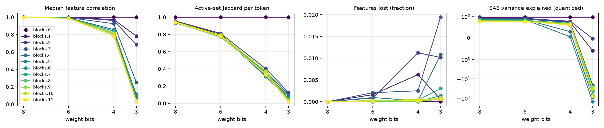
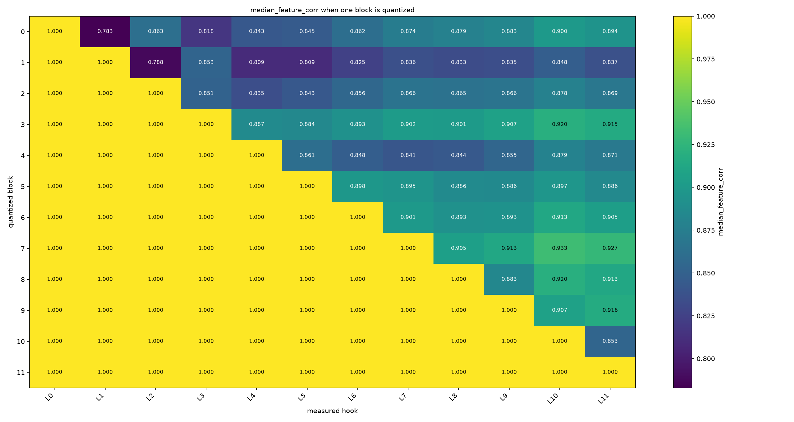
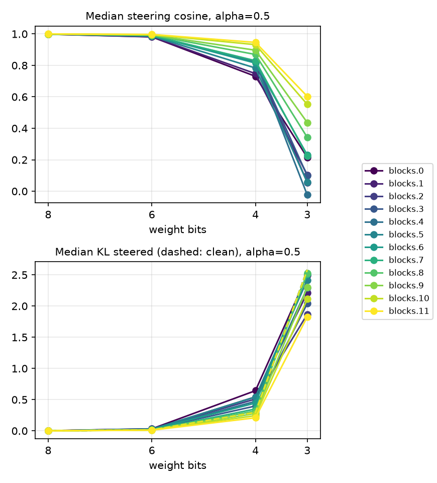
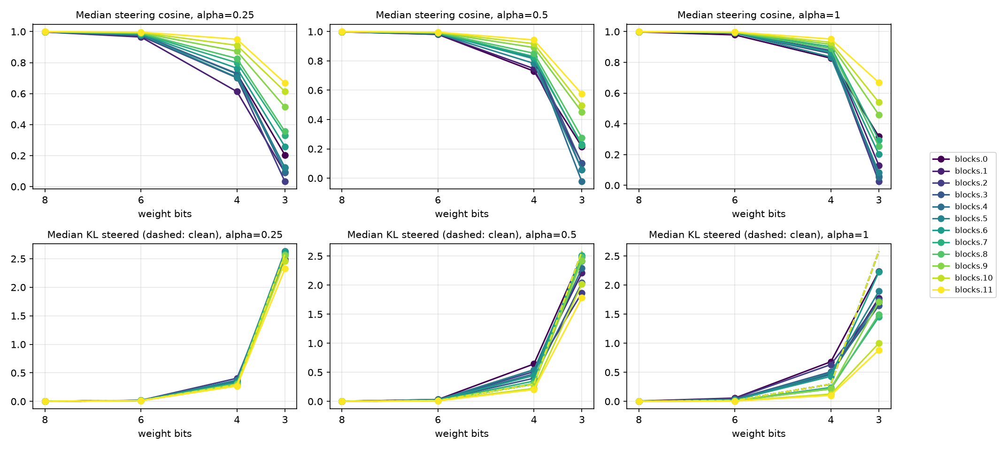

# quant-lens

**Does quantizing a model's weights change what it represents inside?**

Quantization is evaluated almost entirely from the outside: perplexity, benchmark scores, maybe KL divergence on the logits. But a model can keep its outputs close while the internal computation drifts. If interpretability tools are going to be used to audit models that are actually deployed, and deployed models are usually quantized, we need to know whether the features found in the full-precision model still describe the quantized one.

This project measures that directly. It takes a model, quantizes it at several bit widths, runs the same text through both versions, and encodes the residual stream at chosen layers with the **same pretrained sparse autoencoder (SAE)**. Then it compares the feature activations token by token, and goes further: which block causes the drift, which features break, and whether steering with a feature still does the same thing after quantization.

> **Status:** first results on GPT-2 small are in (see [Results](#results)). Gemma 2 2B is next.

## Questions

1. How many bits can you remove before SAE features stop matching? Is there a cliff?
2. Which layers drift first, and which block is responsible when they do?
3. Are some features fragile, for example rare features, ones with small activations, or ones with small decoder norms?
4. Do features drift before the output does? Feature metrics are compared against logit KL and top-1 agreement on the same tokens.
5. Does a smarter quantization scheme (activation-aware scaling) or quantizing activations as well change the picture?
6. If you steer the model along a feature direction, does the quantized model respond the same way?

## Method

### Models and SAEs

Models run in [TransformerLens](https://github.com/TransformerLensOrg/TransformerLens) as `HookedTransformer`s, and SAEs are loaded through [SAELens](https://github.com/jbloomAus/SAELens). A small registry (`quant_lens/registry.py`) maps a model name to its SAE release, hook name, SAE id, default layers and Neuronpedia link, so `--model` is usually all you need:

| `--model` | SAE release | hook | SAE id | default layers |
|---|---|---|---|---|
| `gpt2` | `gpt2-small-res-jb` | `blocks.{layer}.hook_resid_pre` | same as the hook | 2 6 10 |
| `gemma-2-2b` | `gemma-scope-2b-pt-res-canonical` | `blocks.{layer}.hook_resid_post` | `layer_{layer}/width_16k/canonical` | 5 12 19 |

Any other TransformerLens model works by passing `--sae-release`, `--hook-template` and `--sae-id-template` yourself. Gemma 2 is gated on Hugging Face, so accept its license and log in first.

### Quantization schemes

All quantization is **simulated** (quantize, then dequantize back to float), so the measurement isolates the rounding itself rather than differences between low-bit kernels. Attention and MLP weights are quantized. Embeddings, unembedding, biases and LayerNorm stay in full precision, as in common practice. Models are loaded with `fold_ln=False`, so LayerNorm gains are not folded into `W_Q/W_K/W_V/W_in` before rounding; folding would let a few large-gain dimensions set each channel's scale, which is not what a deployed model quantizes. Folding is exact, so the residual stream the SAEs read is the same either way. The original model is never modified, so one reference is compared against every bit width.

- **`rtn`**: symmetric round-to-nearest weights, with one scale per output channel, or per group of `--group-size` input rows.
- **`awq_lite`**: a stripped-down version of activation-aware weight quantization. On a held-out calibration set (`--calib-seqs` sequences, BOS excluded), it measures the mean absolute activation of every input channel of each linear layer. Salient channels are scaled up by `s = mean_abs ** alpha` before rounding and the scale is divided back out afterwards (`Q(W * s) / s`, equivalent to folding `1/s` into the previous op). `alpha` is chosen per layer by a grid search over [0, 1] that minimizes the layer's output MSE. Q, K and V share one scale, as do `W_in` and `W_gate`, as in AWQ. There is no clipping search, and calibration uses full-precision activations. Calibration text is taken from after the evaluation sequences, so the two never overlap.
- **`awq_seq`**: `awq_lite` with sequential calibration, as in real AWQ and GPTQ. Blocks are processed in order, and each block is calibrated on the activations of the partially quantized model, whose earlier blocks are already rounded, so the scale search sees the error that has built up upstream.
- **`w8a8`**: RTN weights plus simulated symmetric per-token activation quantization (`--act-bits`, default 8) at the inputs of the quantized linear layers, applied through TransformerLens hooks.

### Measurement

The BOS position is excluded from every feature statistic, because its residual norm is an outlier. Metrics are computed in a streaming way, so thousands of tokens fit in memory even with tens of thousands of SAE features.

## Metrics

A feature is *active* on a token when its activation is above 0, and *live* when it fires on at least a handful of reference tokens.

### Main sweep (`summary.csv`, one row per hook and bit width)

| metric | meaning |
|---|---|
| `median_feature_corr` | Pearson correlation of each feature's activations across tokens, reference vs quantized, as the median over live features |
| `mean_feature_corr` | the same correlation, averaged instead of median |
| `jaccard` | per-token overlap of the sets of active features, averaged over tokens |
| `topk_overlap` | per-token overlap of the 10 strongest features |
| `lost_frac` | of the reference-live features, the fraction that never fire in the quantized model |
| `new_frac` | features that never fire in the reference but are live in the quantized model, as a fraction of reference-live features |
| `l0_ref` / `l0_q` | mean number of active features per token, before and after |
| `fve_ref` / `fve_q` | fraction of residual-stream variance the SAE reconstruction explains, before and after. A drop in `fve_q` means the SAE fits the quantized model's activations less well |
| `weight_rel_err` | relative Frobenius error of the quantized weights, pooled over all quantized matrices |
| `logit_kl` | KL(reference ‖ quantized) of the next-token distribution, averaged over tokens |
| `top1_agree` | fraction of tokens where both models predict the same next token |

### Layer ablation (`--ablate-layers`)

| output | meaning |
|---|---|
| `ablation_table.csv` | `median_feature_corr` for every pair of [quantized block × measured hook]. Only one block is quantized at a time, at `--analysis-bits`; the rest stay in full precision. Hooks upstream of the quantized block match exactly by construction, the first hook after it shows that block's own effect, and later hooks show whether the error grows or heals |
| `ablation.csv` | the same runs in long form, with every main-sweep metric |

### Feature fragility (`--fragility`)

| output | meaning |
|---|---|
| `fragile_features.csv` | the 50 most fragile (lowest correlation) and 50 most robust (highest correlation) live features per layer at `--analysis-bits`, with `corr`, `freq_ref`, `freq_q`, `mean_active_ref` (mean reference activation when active), `dec_norm` (decoder-row norm), the top-activating reference contexts and a Neuronpedia link |
| `fragility_summary.csv` | per layer, the Spearman rank correlation of feature correlation against log10 reference firing frequency (`rho_log10_freq_ref`), mean activation when active (`rho_mean_active_ref`) and decoder norm (`rho_dec_norm`) |

### Steering transfer (`--steering`)

For a sample of live features (`--steer-features`), add `alpha * r * d` at every non-BOS position, where `d` is the feature's unit decoder direction and `r` is the mean reference residual norm at that hook (excluding BOS), in both models. Then compare how next-token log-probs move. `alpha` is set with `--steer-alphas` on `--steer-seqs` sequences.

| metric | meaning |
|---|---|
| `cos_mean` | mean per-token cosine between the reference and quantized log-prob deltas (steered minus clean). 1 means steering moves both models the same way |
| `kl_steered` | KL(reference steered ‖ quantized steered) |
| `kl_clean` | KL(reference clean ‖ quantized clean), the unsteered baseline |
| `delta_norm_ref` / `delta_norm_q` | size of the log-prob change caused by steering, per model |
| `effect_ratio` | `delta_norm_q / delta_norm_ref`: above 1 steering hits harder after quantization, below 1 it is weaker |

## Run it

On Colab, open `notebooks/run_gpt2.ipynb` (T4 GPU), `notebooks/run_gpt2_followups.ipynb` (T4; the robustness, AWQ and 4-bit runs described under Results) or `notebooks/run_gemma.ipynb` (A100; the float32 reference plus a quantized copy take roughly 21 GB). Locally:

```bash
pip install -e .
```

Main sweep on GPT-2 small, with the registry defaults (layers 2, 6, 10):

```bash
python -m quant_lens.experiment --model gpt2 --scheme rtn --bits 8 6 4 3 --out results/gpt2_rtn
```

Other schemes:

```bash
python -m quant_lens.experiment --model gpt2 --scheme rtn --group-size 128 --bits 8 6 4 3 --out results/gpt2_rtn_g128
python -m quant_lens.experiment --model gpt2 --scheme awq_lite --calib-seqs 32 --bits 8 6 4 3 --out results/gpt2_awq_lite
python -m quant_lens.experiment --model gpt2 --scheme awq_seq --calib-seqs 32 --bits 8 6 4 3 --out results/gpt2_awq_seq
python -m quant_lens.experiment --model gpt2 --scheme w8a8 --act-bits 8 --bits 8 6 4 3 --out results/gpt2_w8a8
```

The analyses run at `--analysis-bits` (default: the lowest value in `--bits`) and can be combined in one run. Layer ablation is most useful with every layer measured:

```bash
# which block causes the drift
python -m quant_lens.experiment --model gpt2 --layers 0 1 2 3 4 5 6 7 8 9 10 11 \
    --bits 8 6 4 3 --ablate-layers --out results/gpt2_rtn

# which features break, and what they have in common
python -m quant_lens.experiment --model gpt2 --bits 8 6 4 3 --fragility --fragility-n 50 --out results/gpt2_rtn

# does feature steering transfer
python -m quant_lens.experiment --model gpt2 --bits 8 6 4 3 --steering \
    --steer-features 32 --steer-alphas 0.5 --steer-seqs 16 --out results/gpt2_rtn
```

Gemma 2 2B with Gemma Scope (registry defaults, layers 5, 12, 19), with a smaller batch to fit memory:

```bash
python -m quant_lens.experiment --model gemma-2-2b --scheme rtn --bits 8 6 4 3 \
    --n-seqs 64 --batch-size 2 --ablate-layers --fragility --steering --out results/gemma_rtn
```

Then write a report for any run directory:

```bash
python -m quant_lens.report results/gpt2_rtn
```

Other useful options: `--dataset` (default `NeelNanda/pile-10k`; `builtin` uses a tiny offline sample), `--n-docs`, `--doc-offset` (skip that many documents first, to sample a different slice), `--n-seqs` (default 128), `--ctx` (default 128), `--batch-size` (default 8), `--save-per-feature`.

## Outputs

Everything goes into `--out`:

| file | written when |
|---|---|
| `summary.csv`, `summary.png`, `config.json` | always |
| `per_feature/{hook}_{bits}bit.pt` | `--save-per-feature` or `--fragility` |
| `ablation.csv`, `ablation_table.csv`, `ablation_heatmap.png` | `--ablate-layers` |
| `fragile_features.csv`, `fragility_summary.csv`, `fragility_scatter.png` | `--fragility` |
| `steering.csv`, `steering.png` | `--steering` |
| `report.md` | `python -m quant_lens.report <dir>` |

## Tests

The tests run offline on a tiny random model with random SAEs, so they need no GPU, downloads or Hugging Face token:

```bash
pip install -e ".[dev]"
pytest tests
```

GitHub Actions runs them on every push and pull request (`.github/workflows/tests.yml`).

## Layout

```
quant_lens/quantize.py    simulated quantization: rtn, awq_lite, awq_seq, w8a8
quant_lens/metrics.py     streaming SAE feature comparison + logit drift
quant_lens/experiment.py  experiment loop and CLI
quant_lens/registry.py    model name -> SAE release, hooks, default layers, Neuronpedia link
quant_lens/ablation.py    quantize one block at a time, measure drift at every hook
quant_lens/fragility.py   most fragile / robust features and what predicts fragility
quant_lens/steering.py    does steering along a feature direction survive quantization
quant_lens/report.py      report.md from a results directory
quant_lens/plots.py       summary plot
notebooks/                Colab notebooks for GPT-2 small (T4) and Gemma 2 2B (A100)
tests/                    offline tests on a tiny random model
```

## Results

First run: GPT-2 small with `gpt2-small-res-jb`, 128 sequences of 128 tokens from `NeelNanda/pile-10k` (16,256 non-BOS tokens), plus 32 held-out calibration sequences for `awq_lite`. The commands are the ones in `notebooks/run_gpt2.ipynb`, run on CPU (Apple M3 Pro) at commit `95466a5`, with the long analyses split across parallel processes using the same settings. Every number below comes from the files in [`results/`](results/), and each run directory has a `report.md` with the full tables and figures. The [follow-up runs](#follow-up-runs) at the end repeat the sweep on a second slice of the data and run on a Colab T4 GPU.

### How many bits before features stop matching

Per-channel RTN, all 12 layers measured ([report](results/gpt2_rtn/report.md)):

| bits | weight rel. error | logit KL | top-1 agree | median feature corr, layer 6 | layer 11 | top-10 overlap, layer 6 |
|---|---|---|---|---|---|---|
| 8 | 0.011 | 0.0011 | 0.979 | 0.999 | 0.999 | 0.974 |
| 6 | 0.045 | 0.017 | 0.921 | 0.990 | 0.986 | 0.914 |
| 4 | 0.185 | 0.308 | 0.697 | 0.841 | 0.781 | 0.683 |
| 3 | 0.402 | 3.139 | 0.189 | 0.066 | 0.028 | 0.167 |



- There is a cliff between 4 and 3 bits. At 4 bits the median feature correlation is still 0.78 to 0.97 at layers 1 to 11; at 3 bits it falls to 0.03 to 0.25 from layer 3 onwards. Layer 0 matches exactly at every bit width, because its residual stream is the embedding, which is never quantized.
- At 3 bits features rarely disappear (`lost_frac` is at most 1.9% at any layer). The SAE instead fires far more: the mean number of active features per token at layer 11 goes from 60.7 to 1,482, and the fraction of variance the SAE explains goes negative at every layer from 1 onwards. The quantized residual stream leaves the region the SAE was trained on.
- The active-set Jaccard is a noisy metric for this question. At 8 bits it is only 0.93 to 0.96 even though the median correlation is 0.999 or higher, so small activations near zero switch on and off. Correlation and top-10 overlap are the more useful numbers.
- At 6 bits the outputs move more visibly than the features: top-1 agreement drops to 0.921 while the median feature correlation stays at 0.986 or above at every layer.

### Which block causes the drift

Quantizing one block at a time at 3 bits, with the rest in full precision ([table](results/gpt2_rtn/ablation_table.csv), [heatmap](results/gpt2_rtn/ablation_heatmap.png)):



- No single block is responsible. With any one block quantized, the median feature correlation at the hook right after it is 0.78 to 0.91, and at layer 11 it is never below 0.837, against 0.028 when all blocks are quantized.
- The early blocks do the most damage. Block 0 gives the lowest correlation at the next hook (0.783), and block 1 gives the largest logit KL of any single block (0.279).
- The damage from one block partly heals downstream. With only block 0 quantized, top-10 overlap is 0.366 at layer 1 and recovers to 0.720 by layer 11.
- The blocks compound more than additively: the twelve single-block logit KLs sum to 1.66, while quantizing all of them gives 3.14.

### Which features break

At 3 bits, the 50 most fragile and 50 most robust live features per layer, and the rank correlation of each feature's correlation with its properties ([fragile_features.csv](results/gpt2_rtn/fragile_features.csv) with contexts and Neuronpedia links, [summary](results/gpt2_rtn/fragility_summary.csv), [scatter](results/gpt2_rtn/fragility_scatter.png)):

- Strength predicts survival. The Spearman correlation between a feature's quantized-vs-reference correlation and its mean activation when active is positive at every layer: 0.84 at layer 1, falling to 0.32 at layer 11. The robust features have a median mean activation of 22.5, against 1.17 for the fragile ones.
- Firing frequency matters much less, and in the other direction: Spearman between −0.22 and +0.01, so rarer features are slightly more robust. The fragile features also fire about four times as often after quantization (median frequency 0.0038 before, 0.0151 after).
- Decoder norm cannot be tested with these SAEs: every decoder row has norm between 0.9999 and 1.0014, so the correlations with it are noise.

### Schemes

Layers 2, 6 and 10 for every scheme ([rtn](results/gpt2_rtn/report.md), [rtn g128](results/gpt2_rtn_g128/report.md), [awq_lite](results/gpt2_awq_lite/report.md), [w8a8](results/gpt2_w8a8/report.md)). Median feature correlation at layer 6, then output metrics:

| bits | rtn | rtn, group 128 | awq_lite | w8a8 | logit KL (rtn / g128 / awq_lite / w8a8) | top-1 agree (rtn / g128 / awq_lite / w8a8) |
|---|---|---|---|---|---|---|
| 8 | 0.999 | 1.000 | 0.999 | 0.988 | 0.0011 / 0.0005 / 0.0012 / 0.057 | 0.979 / 0.987 / 0.980 / 0.866 |
| 6 | 0.990 | 0.996 | 0.990 | 0.979 | 0.017 / 0.008 / 0.017 / 0.080 | 0.921 / 0.946 / 0.922 / 0.842 |
| 4 | 0.841 | 0.935 | 0.851 | 0.826 | 0.308 / 0.134 / 0.373 / 0.383 | 0.697 / 0.798 / 0.678 / 0.665 |
| 3 | 0.066 | 0.554 | 0.061 | 0.054 | 3.139 / 1.467 / 4.250 / 3.261 | 0.189 / 0.396 / 0.126 / 0.183 |

- Group-wise scales (128 input rows per group) help most, and the gap widens as bits drop. At 3 bits the layer 6 correlation is 0.554 against 0.066 per channel.
- `awq_lite` does not beat per-channel RTN here: it is close at 6 and 8 bits, somewhat worse at 4 bits (KL 0.373 against 0.308) and clearly worse at 3 bits (4.25 against 3.14). The scales are chosen to minimise each layer's own output error, and that choice does not carry through the full network. The follow-up runs below add group-wise scales and sequential calibration.
- Quantizing activations costs more than quantizing weights at 8 bits. `w8a8` with 8-bit weights has KL 0.057 and top-1 agreement 0.866, against 0.0011 and 0.979 for weights alone, and its feature correlation at layer 10 is 0.978 against 0.999.

### Does steering still work

32 live features per layer, steered at `alpha = 0.5` (half the mean residual norm) on 16 sequences, RTN ([steering.csv](results/gpt2_rtn/steering.csv), [plot](results/gpt2_rtn/steering.png)). Median per-token cosine between the reference and quantized log-prob changes:

| bits | layer 0 | layer 3 | layer 6 | layer 9 | layer 11 |
|---|---|---|---|---|---|
| 8 | 0.998 | 0.999 | 0.999 | 1.000 | 1.000 |
| 6 | 0.981 | 0.989 | 0.990 | 0.994 | 0.997 |
| 4 | 0.731 | 0.828 | 0.815 | 0.897 | 0.946 |
| 3 | 0.215 | 0.098 | 0.231 | 0.437 | 0.603 |



- Steering transfers almost perfectly at 6 and 8 bits.
- At 4 bits it transfers better the later you steer: there are fewer quantized blocks between the intervention and the output.
- At 3 bits steering mostly fails to transfer. The quantized model's response is also weaker when steering early (median effect ratio 0.50 to 0.75 at layers 0 to 5) and stronger when steering late (1.14 to 1.23 at layers 8 to 11).

### Follow-up runs

Run with `notebooks/run_gpt2_followups.ipynb` on a Colab T4 at commit `803e261`. I also re-ran `notebooks/run_gpt2.ipynb` on the T4 to check it against the CPU results. RTN, group-wise RTN and `w8a8`, the ablation table and the fragility correlations all match to within 0.003, mostly to within 1e-4, and the same 1,200 fragile and robust features are selected. The exception is `awq_lite` at 3 bits: logit KL 4.51 on the GPU against 4.25 on the CPU. Its weight error at 8 bits also differs (0.0158 against 0.0176), so tiny numerical differences make the alpha grid search pick different scales for some layers. Its 3-bit numbers carry about that much uncertainty, though it is worse than RTN (3.14) either way.

**A second slice of the data.** All four schemes again on documents 5,000 onwards of the Pile sample, with 512 sequences (65,024 tokens, four times the first run) ([results/robust](results/robust/)). Top-1 agreement stays within 0.03 of the first run for every scheme and bit width, group-wise RTN is still the best scheme at every bit width, `w8a8` is still the worst from 4 bits up, and `awq_lite` is again worse than RTN at 3 and 4 bits. The least stable numbers are the 3-bit feature correlations in the middle of the network: group-wise RTN at layer 6 went from 0.554 to 0.395.

**Fuller AWQ.** Group-wise scales and sequential calibration (`awq_seq`), on the original slice at layers 2, 6 and 10 ([awq_lite g128](results/gpt2_awq_lite_g128/report.md), [awq_seq](results/gpt2_awq_seq/report.md), [awq_seq g128](results/gpt2_awq_seq_g128/report.md)):

| bits | | rtn | awq_lite | awq_seq | rtn g128 | awq_lite g128 | awq_seq g128 |
|---|---|---|---|---|---|---|---|
| 4 | logit KL | 0.308 | 0.373 | 0.386 | 0.134 | 0.132 | 0.147 |
| 4 | top-1 agree | 0.697 | 0.678 | 0.666 | 0.798 | 0.801 | 0.792 |
| 4 | median feature corr, layer 6 | 0.841 | 0.851 | 0.829 | 0.935 | 0.933 | 0.933 |
| 3 | logit KL | 3.139 | 4.250 | 3.657 | 1.467 | 1.212 | 1.378 |
| 3 | top-1 agree | 0.189 | 0.126 | 0.170 | 0.396 | 0.464 | 0.422 |
| 3 | median feature corr, layer 6 | 0.066 | 0.061 | 0.022 | 0.554 | 0.210 | 0.123 |

- With group-wise scales, AWQ gives the best 3-bit outputs of any scheme here (KL 1.21 against 1.47 for group-wise RTN). At 4 bits the three group-wise schemes are within 0.015 KL of each other.
- At 3 bits the outputs and the features disagree about which scheme is better. Group-wise AWQ has better outputs and slightly better top-10 overlap at layer 6 (0.444 against 0.404), but a much lower median feature correlation at layers 6 and 10 (0.210 and 0.246 against 0.554 and 0.378), and the SAE's variance explained at layer 6 falls to −120 against +0.30. One possible reading is that a few tokens get very large residual errors, which wrecks correlation and variance explained without changing the top features of most tokens. I have not checked this yet.
- Sequential calibration does not help in this implementation. Per channel it narrows the gap to RTN at 3 bits (KL 3.66 against 4.25 for `awq_lite`) but is still worse than plain RTN (3.14), and group-wise it is worse than `awq_lite` (1.38 against 1.21).

**Ablation, fragility and steering at 4 bits** ([results/gpt2_rtn_4bit](results/gpt2_rtn_4bit/report.md)):

- Quantizing one block at 4 bits barely moves the features: the median correlation at the next hook is at least 0.968, and at least 0.955 anywhere downstream. Block 2 does the most damage, with the largest single-block KL (0.038) and the lowest top-1 agreement (0.893).
- At 4 bits the blocks compound only a little: the single-block KLs sum to 0.25, against 0.31 with every block quantized. At 3 bits the same comparison was 1.66 against 3.14.
- Strength predicts survival even more clearly at 4 bits: Spearman between a feature's correlation and its mean activation when active is between 0.81 and 0.88 at every layer from 1 to 11. Fragile and robust features fire equally often (median frequency 0.0004 for both), but the robust ones are about 35 times stronger (median mean activation 23.8 against 0.68).
- Steering with `alpha` 0.25, 0.5 and 1.0: at 4 bits stronger steering transfers better, especially early in the network (median cosine at layer 1 rises from 0.61 to 0.88 as `alpha` goes from 0.25 to 1.0). Weak steering is exaggerated by the 4-bit model (effect ratio up to 1.47 at `alpha` 0.25). At 3 bits no strength makes steering transfer: the best median cosine at any layer is 0.67.

  
- The steering medians come from 32 sampled features per layer and are noisy. Where this run and the first run sampled the same features (layers 0 to 7), the per-feature cosines agree to 0.0002. At layers 8 to 11 slightly different live-feature counts on CPU and GPU led to a different sample, and the medians differ by up to 0.07.

## Roadmap

- Run the full suite on Gemma 2 2B with Gemma Scope (`notebooks/run_gemma.ipynb`)
- Find out why group-wise AWQ at 3 bits has better outputs but worse feature correlations: look at the per-token residual errors and the tokens with the largest ones
- Steering with more features per layer, so the medians are less noisy
- Compare feature drift against output drift across schemes, to see which one keeps the internals closest at a given bit width
- Look at the fragile features by hand through their contexts and Neuronpedia dashboards
- Real low-bit kernels (for example GPTQ or bitsandbytes checkpoints) alongside simulated quantization, to check the two agree
