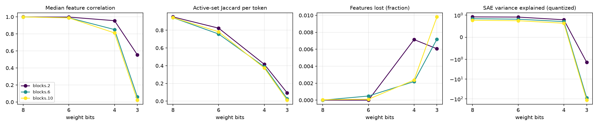

# quant-lens report

## Run config

| key | value |
|---|---|
| model | gpt2 |
| sae_release | gpt2-small-res-jb |
| hook_template | blocks.{layer}.hook_resid_pre |
| sae_id_template | blocks.{layer}.hook_resid_pre |
| layers | [2, 6, 10] |
| bits | [8, 6, 4, 3] |
| scheme | awq_lite |
| group_size | None |
| act_bits | 8 |
| calib_seqs | 32 |
| dataset | NeelNanda/pile-10k |
| n_docs | 2000 |
| n_seqs | 128 |
| ctx | 128 |
| batch_size | 8 |
| out | results/gpt2_awq_lite |
| save_per_feature | True |
| analysis_bits | None |
| ablate_layers | False |
| fragility | False |
| fragility_n | 50 |
| steering | False |
| steer_features | 32 |
| steer_alphas | [0.5] |
| steer_seqs | 16 |

## Summary

One row per (hook, bit width). `median_feature_corr`: median over live features of the Pearson correlation of activations, reference vs quantized. `jaccard`: per-token overlap of active feature sets. `topk_overlap`: per-token overlap of the 10 strongest features. `lost_frac` / `new_frac`: features that stop firing / only fire after quantization. `fve_ref` / `fve_q`: residual-stream variance explained by the SAE. `logit_kl`, `top1_agree`: output drift on the same tokens.

| hook | bits | scheme | group_size | median_feature_corr | jaccard | topk_overlap | lost_frac | new_frac | fve_ref | fve_q | logit_kl | top1_agree |
|---|---|---|---|---|---|---|---|---|---|---|---|---|
| blocks.2.hook_resid_pre | 8 | awq_lite | 0 | 0.9998 | 0.9509 | 0.9737 | 0 | 0 | 0.9231 | 0.9219 | 0.001175 | 0.9796 |
| blocks.6.hook_resid_pre | 8 | awq_lite | 0 | 0.9994 | 0.9424 | 0.9757 | 0 | 0 | 0.8432 | 0.8411 | 0.001175 | 0.9796 |
| blocks.10.hook_resid_pre | 8 | awq_lite | 0 | 0.9992 | 0.9433 | 0.9747 | 5.278e-05 | 0 | 0.7703 | 0.7687 | 0.001175 | 0.9796 |
| blocks.2.hook_resid_pre | 6 | awq_lite | 0 | 0.9974 | 0.8238 | 0.9049 | 0 | 0.0004329 | 0.9231 | 0.9131 | 0.01675 | 0.922 |
| blocks.6.hook_resid_pre | 6 | awq_lite | 0 | 0.9898 | 0.7577 | 0.9145 | 0.0004873 | 0.0001218 | 0.8432 | 0.8181 | 0.01675 | 0.922 |
| blocks.10.hook_resid_pre | 6 | awq_lite | 0 | 0.9884 | 0.7826 | 0.912 | 0.0001056 | 0 | 0.7703 | 0.7487 | 0.01675 | 0.922 |
| blocks.2.hook_resid_pre | 4 | awq_lite | 0 | 0.9554 | 0.416 | 0.6775 | 0.007143 | 0.2983 | 0.9231 | 0.7907 | 0.373 | 0.6781 |
| blocks.6.hook_resid_pre | 4 | awq_lite | 0 | 0.8511 | 0.3879 | 0.6687 | 0.002193 | 0.0106 | 0.8432 | 0.7094 | 0.373 | 0.6781 |
| blocks.10.hook_resid_pre | 4 | awq_lite | 0 | 0.8115 | 0.3741 | 0.6445 | 0.002375 | 0.003008 | 0.7703 | 0.6348 | 0.373 | 0.6781 |
| blocks.2.hook_resid_pre | 3 | awq_lite | 0 | 0.5546 | 0.09392 | 0.2783 | 0.006061 | 1.291 | 0.9231 | -1.426 | 4.25 | 0.1256 |
| blocks.6.hook_resid_pre | 3 | awq_lite | 0 | 0.06112 | 0.02739 | 0.1394 | 0.007187 | 0.09569 | 0.8432 | -88.09 | 4.25 | 0.1256 |
| blocks.10.hook_resid_pre | 3 | awq_lite | 0 | 0.02201 | 0.01107 | 0.08718 | 0.009817 | 0.04819 | 0.7703 | -115.3 | 4.25 | 0.1256 |

