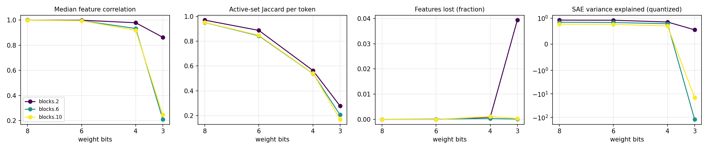

# quant-lens report

## Run config

| key | value |
|---|---|
| model | gpt2 |
| sae_release | gpt2-small-res-jb |
| hook_template | blocks.{layer}.hook_resid_pre |
| sae_id_template | blocks.{layer}.hook_resid_pre |
| layers | [2, 6, 10] |
| bits | [8, 6, 4, 3] |
| scheme | awq_lite |
| group_size | 128 |
| act_bits | 8 |
| calib_seqs | 32 |
| dataset | NeelNanda/pile-10k |
| n_docs | 2000 |
| doc_offset | 0 |
| n_seqs | 128 |
| ctx | 128 |
| batch_size | 8 |
| out | results/gpt2_awq_lite_g128 |
| save_per_feature | False |
| analysis_bits | None |
| ablate_layers | False |
| fragility | False |
| fragility_n | 50 |
| steering | False |
| steer_features | 32 |
| steer_alphas | [0.5] |
| steer_seqs | 16 |

## Summary

One row per (hook, bit width). `median_feature_corr`: median over live features of the Pearson correlation of activations, reference vs quantized. `jaccard`: per-token overlap of active feature sets. `topk_overlap`: per-token overlap of the 10 strongest features. `lost_frac` / `new_frac`: features that stop firing / only fire after quantization. `fve_ref` / `fve_q`: residual-stream variance explained by the SAE. `logit_kl`, `top1_agree`: output drift on the same tokens.

| hook | bits | scheme | group_size | median_feature_corr | jaccard | topk_overlap | lost_frac | new_frac | fve_ref | fve_q | logit_kl | top1_agree |
|---|---|---|---|---|---|---|---|---|---|---|---|---|
| blocks.2.hook_resid_pre | 8 | awq_lite | 128 | 0.9999 | 0.9706 | 0.9836 | 0 | 0.0002165 | 0.9231 | 0.9229 | 0.0009499 | 0.9802 |
| blocks.6.hook_resid_pre | 8 | awq_lite | 128 | 0.9996 | 0.9511 | 0.9782 | 0 | 0 | 0.8432 | 0.8426 | 0.0009499 | 0.9802 |
| blocks.10.hook_resid_pre | 8 | awq_lite | 128 | 0.9995 | 0.952 | 0.9768 | 0 | 0 | 0.7703 | 0.7688 | 0.0009499 | 0.9802 |
| blocks.2.hook_resid_pre | 6 | awq_lite | 128 | 0.9987 | 0.8874 | 0.9413 | 0 | 0.0008658 | 0.9231 | 0.9188 | 0.007906 | 0.9435 |
| blocks.6.hook_resid_pre | 6 | awq_lite | 128 | 0.9956 | 0.844 | 0.9415 | 0.0001218 | 0 | 0.8432 | 0.8317 | 0.007906 | 0.9435 |
| blocks.10.hook_resid_pre | 6 | awq_lite | 128 | 0.9946 | 0.8482 | 0.9376 | 0 | 0 | 0.7703 | 0.7604 | 0.007906 | 0.9435 |
| blocks.2.hook_resid_pre | 4 | awq_lite | 128 | 0.9791 | 0.5637 | 0.7743 | 0.0008658 | 0.247 | 0.9231 | 0.8503 | 0.132 | 0.8009 |
| blocks.6.hook_resid_pre | 4 | awq_lite | 128 | 0.9333 | 0.5391 | 0.7763 | 0.0003045 | 0.004325 | 0.8432 | 0.785 | 0.132 | 0.8009 |
| blocks.10.hook_resid_pre | 4 | awq_lite | 128 | 0.9188 | 0.5408 | 0.7708 | 0.001108 | 0.0007389 | 0.7703 | 0.6994 | 0.132 | 0.8009 |
| blocks.2.hook_resid_pre | 3 | awq_lite | 128 | 0.8634 | 0.2775 | 0.4828 | 0.03939 | 0.3903 | 0.9231 | 0.5521 | 1.212 | 0.4638 |
| blocks.6.hook_resid_pre | 3 | awq_lite | 128 | 0.2103 | 0.2056 | 0.4441 | 0.0001218 | 0.0388 | 0.8432 | -120.3 | 1.212 | 0.4638 |
| blocks.10.hook_resid_pre | 3 | awq_lite | 128 | 0.2462 | 0.1695 | 0.3807 | 0.0003167 | 0.006439 | 0.7703 | -14.29 | 1.212 | 0.4638 |

