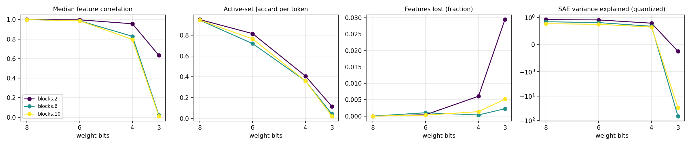

# quant-lens report

## Run config

| key | value |
|---|---|
| model | gpt2 |
| sae_release | gpt2-small-res-jb |
| hook_template | blocks.{layer}.hook_resid_pre |
| sae_id_template | blocks.{layer}.hook_resid_pre |
| layers | [2, 6, 10] |
| bits | [8, 6, 4, 3] |
| scheme | awq_seq |
| group_size | None |
| act_bits | 8 |
| calib_seqs | 32 |
| dataset | NeelNanda/pile-10k |
| n_docs | 2000 |
| doc_offset | 0 |
| n_seqs | 128 |
| ctx | 128 |
| batch_size | 8 |
| out | results/gpt2_awq_seq |
| save_per_feature | False |
| analysis_bits | None |
| ablate_layers | False |
| fragility | False |
| fragility_n | 50 |
| steering | False |
| steer_features | 32 |
| steer_alphas | [0.5] |
| steer_seqs | 16 |

## Summary

One row per (hook, bit width). `median_feature_corr`: median over live features of the Pearson correlation of activations, reference vs quantized. `jaccard`: per-token overlap of active feature sets. `topk_overlap`: per-token overlap of the 10 strongest features. `lost_frac` / `new_frac`: features that stop firing / only fire after quantization. `fve_ref` / `fve_q`: residual-stream variance explained by the SAE. `logit_kl`, `top1_agree`: output drift on the same tokens.

| hook | bits | scheme | group_size | median_feature_corr | jaccard | topk_overlap | lost_frac | new_frac | fve_ref | fve_q | logit_kl | top1_agree |
|---|---|---|---|---|---|---|---|---|---|---|---|---|
| blocks.2.hook_resid_pre | 8 | awq_seq | 0 | 0.9998 | 0.9499 | 0.9738 | 0 | 0 | 0.9231 | 0.9216 | 0.001104 | 0.9801 |
| blocks.6.hook_resid_pre | 8 | awq_seq | 0 | 0.9994 | 0.9443 | 0.9769 | 0 | 6.091e-05 | 0.8432 | 0.8415 | 0.001104 | 0.9801 |
| blocks.10.hook_resid_pre | 8 | awq_seq | 0 | 0.9993 | 0.9444 | 0.9748 | 0 | 0 | 0.7703 | 0.769 | 0.001104 | 0.9801 |
| blocks.2.hook_resid_pre | 6 | awq_seq | 0 | 0.9973 | 0.8148 | 0.9038 | 0.0004329 | 0 | 0.9231 | 0.9083 | 0.01923 | 0.917 |
| blocks.6.hook_resid_pre | 6 | awq_seq | 0 | 0.9878 | 0.7193 | 0.9079 | 0.001035 | 0 | 0.8432 | 0.8107 | 0.01923 | 0.917 |
| blocks.10.hook_resid_pre | 6 | awq_seq | 0 | 0.9871 | 0.7644 | 0.9063 | 0.0003167 | 0 | 0.7703 | 0.748 | 0.01923 | 0.917 |
| blocks.2.hook_resid_pre | 4 | awq_seq | 0 | 0.9569 | 0.4074 | 0.6667 | 0.006061 | 0.3411 | 0.9231 | 0.7887 | 0.3859 | 0.6661 |
| blocks.6.hook_resid_pre | 4 | awq_seq | 0 | 0.8285 | 0.3606 | 0.6568 | 0.0003655 | 0.03033 | 0.8432 | 0.6754 | 0.3859 | 0.6661 |
| blocks.10.hook_resid_pre | 4 | awq_seq | 0 | 0.7966 | 0.3609 | 0.6344 | 0.001372 | 0.005489 | 0.7703 | 0.6446 | 0.3859 | 0.6661 |
| blocks.2.hook_resid_pre | 3 | awq_seq | 0 | 0.6334 | 0.1162 | 0.2789 | 0.02944 | 0.7067 | 0.9231 | -0.2477 | 3.657 | 0.1696 |
| blocks.6.hook_resid_pre | 3 | awq_seq | 0 | 0.02188 | 0.04255 | 0.1399 | 0.002254 | 0.09142 | 0.8432 | -66.67 | 3.657 | 0.1696 |
| blocks.10.hook_resid_pre | 3 | awq_seq | 0 | 0.01183 | 0.0225 | 0.09478 | 0.005172 | 0.04497 | 0.7703 | -29.78 | 3.657 | 0.1696 |

