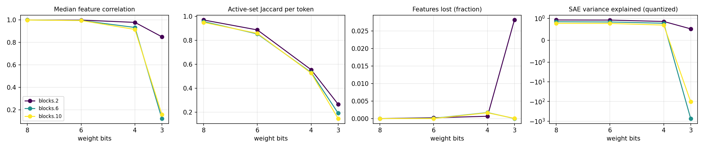

# quant-lens report

## Run config

| key | value |
|---|---|
| model | gpt2 |
| sae_release | gpt2-small-res-jb |
| hook_template | blocks.{layer}.hook_resid_pre |
| sae_id_template | blocks.{layer}.hook_resid_pre |
| layers | [2, 6, 10] |
| bits | [8, 6, 4, 3] |
| scheme | awq_seq |
| group_size | 128 |
| act_bits | 8 |
| calib_seqs | 32 |
| dataset | NeelNanda/pile-10k |
| n_docs | 2000 |
| doc_offset | 0 |
| n_seqs | 128 |
| ctx | 128 |
| batch_size | 8 |
| out | results/gpt2_awq_seq_g128 |
| save_per_feature | False |
| analysis_bits | None |
| ablate_layers | False |
| fragility | False |
| fragility_n | 50 |
| steering | False |
| steer_features | 32 |
| steer_alphas | [0.5] |
| steer_seqs | 16 |

## Summary

One row per (hook, bit width). `median_feature_corr`: median over live features of the Pearson correlation of activations, reference vs quantized. `jaccard`: per-token overlap of active feature sets. `topk_overlap`: per-token overlap of the 10 strongest features. `lost_frac` / `new_frac`: features that stop firing / only fire after quantization. `fve_ref` / `fve_q`: residual-stream variance explained by the SAE. `logit_kl`, `top1_agree`: output drift on the same tokens.

| hook | bits | scheme | group_size | median_feature_corr | jaccard | topk_overlap | lost_frac | new_frac | fve_ref | fve_q | logit_kl | top1_agree |
|---|---|---|---|---|---|---|---|---|---|---|---|---|
| blocks.2.hook_resid_pre | 8 | awq_seq | 128 | 0.9999 | 0.971 | 0.9836 | 0 | 0 | 0.9231 | 0.9229 | 0.0008943 | 0.9804 |
| blocks.6.hook_resid_pre | 8 | awq_seq | 128 | 0.9997 | 0.9578 | 0.9813 | 0 | 0 | 0.8432 | 0.8427 | 0.0008943 | 0.9804 |
| blocks.10.hook_resid_pre | 8 | awq_seq | 128 | 0.9995 | 0.951 | 0.9776 | 0 | 0 | 0.7703 | 0.7681 | 0.0008943 | 0.9804 |
| blocks.2.hook_resid_pre | 6 | awq_seq | 128 | 0.9988 | 0.8878 | 0.9416 | 0.0002165 | 0.0004329 | 0.9231 | 0.9182 | 0.007893 | 0.9434 |
| blocks.6.hook_resid_pre | 6 | awq_seq | 128 | 0.9959 | 0.8541 | 0.9425 | 6.091e-05 | 0 | 0.8432 | 0.8328 | 0.007893 | 0.9434 |
| blocks.10.hook_resid_pre | 6 | awq_seq | 128 | 0.995 | 0.859 | 0.9389 | 0 | 0 | 0.7703 | 0.7658 | 0.007893 | 0.9434 |
| blocks.2.hook_resid_pre | 4 | awq_seq | 128 | 0.9785 | 0.5546 | 0.7686 | 0.0006494 | 0.2779 | 0.9231 | 0.8542 | 0.1471 | 0.7916 |
| blocks.6.hook_resid_pre | 4 | awq_seq | 128 | 0.9332 | 0.5315 | 0.7713 | 0.001705 | 0.001827 | 0.8432 | 0.7739 | 0.1471 | 0.7916 |
| blocks.10.hook_resid_pre | 4 | awq_seq | 128 | 0.9156 | 0.5264 | 0.7628 | 0.001636 | 0.000475 | 0.7703 | 0.6897 | 0.1471 | 0.7916 |
| blocks.2.hook_resid_pre | 3 | awq_seq | 128 | 0.8505 | 0.2667 | 0.4919 | 0.02814 | 0.5037 | 0.9231 | 0.5179 | 1.378 | 0.4217 |
| blocks.6.hook_resid_pre | 3 | awq_seq | 128 | 0.123 | 0.192 | 0.4497 | 0 | 0.09648 | 0.8432 | -730.5 | 1.378 | 0.4217 |
| blocks.10.hook_resid_pre | 3 | awq_seq | 128 | 0.1598 | 0.1468 | 0.3691 | 5.278e-05 | 0.04977 | 0.7703 | -102.2 | 1.378 | 0.4217 |

