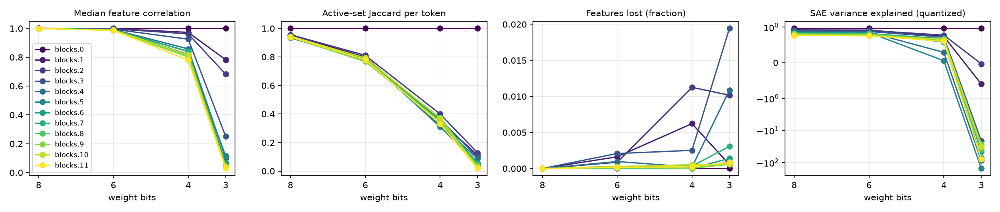
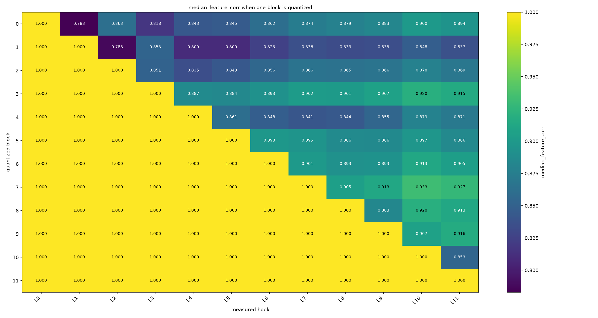
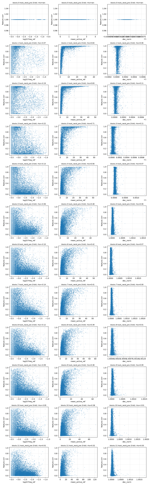
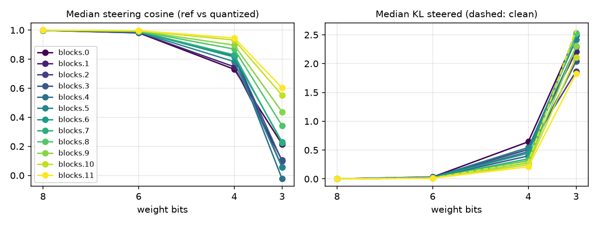

# quant-lens report

## Run config

| key | value |
|---|---|
| model | gpt2 |
| sae_release | gpt2-small-res-jb |
| hook_template | blocks.{layer}.hook_resid_pre |
| sae_id_template | blocks.{layer}.hook_resid_pre |
| layers | [0, 1, 2, 3, 4, 5, 6, 7, 8, 9, 10, 11] |
| bits | [8, 6, 4, 3] |
| scheme | rtn |
| group_size | None |
| act_bits | 8 |
| calib_seqs | 32 |
| dataset | NeelNanda/pile-10k |
| n_docs | 2000 |
| n_seqs | 128 |
| ctx | 128 |
| batch_size | 8 |
| out | results/gpt2_rtn |
| save_per_feature | True |
| analysis_bits | None |
| ablate_layers | True |
| fragility | True |
| fragility_n | 50 |
| steering | True |
| steer_features | 32 |
| steer_alphas | [0.5] |
| steer_seqs | 16 |

## Summary

One row per (hook, bit width). `median_feature_corr`: median over live features of the Pearson correlation of activations, reference vs quantized. `jaccard`: per-token overlap of active feature sets. `topk_overlap`: per-token overlap of the 10 strongest features. `lost_frac` / `new_frac`: features that stop firing / only fire after quantization. `fve_ref` / `fve_q`: residual-stream variance explained by the SAE. `logit_kl`, `top1_agree`: output drift on the same tokens.

| hook | bits | scheme | group_size | median_feature_corr | jaccard | topk_overlap | lost_frac | new_frac | fve_ref | fve_q | logit_kl | top1_agree |
|---|---|---|---|---|---|---|---|---|---|---|---|---|
| blocks.0.hook_resid_pre | 8 | rtn | 0 | 1 | 1 | 1 | 0 | 0 | 0.9648 | 0.9648 | 0.001137 | 0.9788 |
| blocks.1.hook_resid_pre | 8 | rtn | 0 | 0.9999 | 0.9557 | 0.9739 | 0 | 0 | 0.9271 | 0.9268 | 0.001137 | 0.9788 |
| blocks.2.hook_resid_pre | 8 | rtn | 0 | 0.9998 | 0.9558 | 0.976 | 0 | 0 | 0.9231 | 0.9226 | 0.001137 | 0.9788 |
| blocks.3.hook_resid_pre | 8 | rtn | 0 | 0.9996 | 0.9343 | 0.97 | 0 | 0 | 0.8957 | 0.8937 | 0.001137 | 0.9788 |
| blocks.4.hook_resid_pre | 8 | rtn | 0 | 0.9994 | 0.9336 | 0.9721 | 0 | 9.693e-05 | 0.8703 | 0.8683 | 0.001137 | 0.9788 |
| blocks.5.hook_resid_pre | 8 | rtn | 0 | 0.9993 | 0.9382 | 0.9745 | 0 | 0 | 0.8586 | 0.8568 | 0.001137 | 0.9788 |
| blocks.6.hook_resid_pre | 8 | rtn | 0 | 0.9993 | 0.9393 | 0.9741 | 0 | 0 | 0.8432 | 0.8416 | 0.001137 | 0.9788 |
| blocks.7.hook_resid_pre | 8 | rtn | 0 | 0.9993 | 0.9385 | 0.9734 | 0 | 0 | 0.8306 | 0.8291 | 0.001137 | 0.9788 |
| blocks.8.hook_resid_pre | 8 | rtn | 0 | 0.9992 | 0.9389 | 0.9744 | 0 | 0 | 0.8202 | 0.8198 | 0.001137 | 0.9788 |
| blocks.9.hook_resid_pre | 8 | rtn | 0 | 0.9992 | 0.938 | 0.9728 | 0 | 0 | 0.8054 | 0.805 | 0.001137 | 0.9788 |
| blocks.10.hook_resid_pre | 8 | rtn | 0 | 0.9992 | 0.944 | 0.9741 | 0 | 0 | 0.7703 | 0.7704 | 0.001137 | 0.9788 |
| blocks.11.hook_resid_pre | 8 | rtn | 0 | 0.9991 | 0.9407 | 0.9718 | 0 | 0 | 0.7766 | 0.7746 | 0.001137 | 0.9788 |
| blocks.0.hook_resid_pre | 6 | rtn | 0 | 1 | 1 | 1 | 0 | 0 | 0.9648 | 0.9648 | 0.01726 | 0.9209 |
| blocks.1.hook_resid_pre | 6 | rtn | 0 | 0.9989 | 0.799 | 0.8947 | 0.001624 | 0.002977 | 0.9271 | 0.9177 | 0.01726 | 0.9209 |
| blocks.2.hook_resid_pre | 6 | rtn | 0 | 0.9973 | 0.8114 | 0.8993 | 0.0008658 | 0.0002165 | 0.9231 | 0.9074 | 0.01726 | 0.9209 |
| blocks.3.hook_resid_pre | 6 | rtn | 0 | 0.9945 | 0.776 | 0.9026 | 0.002077 | 0.0002966 | 0.8957 | 0.8778 | 0.01726 | 0.9209 |
| blocks.4.hook_resid_pre | 6 | rtn | 0 | 0.9921 | 0.7839 | 0.9103 | 0.0009693 | 0.0003877 | 0.8703 | 0.8555 | 0.01726 | 0.9209 |
| blocks.5.hook_resid_pre | 6 | rtn | 0 | 0.991 | 0.7927 | 0.9133 | 0.0002141 | 7.138e-05 | 0.8586 | 0.8465 | 0.01726 | 0.9209 |
| blocks.6.hook_resid_pre | 6 | rtn | 0 | 0.9905 | 0.7859 | 0.9137 | 6.091e-05 | 6.091e-05 | 0.8432 | 0.8308 | 0.01726 | 0.9209 |
| blocks.7.hook_resid_pre | 6 | rtn | 0 | 0.9897 | 0.7769 | 0.9111 | 0.0002748 | 0 | 0.8306 | 0.8167 | 0.01726 | 0.9209 |
| blocks.8.hook_resid_pre | 6 | rtn | 0 | 0.9888 | 0.7815 | 0.912 | 5.103e-05 | 0 | 0.8202 | 0.8078 | 0.01726 | 0.9209 |
| blocks.9.hook_resid_pre | 6 | rtn | 0 | 0.9873 | 0.7671 | 0.9101 | 0.0001946 | 0 | 0.8054 | 0.7868 | 0.01726 | 0.9209 |
| blocks.10.hook_resid_pre | 6 | rtn | 0 | 0.9887 | 0.7931 | 0.9116 | 0.0002639 | 0 | 0.7703 | 0.7596 | 0.01726 | 0.9209 |
| blocks.11.hook_resid_pre | 6 | rtn | 0 | 0.9862 | 0.7797 | 0.9063 | 0.0001516 | 0 | 0.7766 | 0.7611 | 0.01726 | 0.9209 |
| blocks.0.hook_resid_pre | 4 | rtn | 0 | 1 | 1 | 1 | 0 | 0 | 0.9648 | 0.9648 | 0.3077 | 0.6965 |
| blocks.1.hook_resid_pre | 4 | rtn | 0 | 0.9724 | 0.3514 | 0.6265 | 0.006225 | 0.9748 | 0.9271 | 0.74 | 0.3077 | 0.6965 |
| blocks.2.hook_resid_pre | 4 | rtn | 0 | 0.9621 | 0.4003 | 0.6414 | 0.01126 | 0.1212 | 0.9231 | 0.7761 | 0.3077 | 0.6965 |
| blocks.3.hook_resid_pre | 4 | rtn | 0 | 0.9255 | 0.3639 | 0.6658 | 0.002522 | 0.1904 | 0.8957 | 0.7199 | 0.3077 | 0.6965 |
| blocks.4.hook_resid_pre | 4 | rtn | 0 | 0.8577 | 0.3214 | 0.6827 | 0.0001939 | 0.277 | 0.8703 | 0.2941 | 0.3077 | 0.6965 |
| blocks.5.hook_resid_pre | 4 | rtn | 0 | 0.819 | 0.3099 | 0.6788 | 0 | 0.1403 | 0.8586 | 0.05901 | 0.3077 | 0.6965 |
| blocks.6.hook_resid_pre | 4 | rtn | 0 | 0.841 | 0.3599 | 0.6833 | 0 | 0.04714 | 0.8432 | 0.5853 | 0.3077 | 0.6965 |
| blocks.7.hook_resid_pre | 4 | rtn | 0 | 0.8392 | 0.3735 | 0.6644 | 0.0003297 | 0.01885 | 0.8306 | 0.6797 | 0.3077 | 0.6965 |
| blocks.8.hook_resid_pre | 4 | rtn | 0 | 0.8126 | 0.3474 | 0.6671 | 5.103e-05 | 0.0174 | 0.8202 | 0.612 | 0.3077 | 0.6965 |
| blocks.9.hook_resid_pre | 4 | rtn | 0 | 0.8023 | 0.3485 | 0.6617 | 4.865e-05 | 0.008611 | 0.8054 | 0.6554 | 0.3077 | 0.6965 |
| blocks.10.hook_resid_pre | 4 | rtn | 0 | 0.8162 | 0.3709 | 0.6592 | 0.0005278 | 0.01378 | 0.7703 | 0.6582 | 0.3077 | 0.6965 |
| blocks.11.hook_resid_pre | 4 | rtn | 0 | 0.7805 | 0.3318 | 0.6351 | 0.0002526 | 0.01516 | 0.7766 | 0.6038 | 0.3077 | 0.6965 |
| blocks.0.hook_resid_pre | 3 | rtn | 0 | 1 | 1 | 1 | 0 | 0 | 0.9648 | 0.9648 | 3.139 | 0.1887 |
| blocks.1.hook_resid_pre | 3 | rtn | 0 | 0.7829 | 0.1112 | 0.3656 | 0.0005413 | 2.641 | 0.9271 | -0.596 | 3.139 | 0.1887 |
| blocks.2.hook_resid_pre | 3 | rtn | 0 | 0.6828 | 0.1282 | 0.3344 | 0.01017 | 0.9032 | 0.9231 | -0.02965 | 3.139 | 0.1887 |
| blocks.3.hook_resid_pre | 3 | rtn | 0 | 0.2514 | 0.0982 | 0.2382 | 0.01943 | 0.6878 | 0.8957 | -20.93 | 3.139 | 0.1887 |
| blocks.4.hook_resid_pre | 3 | rtn | 0 | 0.1011 | 0.08905 | 0.2307 | 0.01086 | 0.3964 | 0.8703 | -86.76 | 3.139 | 0.1887 |
| blocks.5.hook_resid_pre | 3 | rtn | 0 | 0.1158 | 0.05454 | 0.2022 | 0.0007138 | 0.1822 | 0.8586 | -152.5 | 3.139 | 0.1887 |
| blocks.6.hook_resid_pre | 3 | rtn | 0 | 0.06587 | 0.05715 | 0.1668 | 0.001401 | 0.09435 | 0.8432 | -71.34 | 3.139 | 0.1887 |
| blocks.7.hook_resid_pre | 3 | rtn | 0 | 0.04399 | 0.04976 | 0.1505 | 0.003077 | 0.05704 | 0.8306 | -45.79 | 3.139 | 0.1887 |
| blocks.8.hook_resid_pre | 3 | rtn | 0 | 0.03818 | 0.04168 | 0.1375 | 0.0009186 | 0.03404 | 0.8202 | -38.38 | 3.139 | 0.1887 |
| blocks.9.hook_resid_pre | 3 | rtn | 0 | 0.03425 | 0.03435 | 0.1282 | 0.0005838 | 0.02257 | 0.8054 | -26.45 | 3.139 | 0.1887 |
| blocks.10.hook_resid_pre | 3 | rtn | 0 | 0.04257 | 0.0241 | 0.1225 | 0.0005806 | 0.04861 | 0.7703 | -31.67 | 3.139 | 0.1887 |
| blocks.11.hook_resid_pre | 3 | rtn | 0 | 0.02828 | 0.01807 | 0.09345 | 0.0008084 | 0.03688 | 0.7766 | -78.15 | 3.139 | 0.1887 |

## Layer ablation

Each row quantizes one transformer block and keeps the rest in full precision; columns are the hooks where features are compared, cells one metric (`median_feature_corr` by default). Long-format data is in `ablation.csv`.

| quantized_block | blocks.0.hook_resid_pre | blocks.1.hook_resid_pre | blocks.2.hook_resid_pre | blocks.3.hook_resid_pre | blocks.4.hook_resid_pre | blocks.5.hook_resid_pre | blocks.6.hook_resid_pre | blocks.7.hook_resid_pre | blocks.8.hook_resid_pre | blocks.9.hook_resid_pre | blocks.10.hook_resid_pre | blocks.11.hook_resid_pre |
|---|---|---|---|---|---|---|---|---|---|---|---|---|
| 0 | 1 | 0.7829 | 0.8626 | 0.8176 | 0.8427 | 0.8451 | 0.8616 | 0.8743 | 0.8785 | 0.8828 | 0.8999 | 0.8941 |
| 1 | 1 | 1 | 0.7878 | 0.8529 | 0.8094 | 0.8094 | 0.8246 | 0.8356 | 0.8335 | 0.8353 | 0.8477 | 0.8366 |
| 2 | 1 | 1 | 1 | 0.851 | 0.8354 | 0.843 | 0.8557 | 0.8658 | 0.8649 | 0.8663 | 0.8784 | 0.8687 |
| 3 | 1 | 1 | 1 | 1 | 0.8871 | 0.8845 | 0.893 | 0.9023 | 0.9012 | 0.9073 | 0.9202 | 0.9155 |
| 4 | 1 | 1 | 1 | 1 | 1 | 0.8611 | 0.848 | 0.8411 | 0.8438 | 0.8546 | 0.879 | 0.8709 |
| 5 | 1 | 1 | 1 | 1 | 1 | 1 | 0.8981 | 0.8949 | 0.8865 | 0.8857 | 0.8971 | 0.8855 |
| 6 | 1 | 1 | 1 | 1 | 1 | 1 | 1 | 0.9006 | 0.8931 | 0.8933 | 0.9129 | 0.9045 |
| 7 | 1 | 1 | 1 | 1 | 1 | 1 | 1 | 1 | 0.9051 | 0.9132 | 0.9326 | 0.9272 |
| 8 | 1 | 1 | 1 | 1 | 1 | 1 | 1 | 1 | 1 | 0.8831 | 0.92 | 0.913 |
| 9 | 1 | 1 | 1 | 1 | 1 | 1 | 1 | 1 | 1 | 1 | 0.9074 | 0.9165 |
| 10 | 1 | 1 | 1 | 1 | 1 | 1 | 1 | 1 | 1 | 1 | 1 | 0.8534 |
| 11 | 1 | 1 | 1 | 1 | 1 | 1 | 1 | 1 | 1 | 1 | 1 | 1 |

## Feature fragility

`corr`: Pearson correlation of one feature's activations, reference vs quantized. `freq_ref`: fraction of tokens it fires on; `mean_active_ref`: mean activation where it fires. `rho_*`: Spearman rank correlation of `corr` with that property over alive features (positive: larger values are more robust). Fragile features have the lowest `corr`, robust the highest; `rank` 0 is the most extreme.

| hook | layer | bits | n_alive | median_corr | rho_log10_freq_ref | rho_mean_active_ref | rho_dec_norm |
|---|---|---|---|---|---|---|---|
| blocks.0.hook_resid_pre | 0 | 3 | 6434 | 1 |  |  |  |
| blocks.1.hook_resid_pre | 1 | 3 | 3693 | 0.7829 | -0.06827 | 0.8406 | 0.05793 |
| blocks.2.hook_resid_pre | 2 | 3 | 4573 | 0.6828 | -0.1931 | 0.8281 | 0.1116 |
| blocks.3.hook_resid_pre | 3 | 3 | 6611 | 0.2514 | -0.2164 | 0.7134 | 0.1134 |
| blocks.4.hook_resid_pre | 4 | 3 | 10205 | 0.1011 | -0.1268 | 0.5633 | 0.07251 |
| blocks.5.hook_resid_pre | 5 | 3 | 13999 | 0.1158 | -0.05938 | 0.4822 | 0.05754 |
| blocks.6.hook_resid_pre | 6 | 3 | 16395 | 0.06587 | -0.1002 | 0.4196 | 0.07432 |
| blocks.7.hook_resid_pre | 7 | 3 | 18141 | 0.04399 | -0.1362 | 0.4118 | 0.0001081 |
| blocks.8.hook_resid_pre | 8 | 3 | 19578 | 0.03818 | -0.1248 | 0.3864 | 0.007806 |
| blocks.9.hook_resid_pre | 9 | 3 | 20543 | 0.03425 | -0.09499 | 0.379 | 0.09252 |
| blocks.10.hook_resid_pre | 10 | 3 | 18936 | 0.04257 | -0.05246 | 0.3774 | -0.008622 |
| blocks.11.hook_resid_pre | 11 | 3 | 19776 | 0.02828 | 0.00634 | 0.3202 | 0.03222 |

### blocks.0.hook_resid_pre: fragile

| hook | kind | rank | feature | corr | freq_ref | mean_active_ref | neuronpedia | contexts |
|---|---|---|---|---|---|---|---|---|
| blocks.0.hook_resid_pre | fragile | 0 | 2 | 1 | 0.0009227 | 0.06896 | [link](https://www.neuronpedia.org/gpt2-small/0-res-jb/2) | the Tastiest” Post-«mortem» \| majority of women reported no regular problems or… |
| blocks.0.hook_resid_pre | fragile | 1 | 3 | 1 | 0.0004306 | 0.04672 | [link](https://www.neuronpedia.org/gpt2-small/0-res-jb/3) | <datatype>«DT» \| <datatype>«DT» \| <datatype>«DT» |
| blocks.0.hook_resid_pre | fragile | 2 | 5 | 1 | 0.0003691 | 1.82 | [link](https://www.neuronpedia.org/gpt2-small/0-res-jb/5) | fast enough.\n\nEven though I« worked» \| comfortable and answered all questions… |
| blocks.0.hook_resid_pre | fragile | 3 | 9 | 1 | 0.0007382 | 0.1096 | [link](https://www.neuronpedia.org/gpt2-small/0-res-jb/9) | , Manuel Lanzini ruptured his« anterior» \| }{d\lambda}\big(\frac«{\» \| n$ for $… |
| blocks.0.hook_resid_pre | fragile | 4 | 18 | 1 | 0.0006152 | 2.878 | [link](https://www.neuronpedia.org/gpt2-small/0-res-jb/18) | <\|endoftext\|>My initial« idea» \| the concept, as it involved into the« idea» \| … |
| blocks.0.hook_resid_pre | fragile | 5 | 19 | 1 | 0.0005536 | 0.06124 | [link](https://www.neuronpedia.org/gpt2-small/0-res-jb/19) | Women, Special Provision and the Debate on« Equality» \| , especially given that… |
| blocks.0.hook_resid_pre | fragile | 6 | 24 | 1 | 0.0005536 | 0.08663 | [link](https://www.neuronpedia.org/gpt2-small/0-res-jb/24) | <\|endoftext\|>. In the latter case, the« chrom» \| for bone regeneration.\nNanost… |
| blocks.0.hook_resid_pre | fragile | 7 | 25 | 1 | 0.0004306 | 0.1996 | [link](https://www.neuronpedia.org/gpt2-small/0-res-jb/25) | la curiosidad y no enti«endo» \| PCI), and this treatment has increased« exponen… |
| blocks.0.hook_resid_pre | fragile | 8 | 34 | 1 | 0.0004306 | 0.1628 | [link](https://www.neuronpedia.org/gpt2-small/0-res-jb/34) | <description>Protection Ind«icator» \| <description>Student Ind«icator» \| <descr… |
| blocks.0.hook_resid_pre | fragile | 9 | 40 | 1 | 0.0003076 | 0.7051 | [link](https://www.neuronpedia.org/gpt2-small/0-res-jb/40) | namely an absorbent core enclosed within the« combination» \| issues, or the O/R… |

### blocks.0.hook_resid_pre: robust

| hook | kind | rank | feature | corr | freq_ref | mean_active_ref | neuronpedia | contexts |
|---|---|---|---|---|---|---|---|---|
| blocks.0.hook_resid_pre | robust | 0 | 24570 | 1 | 0.00326 | 0.1809 | [link](https://www.neuronpedia.org/gpt2-small/0-res-jb/24570) | <field min«Occ» \| <field min«Occ» \| field minOccurs="0" max«Occ» |
| blocks.0.hook_resid_pre | robust | 1 | 24569 | 1 | 0.001784 | 2.175 | [link](https://www.neuronpedia.org/gpt2-small/0-res-jb/24569) | would allow women to walk around and get« some» \| \n\nYour query DSL looks rath… |
| blocks.0.hook_resid_pre | robust | 2 | 24566 | 1 | 0.0003691 | 0.5767 | [link](https://www.neuronpedia.org/gpt2-small/0-res-jb/24566) | only real solution was through the use of« artificial» \| to protect the health … |
| blocks.0.hook_resid_pre | robust | 3 | 24565 | 1 | 0.0003691 | 0.09795 | [link](https://www.neuronpedia.org/gpt2-small/0-res-jb/24565) | more I thought about it the more it« sounded» \| Sequel gem, or Arel.« Interesti… |
| blocks.0.hook_resid_pre | robust | 4 | 24563 | 1 | 0.0006152 | 0.7551 | [link](https://www.neuronpedia.org/gpt2-small/0-res-jb/24563) | mean "characterized by being opposed to« fact» \| a DrivingBloodTestResult colum… |
| blocks.0.hook_resid_pre | robust | 5 | 24562 | 1 | 0.0005536 | 0.1398 | [link](https://www.neuronpedia.org/gpt2-small/0-res-jb/24562) | wearer. Such extension and expansion about the« wearer» \| articles should comfo… |
| blocks.0.hook_resid_pre | robust | 6 | 24560 | 1 | 0.0003076 | 0.2948 | [link](https://www.neuronpedia.org/gpt2-small/0-res-jb/24560) | , NVs (which are truly An«cill» \| , and are the equivalent of the an«cill» \| an… |
| blocks.0.hook_resid_pre | robust | 7 | 24559 | 1 | 0.0003691 | 0.09752 | [link](https://www.neuronpedia.org/gpt2-small/0-res-jb/24559) | é que si quisiera empe«zar» \| College in New York City\n\nPed«iatric» \| \n}\n.a… |
| blocks.0.hook_resid_pre | robust | 8 | 24547 | 1 | 0.0004921 | 0.1556 | [link](https://www.neuronpedia.org/gpt2-small/0-res-jb/24547) | of 85% with the higher efficiency fore«seen» \| que no es del todo erró«nea» \| C… |
| blocks.0.hook_resid_pre | robust | 9 | 24545 | 1 | 0.0008612 | 0.05869 | [link](https://www.neuronpedia.org/gpt2-small/0-res-jb/24545) | when resting for a bit.\n\n«Design» \| very low incomes.<\|endoftext\|><\|endoftext… |

### blocks.1.hook_resid_pre: fragile

| hook | kind | rank | feature | corr | freq_ref | mean_active_ref | neuronpedia | contexts |
|---|---|---|---|---|---|---|---|---|
| blocks.1.hook_resid_pre | fragile | 0 | 20514 | -0.003641 | 0.005844 | 0.0904 | [link](https://www.neuronpedia.org/gpt2-small/1-res-jb/20514) | icate Patient</description> \n « » \| Patient</description> \n « » \| \n « » |
| blocks.1.hook_resid_pre | fragile | 1 | 601 | -0.003331 | 0.0005536 | 2.358 | [link](https://www.neuronpedia.org/gpt2-small/1-res-jb/601) | match to the measured curves from [2«],[» \| the measured curves from [2],[6«],[… |
| blocks.1.hook_resid_pre | fragile | 2 | 13834 | -0.001663 | 0.002768 | 1.835 | [link](https://www.neuronpedia.org/gpt2-small/1-res-jb/13834) | <«description» \| <«description» \| <«description» |
| blocks.1.hook_resid_pre | fragile | 3 | 13669 | -0.001556 | 0.0009227 | 0.1755 | [link](https://www.neuronpedia.org/gpt2-small/1-res-jb/13669) | " maxOccurs="0"> «\n» \| " maxOccurs="0"> «\n» \| " maxOccurs="0"> «\n» |
| blocks.1.hook_resid_pre | fragile | 4 | 8516 | -0.001342 | 0.0004921 | 1.188 | [link](https://www.neuronpedia.org/gpt2-small/1-res-jb/8516) | \nBesides the charge steering mechanism of a« mem» \| Now Somewhere in this is e… |
| blocks.1.hook_resid_pre | fragile | 5 | 1703 | -0.001169 | 0.002522 | 0.9569 | [link](https://www.neuronpedia.org/gpt2-small/1-res-jb/1703) | <«dat» \| <«dat» \| <«dat» |
| blocks.1.hook_resid_pre | fragile | 6 | 7973 | -0.0009632 | 0.002584 | 0.5386 | [link](https://www.neuronpedia.org/gpt2-small/1-res-jb/7973) | <\|endoftext\|>IS</«dat» \| <datatype>XCN</«dat» \| <datatype>CX</«dat» |
| blocks.1.hook_resid_pre | fragile | 7 | 2976 | -0.0009477 | 0.0006767 | 0.8818 | [link](https://www.neuronpedia.org/gpt2-small/1-res-jb/2976) | "Object Role Modeling" and C«QL» \| DL. Since you can already transform C«QL» \| … |
| blocks.1.hook_resid_pre | fragile | 8 | 14723 | -0.0009143 | 0.002584 | 0.4813 | [link](https://www.neuronpedia.org/gpt2-small/1-res-jb/14723) | <field min«Occ» \| <field min«Occ» \| <field min«Occ» |
| blocks.1.hook_resid_pre | fragile | 9 | 14420 | -0.0009029 | 0.0003076 | 0.4544 | [link](https://www.neuronpedia.org/gpt2-small/1-res-jb/14420) | datatype>IS</datat«ype» \| datatype>IS</datat«ype» \| <\|endoftext\|>IS</datat«ype» |

### blocks.1.hook_resid_pre: robust

| hook | kind | rank | feature | corr | freq_ref | mean_active_ref | neuronpedia | contexts |
|---|---|---|---|---|---|---|---|---|
| blocks.1.hook_resid_pre | robust | 0 | 22133 | 0.9996 | 0.0003076 | 28.02 | [link](https://www.neuronpedia.org/gpt2-small/1-res-jb/22133) | . I’d say the only« real» \| \n\n"We can show you in« real» \| counter--; // Desp… |
| blocks.1.hook_resid_pre | robust | 1 | 16877 | 0.9995 | 0.0003691 | 6.774 | [link](https://www.neuronpedia.org/gpt2-small/1-res-jb/16877) | emission tomography combined with computed tomographic« ang» \| that has been sh… |
| blocks.1.hook_resid_pre | robust | 2 | 1601 | 0.9994 | 0.0003076 | 14.61 | [link](https://www.neuronpedia.org/gpt2-small/1-res-jb/1601) | of my book Women Workers in the Soviet« Inter» \| \nand it used MachZenhder« Int… |
| blocks.1.hook_resid_pre | robust | 3 | 6537 | 0.9993 | 0.0003076 | 13.02 | [link](https://www.neuronpedia.org/gpt2-small/1-res-jb/6537) | de los caso para modificarl«os» \| os o simplemente imprimirl«os» \| as its main … |
| blocks.1.hook_resid_pre | robust | 4 | 22863 | 0.9993 | 0.0006152 | 29.33 | [link](https://www.neuronpedia.org/gpt2-small/1-res-jb/22863) | women workers:\n\nDecree �«�» \| the Soviet Interwar Economy: From �«�» \| 11 Jan… |
| blocks.1.hook_resid_pre | robust | 5 | 17169 | 0.9991 | 0.00123 | 4.046 | [link](https://www.neuronpedia.org/gpt2-small/1-res-jb/17169) | <description>Immunization Registry« Status» \| <description>Immunization Registr… |
| blocks.1.hook_resid_pre | robust | 6 | 11929 | 0.9991 | 0.005167 | 18.6 | [link](https://www.neuronpedia.org/gpt2-small/1-res-jb/11929) | <\|endoftext\|>urs="0" max«Occ» \| <field min«Occ» \| <field min«Occ» |
| blocks.1.hook_resid_pre | robust | 7 | 9268 | 0.999 | 0.0004306 | 16.62 | [link](https://www.neuronpedia.org/gpt2-small/1-res-jb/9268) | <\|endoftext\|> and I did a« half» \| <\|endoftext\|> I pretty much spend« half» \| i… |
| blocks.1.hook_resid_pre | robust | 8 | 13563 | 0.999 | 0.0004921 | 20.88 | [link](https://www.neuronpedia.org/gpt2-small/1-res-jb/13563) | , and knee joint pain on gait« properties» \| to a final value imprinted into th… |
| blocks.1.hook_resid_pre | robust | 9 | 16885 | 0.999 | 0.0003076 | 14.39 | [link](https://www.neuronpedia.org/gpt2-small/1-res-jb/16885) | \n\nIt may actually be possible using« phase» \| .\nthe information was sent in … |

### blocks.2.hook_resid_pre: fragile

| hook | kind | rank | feature | corr | freq_ref | mean_active_ref | neuronpedia | contexts |
|---|---|---|---|---|---|---|---|---|
| blocks.2.hook_resid_pre | fragile | 0 | 13592 | -0.01285 | 0.00689 | 0.8848 | [link](https://www.neuronpedia.org/gpt2-small/2-res-jb/13592) | s weaker; and my favorite, V«odka» \| <\|endoftext\|>« » \| <\|endoftext\|>« » |
| blocks.2.hook_resid_pre | fragile | 1 | 10435 | -0.003137 | 0.001353 | 0.6119 | [link](https://www.neuronpedia.org/gpt2-small/2-res-jb/10435) | of them, and ended up with 5« different» \| \n\nEven though I worked around 32«+… |
| blocks.2.hook_resid_pre | fragile | 2 | 9896 | -0.002617 | 0.002707 | 1.816 | [link](https://www.neuronpedia.org/gpt2-small/2-res-jb/9896) | Provider Name &amp; ID No.</«description» \| <\|endoftext\|> Branch</«description»… |
| blocks.2.hook_resid_pre | fragile | 3 | 10295 | -0.002543 | 0.06435 | 0.4998 | [link](https://www.neuronpedia.org/gpt2-small/2-res-jb/10295) | answered all questions. The crew worked hard« all» \| us feel comfortable and an… |
| blocks.2.hook_resid_pre | fragile | 4 | 22882 | -0.002028 | 0.04158 | 1.325 | [link](https://www.neuronpedia.org/gpt2-small/2-res-jb/22882) | UK introduces such an initiative, it would« not» \| fun competition and after a … |
| blocks.2.hook_resid_pre | fragile | 5 | 19010 | -0.002023 | 0.02744 | 0.4838 | [link](https://www.neuronpedia.org/gpt2-small/2-res-jb/19010) | so it’s hard to know« what» \| little pieces of pasta. You do so« by» \| to know … |
| blocks.2.hook_resid_pre | fragile | 6 | 17401 | -0.001921 | 0.007013 | 1.958 | [link](https://www.neuronpedia.org/gpt2-small/2-res-jb/17401) | </field>« » \| </field>« » \| </field>« » |
| blocks.2.hook_resid_pre | fragile | 7 | 9461 | -0.001915 | 0.006521 | 0.9758 | [link](https://www.neuronpedia.org/gpt2-small/2-res-jb/9461) | ization Registry Status Effective Date</description>« » \| Publicity Code Effect… |
| blocks.2.hook_resid_pre | fragile | 8 | 1106 | -0.001906 | 0.005475 | 0.9476 | [link](https://www.neuronpedia.org/gpt2-small/2-res-jb/1106) | (all based in 2001: A Space« Odyssey» \| </field>« » \| ype>CE</datatype>« » |
| blocks.2.hook_resid_pre | fragile | 9 | 17130 | -0.001842 | 0.003752 | 0.4855 | [link](https://www.neuronpedia.org/gpt2-small/2-res-jb/17130) | 0" maxOccurs="0">« » \| 0" maxOccurs="0">« » \| 0" maxOccurs="0">« » |

### blocks.2.hook_resid_pre: robust

| hook | kind | rank | feature | corr | freq_ref | mean_active_ref | neuronpedia | contexts |
|---|---|---|---|---|---|---|---|---|
| blocks.2.hook_resid_pre | robust | 0 | 11042 | 0.9998 | 0.0003076 | 28.95 | [link](https://www.neuronpedia.org/gpt2-small/2-res-jb/11042) | both the bodyside liner and the« outer» \| direction.\nIn conventional structure… |
| blocks.2.hook_resid_pre | robust | 1 | 6100 | 0.9997 | 0.0003691 | 28.75 | [link](https://www.neuronpedia.org/gpt2-small/2-res-jb/6100) | which he received a letter from Werner He«isen» \| .\n\nFor example, the He«isen… |
| blocks.2.hook_resid_pre | robust | 2 | 3494 | 0.9996 | 0.0003691 | 25.96 | [link](https://www.neuronpedia.org/gpt2-small/2-res-jb/3494) | I like to believe I got to a« point» \| panda ;( but more to the« point» \| and I… |
| blocks.2.hook_resid_pre | robust | 3 | 3455 | 0.9996 | 0.0003076 | 40.06 | [link](https://www.neuronpedia.org/gpt2-small/2-res-jb/3455) | insurance companies' businesses, I'd be« pretty» \| and I got to say, it is« pre… |
| blocks.2.hook_resid_pre | robust | 4 | 9519 | 0.9995 | 0.0003076 | 22.2 | [link](https://www.neuronpedia.org/gpt2-small/2-res-jb/9519) | to date features a Mach–Zeh«nder» \| \n\nHence Mach-Zeh«nder» \| a photon using a… |
| blocks.2.hook_resid_pre | robust | 5 | 8002 | 0.9995 | 0.0003076 | 7.133 | [link](https://www.neuronpedia.org/gpt2-small/2-res-jb/8002) | be used in more medical schools across the« United» \| so you can differentiate … |
| blocks.2.hook_resid_pre | robust | 6 | 6095 | 0.9995 | 0.0003691 | 28.53 | [link](https://www.neuronpedia.org/gpt2-small/2-res-jb/6095) | <\|endoftext\|>Topic: reinvent midnight madness\n\n«Amazon» \| \nAll-Century Team … |
| blocks.2.hook_resid_pre | robust | 7 | 10494 | 0.9995 | 0.0003076 | 29.67 | [link](https://www.neuronpedia.org/gpt2-small/2-res-jb/10494) | from the start\n\nThis may be« hard» \| ultimately faced. It’s very« hard» \| rea… |
| blocks.2.hook_resid_pre | robust | 8 | 11529 | 0.9995 | 0.0003691 | 5.624 | [link](https://www.neuronpedia.org/gpt2-small/2-res-jb/11529) | \n\nHence, my biggest d«ille» \| <\|endoftext\|>’s mirror from Grimm«auld» \| </«fi… |
| blocks.2.hook_resid_pre | robust | 9 | 20239 | 0.9994 | 0.0003076 | 15.76 | [link](https://www.neuronpedia.org/gpt2-small/2-res-jb/20239) | i porque es como funciona« intern» \| ce un metodo simple de resta« intern» \| (s… |

### blocks.3.hook_resid_pre: fragile

| hook | kind | rank | feature | corr | freq_ref | mean_active_ref | neuronpedia | contexts |
|---|---|---|---|---|---|---|---|---|
| blocks.3.hook_resid_pre | fragile | 0 | 2260 | -0.004288 | 0.04995 | 0.151 | [link](https://www.neuronpedia.org/gpt2-small/3-res-jb/2260) | (CVD) currently claims nearly one« million» \| problem is overscoping. Like Eric… |
| blocks.3.hook_resid_pre | fragile | 1 | 9132 | -0.003789 | 0.04767 | 1.45 | [link](https://www.neuronpedia.org/gpt2-small/3-res-jb/9132) | lose muscular strength and powers of concentration\n«•» \| be open to uneven app… |
| blocks.3.hook_resid_pre | fragile | 2 | 10295 | -0.003639 | 0.002953 | 0.2957 | [link](https://www.neuronpedia.org/gpt2-small/3-res-jb/10295) | <description>Military Status</description>« » \| >Military Rank/Grade</descripti… |
| blocks.3.hook_resid_pre | fragile | 3 | 19523 | -0.002926 | 0.007197 | 1.567 | [link](https://www.neuronpedia.org/gpt2-small/3-res-jb/19523) | <\|endoftext\|>« » \| <\|endoftext\|>« » \| 0" maxOccurs="0">« » |
| blocks.3.hook_resid_pre | fragile | 4 | 6534 | -0.002574 | 0.06102 | 0.833 | [link](https://www.neuronpedia.org/gpt2-small/3-res-jb/6534) | forth's establishment further trouble), but doesn«'t» \| 's establishment furthe… |
| blocks.3.hook_resid_pre | fragile | 5 | 11721 | -0.002517 | 0.0009227 | 1.539 | [link](https://www.neuronpedia.org/gpt2-small/3-res-jb/11721) | fit the body of a wearer. Most« absorb» \| ively secured to the forming tissue o… |
| blocks.3.hook_resid_pre | fragile | 6 | 15921 | -0.002259 | 0.0009843 | 1.03 | [link](https://www.neuronpedia.org/gpt2-small/3-res-jb/15921) | th, 2012 at 10:54 am« and» \| structures, the outer cover is typically ad«hes» \|… |
| blocks.3.hook_resid_pre | fragile | 7 | 19333 | -0.002248 | 0.002399 | 1.198 | [link](https://www.neuronpedia.org/gpt2-small/3-res-jb/19333) | more human-like way? Lok says« they» \| \n\nFor example, she tells you« she» \| w… |
| blocks.3.hook_resid_pre | fragile | 8 | 4809 | -0.002209 | 0.001169 | 0.83 | [link](https://www.neuronpedia.org/gpt2-small/3-res-jb/4809) | are called actors."\n\nMany medical« schools» \| \nPatrick is currently being us… |
| blocks.3.hook_resid_pre | fragile | 9 | 598 | -0.002194 | 0.007136 | 0.7636 | [link](https://www.neuronpedia.org/gpt2-small/3-res-jb/598) | 0" maxOccurs="0">« » \| the very idea of evolution. Being ag«nostic» \| 0" maxOcc… |

### blocks.3.hook_resid_pre: robust

| hook | kind | rank | feature | corr | freq_ref | mean_active_ref | neuronpedia | contexts |
|---|---|---|---|---|---|---|---|---|
| blocks.3.hook_resid_pre | robust | 0 | 12462 | 0.9996 | 0.0003691 | 20.66 | [link](https://www.neuronpedia.org/gpt2-small/3-res-jb/12462) | partes. Para cuando javascript« h» \| , en recursividad lo que« h» \| 9 entonces … |
| blocks.3.hook_resid_pre | robust | 1 | 11720 | 0.9995 | 0.0003076 | 31.89 | [link](https://www.neuronpedia.org/gpt2-small/3-res-jb/11720) | from the start\n\nThis may be« hard» \| and answered all questions. The crew wor… |
| blocks.3.hook_resid_pre | robust | 2 | 12261 | 0.9993 | 0.0003076 | 24.11 | [link](https://www.neuronpedia.org/gpt2-small/3-res-jb/12261) | \nSo, he was banned from the« pub» \| , he just was not allowed in the« pub» \| o… |
| blocks.3.hook_resid_pre | robust | 3 | 4825 | 0.9993 | 0.0003076 | 17.89 | [link](https://www.neuronpedia.org/gpt2-small/3-res-jb/4825) | A student interacting with "Patrick" («Courtesy» \| ate exam program, "Patrick" … |
| blocks.3.hook_resid_pre | robust | 4 | 17779 | 0.9991 | 0.0003076 | 26.86 | [link](https://www.neuronpedia.org/gpt2-small/3-res-jb/17779) | Stat\n\nDinner with people is« always» \| position and momentum..\nWhich are app… |
| blocks.3.hook_resid_pre | robust | 5 | 14660 | 0.999 | 0.0003691 | 5.933 | [link](https://www.neuronpedia.org/gpt2-small/3-res-jb/14660) | the uncertainty in our observation does not arise« exclusively» \| , such that S… |
| blocks.3.hook_resid_pre | robust | 6 | 14198 | 0.9987 | 0.0003076 | 22.92 | [link](https://www.neuronpedia.org/gpt2-small/3-res-jb/14198) | \n "size": "«cover» \| the bodyside liner and the outer« cover» \| .\nIn conventi… |
| blocks.3.hook_resid_pre | robust | 7 | 1069 | 0.9987 | 0.0003691 | 17.32 | [link](https://www.neuronpedia.org/gpt2-small/3-res-jb/1069) | Fame and Museum\n\nReferences\n\n«External» \| well in very simple cases. I pref… |
| blocks.3.hook_resid_pre | robust | 8 | 18937 | 0.9986 | 0.0003076 | 17.42 | [link](https://www.neuronpedia.org/gpt2-small/3-res-jb/18937) | }<\|endoftext\|><\|endoftext\|>PCI Alternative Using S«ust» \| is termed "PCI Altern… |
| blocks.3.hook_resid_pre | robust | 9 | 13557 | 0.9985 | 0.0004306 | 19.94 | [link](https://www.neuronpedia.org/gpt2-small/3-res-jb/13557) | about where West Ham are set to be« based» \| � (Macmillan, 1999),« based» \| in … |

### blocks.4.hook_resid_pre: fragile

| hook | kind | rank | feature | corr | freq_ref | mean_active_ref | neuronpedia | contexts |
|---|---|---|---|---|---|---|---|---|
| blocks.4.hook_resid_pre | fragile | 0 | 4604 | -0.005344 | 0.05789 | 1.456 | [link](https://www.neuronpedia.org/gpt2-small/4-res-jb/4604) | wards established in 1999<\|endoftext\|><\|endoftext\|>{\n« » \| established in 1999… |
| blocks.4.hook_resid_pre | fragile | 1 | 294 | -0.005017 | 0.003752 | 0.4368 | [link](https://www.neuronpedia.org/gpt2-small/4-res-jb/294) | </field>« » \| ype>IS</datatype>« » \| <description>Military Status</description>… |
| blocks.4.hook_resid_pre | fragile | 2 | 8364 | -0.004627 | 0.004983 | 1.81 | [link](https://www.neuronpedia.org/gpt2-small/4-res-jb/8364) | feel what a prostate would feel like."«\n» \| speed on the pasta hit by it.«\n» … |
| blocks.4.hook_resid_pre | fragile | 3 | 2756 | -0.004485 | 0.0007997 | 0.2785 | [link](https://www.neuronpedia.org/gpt2-small/4-res-jb/2756) | description>Publicity Code</description>« » \| <\|endoftext\|>« others» \| ization … |
| blocks.4.hook_resid_pre | fragile | 4 | 6317 | -0.004482 | 0.005844 | 0.2254 | [link](https://www.neuronpedia.org/gpt2-small/4-res-jb/6317) | « » \| « » \| « » |
| blocks.4.hook_resid_pre | fragile | 5 | 23775 | -0.003938 | 0.03642 | 0.8455 | [link](https://www.neuronpedia.org/gpt2-small/4-res-jb/23775) | . As a result, you have a« comp» \| Underdogs” signature logo for my« int» \| <\|e… |
| blocks.4.hook_resid_pre | fragile | 6 | 18607 | -0.003885 | 0.005967 | 1.338 | [link](https://www.neuronpedia.org/gpt2-small/4-res-jb/18607) | UM REPEATERS\nPHOT«ON» \| <dat«at» \| <dat«at» |
| blocks.4.hook_resid_pre | fragile | 7 | 1937 | -0.003869 | 0.009227 | 1.368 | [link](https://www.neuronpedia.org/gpt2-small/4-res-jb/1937) | 20 years is a long time?) «\n» \| about later in the live blog.\n«\n» \| out abou… |
| blocks.4.hook_resid_pre | fragile | 8 | 5775 | -0.00338 | 0.004368 | 0.2801 | [link](https://www.neuronpedia.org/gpt2-small/4-res-jb/5775) | datatype> \n « » \| </datatype> \n « » \| datatype> \n « » |
| blocks.4.hook_resid_pre | fragile | 9 | 655 | -0.003348 | 0.03199 | 0.3395 | [link](https://www.neuronpedia.org/gpt2-small/4-res-jb/655) | \n « » \| \n « » \| \n « » |

### blocks.4.hook_resid_pre: robust

| hook | kind | rank | feature | corr | freq_ref | mean_active_ref | neuronpedia | contexts |
|---|---|---|---|---|---|---|---|---|
| blocks.4.hook_resid_pre | robust | 0 | 6474 | 0.9994 | 0.0003691 | 27.35 | [link](https://www.neuronpedia.org/gpt2-small/4-res-jb/6474) | both the bodyside liner and the« outer» \| direction.\nIn conventional structure… |
| blocks.4.hook_resid_pre | robust | 1 | 4703 | 0.9979 | 0.0003691 | 24.65 | [link](https://www.neuronpedia.org/gpt2-small/4-res-jb/4703) | are coupled to whispering gallery modes in a« sil» \| ometer precision near the … |
| blocks.4.hook_resid_pre | robust | 2 | 15453 | 0.9971 | 0.0003076 | 32.12 | [link](https://www.neuronpedia.org/gpt2-small/4-res-jb/15453) | <\|endoftext\|>. In the« latter» \| Object Relational Mapping, but the« latter» \| … |
| blocks.4.hook_resid_pre | robust | 3 | 1738 | 0.9964 | 0.0003076 | 27.32 | [link](https://www.neuronpedia.org/gpt2-small/4-res-jb/1738) | and fires..\n\nSo the an«cill» \| were not\n\nand its the An«cill» \| , NVs (whic… |
| blocks.4.hook_resid_pre | robust | 4 | 16639 | 0.9956 | 0.0003076 | 32.28 | [link](https://www.neuronpedia.org/gpt2-small/4-res-jb/16639) | my next inspiration, as their whole hypothesis« fit» \| down view. I was confide… |
| blocks.4.hook_resid_pre | robust | 5 | 22602 | 0.9954 | 0.0003076 | 17 | [link](https://www.neuronpedia.org/gpt2-small/4-res-jb/22602) | around the anus area is a foam,« rub» \| , that’s not something that« rubbed» \| … |
| blocks.4.hook_resid_pre | robust | 6 | 24183 | 0.9952 | 0.0003691 | 9.141 | [link](https://www.neuronpedia.org/gpt2-small/4-res-jb/24183) | radiant thermal decay or ‘ph«osph» \| . There is a growing body of data« eluc» \|… |
| blocks.4.hook_resid_pre | robust | 7 | 16484 | 0.995 | 0.001907 | 26.06 | [link](https://www.neuronpedia.org/gpt2-small/4-res-jb/16484) | <\|endoftext\|> desde el 10. Sé« que» \| digo... mi pregunta ya« que» \| ara realiz… |
| blocks.4.hook_resid_pre | robust | 8 | 15306 | 0.9947 | 0.0007382 | 28.92 | [link](https://www.neuronpedia.org/gpt2-small/4-res-jb/15306) | 've learned the nitrogen vacancies used in Mem«rist» \| Somewhere in this is evi… |
| blocks.4.hook_resid_pre | robust | 9 | 16141 | 0.9942 | 0.00123 | 29.11 | [link](https://www.neuronpedia.org/gpt2-small/4-res-jb/16141) | <\|endoftext\|> potential and fires«..» \| its the Ancillas that store values«..» … |

### blocks.5.hook_resid_pre: fragile

| hook | kind | rank | feature | corr | freq_ref | mean_active_ref | neuronpedia | contexts |
|---|---|---|---|---|---|---|---|---|
| blocks.5.hook_resid_pre | fragile | 0 | 897 | -0.008263 | 0.06644 | 1.339 | [link](https://www.neuronpedia.org/gpt2-small/5-res-jb/897) | characterized by a\nlifetime of a« few» \| -classical light..\n\nand« it» \| poin… |
| blocks.5.hook_resid_pre | fragile | 1 | 18733 | -0.007331 | 0.03254 | 0.8382 | [link](https://www.neuronpedia.org/gpt2-small/5-res-jb/18733) | occasion on which Dung, who had« taken» \| have left before conquering it, which… |
| blocks.5.hook_resid_pre | fragile | 2 | 17600 | -0.006901 | 0.0007997 | 0.4817 | [link](https://www.neuronpedia.org/gpt2-small/5-res-jb/17600) | <datatype>DT</dat«at» \| <datatype>DT</dat«at» \| <datatype>IS</dat«at» |
| blocks.5.hook_resid_pre | fragile | 3 | 10416 | -0.006274 | 0.001169 | 1.741 | [link](https://www.neuronpedia.org/gpt2-small/5-res-jb/10416) | lifetime of a few nanosecond«s» \| \nlifetime of a few nanose«cond» \| with bash … |
| blocks.5.hook_resid_pre | fragile | 4 | 978 | -0.006241 | 0.001169 | 1.011 | [link](https://www.neuronpedia.org/gpt2-small/5-res-jb/978) | saying is true, “Lif«es» \| is serious!”\n\nTR«IP» \| professor of psychology in … |
| blocks.5.hook_resid_pre | fragile | 5 | 13151 | -0.006123 | 0.003137 | 0.7815 | [link](https://www.neuronpedia.org/gpt2-small/5-res-jb/13151) | <\|endoftext\|>urs="«0» \| <datat«ype» \| <datat«ype» |
| blocks.5.hook_resid_pre | fragile | 6 | 11503 | -0.005995 | 0.006828 | 1.459 | [link](https://www.neuronpedia.org/gpt2-small/5-res-jb/11503) | show that this sequence of functions converges« uniformly» \| ype>IS</datatype>«… |
| blocks.5.hook_resid_pre | fragile | 7 | 17461 | -0.005815 | 0.005844 | 3.566 | [link](https://www.neuronpedia.org/gpt2-small/5-res-jb/17461) | about the evolution of Pasta.\n«\n» \| walk around and get some exercise.\n«\n» … |
| blocks.5.hook_resid_pre | fragile | 8 | 19386 | -0.005674 | 0.002153 | 3.585 | [link](https://www.neuronpedia.org/gpt2-small/5-res-jb/19386) | TE/AFP/Getty Images)\n«\n» \| Andrew Robb, University of Florida)\n«\n» \| Andrew… |
| blocks.5.hook_resid_pre | fragile | 9 | 3886 | -0.004813 | 0.007443 | 4.697 | [link](https://www.neuronpedia.org/gpt2-small/5-res-jb/3886) | of silica microspheres.\n«\n» \| would be in the Claim table.\n«\n» \| my wife, d… |

### blocks.5.hook_resid_pre: robust

| hook | kind | rank | feature | corr | freq_ref | mean_active_ref | neuronpedia | contexts |
|---|---|---|---|---|---|---|---|---|
| blocks.5.hook_resid_pre | robust | 0 | 10867 | 0.9906 | 0.06447 | 27.79 | [link](https://www.neuronpedia.org/gpt2-small/5-res-jb/10867) | <\|endoftext\|>47a1",\n« » \| <\|endoftext\|> variable\n« » \| an inappropriate setti… |
| blocks.5.hook_resid_pre | robust | 1 | 13458 | 0.9906 | 0.005536 | 22.39 | [link](https://www.neuronpedia.org/gpt2-small/5-res-jb/13458) | <\|endoftext\|>urs="0" max«Occ» \| <field min«Occ» \| <field min«Occ» |
| blocks.5.hook_resid_pre | robust | 2 | 17861 | 0.9873 | 0.001476 | 13.13 | [link](https://www.neuronpedia.org/gpt2-small/5-res-jb/17861) | the developer of jOOQ, a« Java» \| work with a statically-types language like« J… |
| blocks.5.hook_resid_pre | robust | 3 | 2378 | 0.9857 | 0.005598 | 20.23 | [link](https://www.neuronpedia.org/gpt2-small/5-res-jb/2378) | </name> \n « <» \| </description> \n « <» \| segment> \n « <» |
| blocks.5.hook_resid_pre | robust | 4 | 21217 | 0.9853 | 0.0004306 | 46.77 | [link](https://www.neuronpedia.org/gpt2-small/5-res-jb/21217) | this link..\n\nA composite optical« micro» \| <\|endoftext\|>ica« micro» \| -galler… |
| blocks.5.hook_resid_pre | robust | 5 | 10296 | 0.9821 | 0.0004306 | 22.95 | [link](https://www.neuronpedia.org/gpt2-small/5-res-jb/10296) | are coupled to whispering gallery modes in a« sil» \| ometer precision near the … |
| blocks.5.hook_resid_pre | robust | 6 | 12239 | 0.981 | 0.003076 | 18.08 | [link](https://www.neuronpedia.org/gpt2-small/5-res-jb/12239) | \nQuote:\n\nAn interpretation of« quantum» \| principle\n\nQuote:\n\nThe« quantu… |
| blocks.5.hook_resid_pre | robust | 7 | 3600 | 0.9799 | 0.001292 | 18.72 | [link](https://www.neuronpedia.org/gpt2-small/5-res-jb/3600) | <\|endoftext\|> All-«Cent» \| References\n\nExternal links\nAll-«Cent» \| certain c… |
| blocks.5.hook_resid_pre | robust | 8 | 10683 | 0.9794 | 0.0003076 | 26.1 | [link](https://www.neuronpedia.org/gpt2-small/5-res-jb/10683) | history, but also have to work through« anxiety» \| feedback but also help reduc… |
| blocks.5.hook_resid_pre | robust | 9 | 8305 | 0.9776 | 0.00732 | 14.64 | [link](https://www.neuronpedia.org/gpt2-small/5-res-jb/8305) | et <3<\|endoftext\|><\|endoftext\|><?xml version«="» \| xml version="1.0" encoding«=… |

### blocks.6.hook_resid_pre: fragile

| hook | kind | rank | feature | corr | freq_ref | mean_active_ref | neuronpedia | contexts |
|---|---|---|---|---|---|---|---|---|
| blocks.6.hook_resid_pre | fragile | 0 | 2669 | -0.01512 | 0.0446 | 0.4905 | [link](https://www.neuronpedia.org/gpt2-small/6-res-jb/2669) | into jOOQ generated source code,« I» \| - I personally have written three) but« … |
| blocks.6.hook_resid_pre | fragile | 1 | 7664 | -0.01471 | 0.04072 | 1.52 | [link](https://www.neuronpedia.org/gpt2-small/6-res-jb/7664) | Demographic</description> \n « » \| datatype> \n « » \| </datatype> \n « » |
| blocks.6.hook_resid_pre | fragile | 2 | 13892 | -0.01064 | 0.0414 | 0.6246 | [link](https://www.neuronpedia.org/gpt2-small/6-res-jb/13892) | n!} \big)$\n«and» \| } \big)$\nand I« would» \| }{n!} \big)$«\n» |
| blocks.6.hook_resid_pre | fragile | 3 | 24169 | -0.008886 | 0.05899 | 2.026 | [link](https://www.neuronpedia.org/gpt2-small/6-res-jb/24169) | Mapping.\n\nObject/Rel«ational» \| 1.11</name> \n« » \| PD1.7</name> «\n» |
| blocks.6.hook_resid_pre | fragile | 4 | 4819 | -0.008008 | 0.007812 | 1.207 | [link](https://www.neuronpedia.org/gpt2-small/6-res-jb/4819) | PAUSE). The primary aim of PA«USE» \| it is an implementation of Object Role Mod… |
| blocks.6.hook_resid_pre | fragile | 5 | 1689 | -0.006841 | 0.00529 | 4.693 | [link](https://www.neuronpedia.org/gpt2-small/6-res-jb/1689) | you start with a number of credits).«\n» \| rush and do something half-assed.«\n… |
| blocks.6.hook_resid_pre | fragile | 6 | 11775 | -0.006536 | 0.004921 | 1.191 | [link](https://www.neuronpedia.org/gpt2-small/6-res-jb/11775) | description>Military Status</description> «\n» \| unization Registry Status</des… |
| blocks.6.hook_resid_pre | fragile | 7 | 14853 | -0.006344 | 0.04767 | 0.8286 | [link](https://www.neuronpedia.org/gpt2-small/6-res-jb/14853) | crazy if they watch it) and that« I» \| if they watch it) and that I« do» \| , wa… |
| blocks.6.hook_resid_pre | fragile | 8 | 10330 | -0.00609 | 0.005044 | 1.299 | [link](https://www.neuronpedia.org/gpt2-small/6-res-jb/10330) | for zooming in and out.\n«\n» \| the high expectations of international visitors… |
| blocks.6.hook_resid_pre | fragile | 9 | 14485 | -0.006015 | 0.01962 | 1.517 | [link](https://www.neuronpedia.org/gpt2-small/6-res-jb/14485) | <field minOccurs="0"« max» \| <field minOccurs="0"« max» \| <field minOccurs="0"«… |

### blocks.6.hook_resid_pre: robust

| hook | kind | rank | feature | corr | freq_ref | mean_active_ref | neuronpedia | contexts |
|---|---|---|---|---|---|---|---|---|
| blocks.6.hook_resid_pre | robust | 0 | 15064 | 0.9928 | 0.0006767 | 34.84 | [link](https://www.neuronpedia.org/gpt2-small/6-res-jb/15064) | <\|endoftext\|>datatype>«IS» \| <\|endoftext\|> <datatype>«IS» \| <datatype>«IS» |
| blocks.6.hook_resid_pre | robust | 1 | 12645 | 0.9919 | 0.06465 | 26.48 | [link](https://www.neuronpedia.org/gpt2-small/6-res-jb/12645) | <\|endoftext\|> variable\n« » \| , 20 years is a long time?)« » \| <\|endoftext\|>47a… |
| blocks.6.hook_resid_pre | robust | 2 | 1070 | 0.9904 | 0.0003076 | 6.797 | [link](https://www.neuronpedia.org/gpt2-small/6-res-jb/1070) | .<\|endoftext\|><\|endoftext\|>Q:\n\n�«�» \| of jOOQ, a Java database« abstraction» … |
| blocks.6.hook_resid_pre | robust | 3 | 9477 | 0.9904 | 0.0003691 | 29.79 | [link](https://www.neuronpedia.org/gpt2-small/6-res-jb/9477) | both the bodyside liner and the« outer» \| direction.\nIn conventional structure… |
| blocks.6.hook_resid_pre | robust | 4 | 12603 | 0.9887 | 0.005659 | 21.83 | [link](https://www.neuronpedia.org/gpt2-small/6-res-jb/12603) | <\|endoftext\|>urs="0" max«Occ» \| <field min«Occ» \| <field min«Occ» |
| blocks.6.hook_resid_pre | robust | 5 | 352 | 0.9882 | 0.003814 | 25.02 | [link](https://www.neuronpedia.org/gpt2-small/6-res-jb/352) | <\|endoftext\|> <«dat» \| <«dat» \| <«dat» |
| blocks.6.hook_resid_pre | robust | 6 | 23410 | 0.986 | 0.003076 | 18.98 | [link](https://www.neuronpedia.org/gpt2-small/6-res-jb/23410) | \nQuote:\n\nAn interpretation of« quantum» \| from the non-running state of the«… |
| blocks.6.hook_resid_pre | robust | 7 | 2098 | 0.9843 | 0.0004921 | 39.46 | [link](https://www.neuronpedia.org/gpt2-small/6-res-jb/2098) | be part of the measurement apparatus... /« inter» \| date features a Mach–Zehnde… |
| blocks.6.hook_resid_pre | robust | 8 | 20051 | 0.9838 | 0.005967 | 50.82 | [link](https://www.neuronpedia.org/gpt2-small/6-res-jb/20051) | <description>Publicity Code«</» \| <description>Organ Donor Code«</» \| <\|endofte… |
| blocks.6.hook_resid_pre | robust | 9 | 18411 | 0.9807 | 0.0003691 | 37.76 | [link](https://www.neuronpedia.org/gpt2-small/6-res-jb/18411) | yside liner and the outer cover are« ext» \| discloses an absorbent article gene… |

### blocks.7.hook_resid_pre: fragile

| hook | kind | rank | feature | corr | freq_ref | mean_active_ref | neuronpedia | contexts |
|---|---|---|---|---|---|---|---|---|
| blocks.7.hook_resid_pre | fragile | 0 | 4489 | -0.01195 | 0.04245 | 0.759 | [link](https://www.neuronpedia.org/gpt2-small/7-res-jb/4489) | �Lifes a game but fishing« is» \| Lifes a game but fishing is« serious» \| dynamo… |
| blocks.7.hook_resid_pre | fragile | 1 | 22983 | -0.009743 | 0.01292 | 0.5637 | [link](https://www.neuronpedia.org/gpt2-small/7-res-jb/22983) | but it’s weaker; and« my» \| submission is something rare ;o or that« could» \| %… |
| blocks.7.hook_resid_pre | fragile | 2 | 1218 | -0.008058 | 0.0227 | 0.8166 | [link](https://www.neuronpedia.org/gpt2-small/7-res-jb/1218) | I had to face.\n\nOriginally«,» \| had to face.\n\nOriginally,« I» \| face.\n\nOr… |
| blocks.7.hook_resid_pre | fragile | 3 | 24019 | -0.007739 | 0.04011 | 0.6932 | [link](https://www.neuronpedia.org/gpt2-small/7-res-jb/24019) | demonstrate the utility of a non-in«vasive» \| <description>«Prot» \| <name>PD1«.» |
| blocks.7.hook_resid_pre | fragile | 4 | 21179 | -0.007333 | 0.01298 | 0.7462 | [link](https://www.neuronpedia.org/gpt2-small/7-res-jb/21179) | not cooperate the entire day was enjoyable.« I» \| great way to make new friends… |
| blocks.7.hook_resid_pre | fragile | 5 | 20897 | -0.007277 | 0.0318 | 0.8132 | [link](https://www.neuronpedia.org/gpt2-small/7-res-jb/20897) | someone crazy if they watch it) and« that» \| crazy if they watch it) and that« … |
| blocks.7.hook_resid_pre | fragile | 6 | 18935 | -0.006873 | 0.01913 | 1.249 | [link](https://www.neuronpedia.org/gpt2-small/7-res-jb/18935) | among pitchers), Honus Wagner (#4« among» \| \n « » \| \n « » |
| blocks.7.hook_resid_pre | fragile | 7 | 23607 | -0.006817 | 0.01372 | 1.569 | [link](https://www.neuronpedia.org/gpt2-small/7-res-jb/23607) | Mapping.\n\nObject/Rel«ational» \| \n\nRe: jOOQ on« The» \| Role Modeling was nam… |
| blocks.7.hook_resid_pre | fragile | 8 | 19912 | -0.006372 | 0.008612 | 1.11 | [link](https://www.neuronpedia.org/gpt2-small/7-res-jb/19912) | , suddenly surname becomes an attribute of family«,» \| is very accurate and has… |
| blocks.7.hook_resid_pre | fragile | 9 | 10856 | -0.005759 | 0.04915 | 0.6439 | [link](https://www.neuronpedia.org/gpt2-small/7-res-jb/10856) | >PD1.1</name>« » \| >XON</datatype>« » \| >PD1.13</name>« » |

### blocks.7.hook_resid_pre: robust

| hook | kind | rank | feature | corr | freq_ref | mean_active_ref | neuronpedia | contexts |
|---|---|---|---|---|---|---|---|---|
| blocks.7.hook_resid_pre | robust | 0 | 3867 | 0.9913 | 0.06459 | 28.25 | [link](https://www.neuronpedia.org/gpt2-small/7-res-jb/3867) | able to split the filename argument like:« » \| <\|endoftext\|> variable\n« » \| <\|… |
| blocks.7.hook_resid_pre | robust | 1 | 11487 | 0.988 | 0.0007997 | 33.93 | [link](https://www.neuronpedia.org/gpt2-small/7-res-jb/11487) | \n\nPatrick is currently being used by« medical» \| which are called actors."\n\… |
| blocks.7.hook_resid_pre | robust | 2 | 20347 | 0.9856 | 0.0007997 | 41.06 | [link](https://www.neuronpedia.org/gpt2-small/7-res-jb/20347) | I've learned the nitrogen vacancies used in« Mem» \| wavefunction non-classicall… |
| blocks.7.hook_resid_pre | robust | 3 | 10728 | 0.982 | 0.0004921 | 38.35 | [link](https://www.neuronpedia.org/gpt2-small/7-res-jb/10728) | be part of the measurement apparatus... /« inter» \| date features a Mach–Zehnde… |
| blocks.7.hook_resid_pre | robust | 4 | 6869 | 0.982 | 0.0004921 | 27.6 | [link](https://www.neuronpedia.org/gpt2-small/7-res-jb/6869) | <\|endoftext\|> with« Ham» \| Anderson and Marlon Santos, while the« Ham» \| never … |
| blocks.7.hook_resid_pre | robust | 5 | 18965 | 0.9785 | 0.005598 | 24.43 | [link](https://www.neuronpedia.org/gpt2-small/7-res-jb/18965) | <\|endoftext\|>urs="0" max«Occ» \| <field min«Occ» \| <field min«Occ» |
| blocks.7.hook_resid_pre | robust | 6 | 23325 | 0.9781 | 0.001538 | 34.28 | [link](https://www.neuronpedia.org/gpt2-small/7-res-jb/23325) | <field« min» \| <field« min» \| <field« min» |
| blocks.7.hook_resid_pre | robust | 7 | 10168 | 0.9777 | 0.001599 | 28.31 | [link](https://www.neuronpedia.org/gpt2-small/7-res-jb/10168) | <\|endoftext\|>(2)« nan» \| structural hierarchy at the first level in the« nan» \|… |
| blocks.7.hook_resid_pre | robust | 8 | 1535 | 0.9777 | 0.0007382 | 27.73 | [link](https://www.neuronpedia.org/gpt2-small/7-res-jb/1535) | de 10 y dentro del loop While« el» \| <\|endoftext\|> desde« el» \| log(counter); /… |
| blocks.7.hook_resid_pre | robust | 9 | 13647 | 0.9775 | 0.00689 | 11.09 | [link](https://www.neuronpedia.org/gpt2-small/7-res-jb/13647) | <\|endoftext\|> <«dat» \| <«dat» \| <«dat» |

### blocks.8.hook_resid_pre: fragile

| hook | kind | rank | feature | corr | freq_ref | mean_active_ref | neuronpedia | contexts |
|---|---|---|---|---|---|---|---|---|
| blocks.8.hook_resid_pre | fragile | 0 | 19793 | -0.01862 | 0.01661 | 0.9907 | [link](https://www.neuronpedia.org/gpt2-small/8-res-jb/19793) | ="0"> \n « » \| <elements> \n « » \| elements> \n « » |
| blocks.8.hook_resid_pre | fragile | 1 | 2573 | -0.01369 | 0.007812 | 2.379 | [link](https://www.neuronpedia.org/gpt2-small/8-res-jb/2573) | so I decided to go with it.«\n» \| talking about the evolution of Pasta.«\n» \| s… |
| blocks.8.hook_resid_pre | fragile | 2 | 23643 | -0.01181 | 0.007874 | 1.03 | [link](https://www.neuronpedia.org/gpt2-small/8-res-jb/23643) | lieu of PCI. One alternative therapy that« has» \| that didn’t turn out to« be» … |
| blocks.8.hook_resid_pre | fragile | 3 | 11242 | -0.009169 | 0.01427 | 0.6011 | [link](https://www.neuronpedia.org/gpt2-small/8-res-jb/11242) | way too many typos where writing code«.» \| someone crazy if they watch it) and«… |
| blocks.8.hook_resid_pre | fragile | 4 | 9104 | -0.00907 | 0.005352 | 1.451 | [link](https://www.neuronpedia.org/gpt2-small/8-res-jb/9104) | for Object/Relational Mapping\n«\n» \| harness non-classical states..\n«\n» \| or… |
| blocks.8.hook_resid_pre | fragile | 5 | 16372 | -0.008674 | 0.004429 | 0.5979 | [link](https://www.neuronpedia.org/gpt2-small/8-res-jb/16372) | it’s not evolution anymore –« it» \| an endless number of elements in there,« bu… |
| blocks.8.hook_resid_pre | fragile | 6 | 11274 | -0.008174 | 0.008674 | 0.6274 | [link](https://www.neuronpedia.org/gpt2-small/8-res-jb/11274) | /Relational Mapping, correct me« if» \| little. Go ahead and help, but« let» \| r… |
| blocks.8.hook_resid_pre | fragile | 7 | 7976 | -0.007602 | 0.01089 | 0.6856 | [link](https://www.neuronpedia.org/gpt2-small/8-res-jb/7976) | good. Good food tastes even better when« enjoyed» \| .\n\nKnowing the video was … |
| blocks.8.hook_resid_pre | fragile | 8 | 1278 | -0.007033 | 0.04448 | 5.148 | [link](https://www.neuronpedia.org/gpt2-small/8-res-jb/1278) | </datatype> \n « » \| Worship</description> \n « » \| </datatype> \n « » |
| blocks.8.hook_resid_pre | fragile | 9 | 2365 | -0.006934 | 0.01526 | 1.208 | [link](https://www.neuronpedia.org/gpt2-small/8-res-jb/2365) | and jOOQ can reverse-engine«er» \| used to do those a few years ago« and» \| use … |

### blocks.8.hook_resid_pre: robust

| hook | kind | rank | feature | corr | freq_ref | mean_active_ref | neuronpedia | contexts |
|---|---|---|---|---|---|---|---|---|
| blocks.8.hook_resid_pre | robust | 0 | 9698 | 0.9873 | 0.0006152 | 29.21 | [link](https://www.neuronpedia.org/gpt2-small/8-res-jb/9698) | be part of the measurement apparatus... /« inter» \| date features a Mach–Zehnde… |
| blocks.8.hook_resid_pre | robust | 1 | 1021 | 0.9859 | 0.004306 | 29.18 | [link](https://www.neuronpedia.org/gpt2-small/8-res-jb/1021) | <\|endoftext\|>urs="0" max«Occ» \| <field min«Occ» \| <field min«Occ» |
| blocks.8.hook_resid_pre | robust | 2 | 9303 | 0.9846 | 0.06465 | 29.51 | [link](https://www.neuronpedia.org/gpt2-small/8-res-jb/9303) | able to split the filename argument like:« » \| <\|endoftext\|> variable\n« » \| <\|… |
| blocks.8.hook_resid_pre | robust | 3 | 16394 | 0.9827 | 0.0007997 | 44.69 | [link](https://www.neuronpedia.org/gpt2-small/8-res-jb/16394) | I've learned the nitrogen vacancies used in« Mem» \| Now Somewhere in this is ev… |
| blocks.8.hook_resid_pre | robust | 4 | 483 | 0.9759 | 0.01187 | 19.24 | [link](https://www.neuronpedia.org/gpt2-small/8-res-jb/483) | <\|endoftext\|> game, love et« <» \| <\|endoftext\|> « <» \| \n « <» |
| blocks.8.hook_resid_pre | robust | 5 | 3597 | 0.9739 | 0.004552 | 21.83 | [link](https://www.neuronpedia.org/gpt2-small/8-res-jb/3597) | <\|endoftext\|> <«dat» \| <«dat» \| <«dat» |
| blocks.8.hook_resid_pre | robust | 6 | 8381 | 0.9734 | 0.004122 | 16.99 | [link](https://www.neuronpedia.org/gpt2-small/8-res-jb/8381) | \nQuote:\n\nAn interpretation of« quantum» \| principle\n\nQuote:\n\nThe« quantu… |
| blocks.8.hook_resid_pre | robust | 7 | 2430 | 0.972 | 0.0003691 | 39.13 | [link](https://www.neuronpedia.org/gpt2-small/8-res-jb/2430) | <\|endoftext\|> with« Ham» \| Anderson and Marlon Santos, while the« Ham» \| never … |
| blocks.8.hook_resid_pre | robust | 8 | 17591 | 0.9714 | 0.0008612 | 42.07 | [link](https://www.neuronpedia.org/gpt2-small/8-res-jb/17591) | <\|endoftext\|> result was derived from the« non» \| quantum metrology and its abi… |
| blocks.8.hook_resid_pre | robust | 9 | 20099 | 0.9699 | 0.00123 | 24.05 | [link](https://www.neuronpedia.org/gpt2-small/8-res-jb/20099) | -gallery-mode (WGM)« micro» \| this link..\n\nA composite optical« micro» \| near… |

### blocks.9.hook_resid_pre: fragile

| hook | kind | rank | feature | corr | freq_ref | mean_active_ref | neuronpedia | contexts |
|---|---|---|---|---|---|---|---|---|
| blocks.9.hook_resid_pre | fragile | 0 | 8840 | -0.01946 | 0.02996 | 0.9977 | [link](https://www.neuronpedia.org/gpt2-small/9-res-jb/8840) | someone crazy if they watch it) and« that» \| drive someone crazy if they watch … |
| blocks.9.hook_resid_pre | fragile | 1 | 10055 | -0.01914 | 0.01439 | 1.384 | [link](https://www.neuronpedia.org/gpt2-small/9-res-jb/10055) | complete it without having to rush and do« something» \| at the expense of forge… |
| blocks.9.hook_resid_pre | fragile | 2 | 15660 | -0.01738 | 0.01704 | 1.248 | [link](https://www.neuronpedia.org/gpt2-small/9-res-jb/15660) | the biggest lesson we can learn with this« is» \| perfect, for us the saying is … |
| blocks.9.hook_resid_pre | fragile | 3 | 4493 | -0.01549 | 0.01809 | 0.643 | [link](https://www.neuronpedia.org/gpt2-small/9-res-jb/4493) | \n\nA:\n\nI do« all» \| it.\n\nMy own stream was« probably» \| oleTM\n\nKeep up t… |
| blocks.9.hook_resid_pre | fragile | 4 | 23074 | -0.01507 | 0.05063 | 3.614 | [link](https://www.neuronpedia.org/gpt2-small/9-res-jb/23074) | “Lifes a game but« fishing» \| ID No.</description> \n « » \| .16</name> \n « » |
| blocks.9.hook_resid_pre | fragile | 5 | 18360 | -0.01373 | 0.01273 | 0.9781 | [link](https://www.neuronpedia.org/gpt2-small/9-res-jb/18360) | is the conundrum: I used it« for» \| have written three) but a tool which« suppo… |
| blocks.9.hook_resid_pre | fragile | 6 | 21468 | -0.0106 | 0.008612 | 1.146 | [link](https://www.neuronpedia.org/gpt2-small/9-res-jb/21468) | 't mean Aberforth won't talk/«do» \| having individual pieces of pasta flying ar… |
| blocks.9.hook_resid_pre | fragile | 7 | 19854 | -0.00966 | 0.01981 | 0.771 | [link](https://www.neuronpedia.org/gpt2-small/9-res-jb/19854) | they became all-powerful. A secondary« idea» \| \nThis may be hard to see for« s… |
| blocks.9.hook_resid_pre | fragile | 8 | 8542 | -0.009512 | 0.01581 | 1.023 | [link](https://www.neuronpedia.org/gpt2-small/9-res-jb/8542) | � Bistro’s founder« and» \| ling, the accelerated graphics framework I used« in»… |
| blocks.9.hook_resid_pre | fragile | 9 | 10721 | -0.009226 | 0.03777 | 1.136 | [link](https://www.neuronpedia.org/gpt2-small/9-res-jb/10721) | base”. There are 5 other« guests» \| in a game is that evolution is un«assisted»… |

### blocks.9.hook_resid_pre: robust

| hook | kind | rank | feature | corr | freq_ref | mean_active_ref | neuronpedia | contexts |
|---|---|---|---|---|---|---|---|---|
| blocks.9.hook_resid_pre | robust | 0 | 14604 | 0.9854 | 0.001107 | 27.01 | [link](https://www.neuronpedia.org/gpt2-small/9-res-jb/14604) | later, Rose admitted publicly to betting on« baseball» \| Pete Rose, who had bee… |
| blocks.9.hook_resid_pre | robust | 1 | 12224 | 0.9794 | 0.005167 | 28.35 | [link](https://www.neuronpedia.org/gpt2-small/9-res-jb/12224) | <\|endoftext\|>urs="0" max«Occ» \| <field min«Occ» \| <field min«Occ» |
| blocks.9.hook_resid_pre | robust | 2 | 17174 | 0.9779 | 0.001476 | 26.03 | [link](https://www.neuronpedia.org/gpt2-small/9-res-jb/17174) | la impresión de la variable« es» \| tu programa y aunque no« es» \| A:\n\nLa razó… |
| blocks.9.hook_resid_pre | robust | 3 | 21693 | 0.9718 | 0.0008612 | 27.51 | [link](https://www.neuronpedia.org/gpt2-small/9-res-jb/21693) | the common apparatus considered to date features a« Mach» \| wavefunction?\n\nan… |
| blocks.9.hook_resid_pre | robust | 4 | 7642 | 0.9709 | 0.0007382 | 18.17 | [link](https://www.neuronpedia.org/gpt2-small/9-res-jb/7642) | tomography combined with computed tomographic ang«i» \| o la curiosidad y no ent… |
| blocks.9.hook_resid_pre | robust | 5 | 12326 | 0.9699 | 0.0003076 | 31.45 | [link](https://www.neuronpedia.org/gpt2-small/9-res-jb/12326) | for nearly 40% of all deaths.« Cor» \| anatomy compared to those randomized to P… |
| blocks.9.hook_resid_pre | robust | 6 | 19931 | 0.9698 | 0.002153 | 44.69 | [link](https://www.neuronpedia.org/gpt2-small/9-res-jb/19931) | with radius of convergence $R=+«\» \| M_n$ for $\big\|«\» \| 1}n}{n!}=«\» |
| blocks.9.hook_resid_pre | robust | 7 | 5100 | 0.9663 | 0.004921 | 15.57 | [link](https://www.neuronpedia.org/gpt2-small/9-res-jb/5100) | Zehnder interferometer. The« quantum» \| \nQuote:\n\nAn interpretation of« quant… |
| blocks.9.hook_resid_pre | robust | 8 | 20674 | 0.9663 | 0.0008612 | 43.44 | [link](https://www.neuronpedia.org/gpt2-small/9-res-jb/20674) | the advantages of a simulator."\n\n«Patrick» \| \n\nPostate exam program, "«Patr… |
| blocks.9.hook_resid_pre | robust | 9 | 11032 | 0.9662 | 0.0004921 | 26.76 | [link](https://www.neuronpedia.org/gpt2-small/9-res-jb/11032) | are coupled to whispering gallery modes in a« sil» \| ometer precision near the … |

### blocks.10.hook_resid_pre: fragile

| hook | kind | rank | feature | corr | freq_ref | mean_active_ref | neuronpedia | contexts |
|---|---|---|---|---|---|---|---|---|
| blocks.10.hook_resid_pre | fragile | 0 | 20517 | -0.01419 | 0.01821 | 1.501 | [link](https://www.neuronpedia.org/gpt2-small/10-res-jb/20517) | games in his autobiography My Prison Without Bars«.» \| > \n « » \| > \n « » |
| blocks.10.hook_resid_pre | fragile | 1 | 10662 | -0.01295 | 0.01606 | 5.786 | [link](https://www.neuronpedia.org/gpt2-small/10-res-jb/10662) | or respond in a more human-like« way» \| ius twoway mirror end up with aber«fort… |
| blocks.10.hook_resid_pre | fragile | 2 | 16877 | -0.01254 | 0.02411 | 1.978 | [link](https://www.neuronpedia.org/gpt2-small/10-res-jb/16877) | the wearer. Such tearing of the absorb«ent» \| > \n « » \| description> \n « » |
| blocks.10.hook_resid_pre | fragile | 3 | 10515 | -0.011 | 0.002645 | 2.031 | [link](https://www.neuronpedia.org/gpt2-small/10-res-jb/10515) | going on with the game until you zoom« in» \| well in very simple cases. I prefe… |
| blocks.10.hook_resid_pre | fragile | 4 | 14288 | -0.01043 | 0.0112 | 2.284 | [link](https://www.neuronpedia.org/gpt2-small/10-res-jb/14288) | oping. I had too much planned,« and» \| \nSorry for my late reply. Apparently« I… |
| blocks.10.hook_resid_pre | fragile | 5 | 5200 | -0.009623 | 0.007874 | 1.42 | [link](https://www.neuronpedia.org/gpt2-small/10-res-jb/5200) | illema when deciding what to create was« not» \| and may or may not be part of« … |
| blocks.10.hook_resid_pre | fragile | 6 | 11121 | -0.009544 | 0.00203 | 3.432 | [link](https://www.neuronpedia.org/gpt2-small/10-res-jb/11121) | \nWorking over the theme was probably one« of» \| , walking angle, and toe angle… |
| blocks.10.hook_resid_pre | fragile | 7 | 11125 | -0.009338 | 0.004983 | 8.084 | [link](https://www.neuronpedia.org/gpt2-small/10-res-jb/11125) | Q on The ORM Foundation?\n«\n» \| fixing the crazy characters in it.\n«\n» \| be … |
| blocks.10.hook_resid_pre | fragile | 8 | 4994 | -0.008252 | 0.001661 | 2.818 | [link](https://www.neuronpedia.org/gpt2-small/10-res-jb/4994) | objects > "ROM").\n\nRe«:» \| <\|endoftext\|>?\n\nRe«:» \| clinical use.<\|endoftext… |
| blocks.10.hook_resid_pre | fragile | 9 | 14191 | -0.008146 | 0.003937 | 1.676 | [link](https://www.neuronpedia.org/gpt2-small/10-res-jb/14191) | 10 seconds for a plate to be conquered«;» \| way, you can actually take two days… |

### blocks.10.hook_resid_pre: robust

| hook | kind | rank | feature | corr | freq_ref | mean_active_ref | neuronpedia | contexts |
|---|---|---|---|---|---|---|---|---|
| blocks.10.hook_resid_pre | robust | 0 | 9273 | 0.9886 | 0.0009227 | 25.99 | [link](https://www.neuronpedia.org/gpt2-small/10-res-jb/9273) | the common apparatus considered to date features a« Mach» \| wavefunction?\n\nan… |
| blocks.10.hook_resid_pre | robust | 1 | 17914 | 0.9879 | 0.003199 | 47.57 | [link](https://www.neuronpedia.org/gpt2-small/10-res-jb/17914) | <\|endoftext\|>urs="0" max«Occ» \| <field min«Occ» \| <field min«Occ» |
| blocks.10.hook_resid_pre | robust | 2 | 4032 | 0.9859 | 0.0003076 | 46.5 | [link](https://www.neuronpedia.org/gpt2-small/10-res-jb/4032) | <\|endoftext\|> with« Ham» \| Anderson and Marlon Santos, while the« Ham» \| never … |
| blocks.10.hook_resid_pre | robust | 3 | 19481 | 0.983 | 0.0009227 | 42.03 | [link](https://www.neuronpedia.org/gpt2-small/10-res-jb/19481) | the advantages of a simulator."\n\n«Patrick» \| says.\n\nBut why not have« Patri… |
| blocks.10.hook_resid_pre | robust | 4 | 11699 | 0.9819 | 0.0003691 | 30.1 | [link](https://www.neuronpedia.org/gpt2-small/10-res-jb/11699) | Rowling Interview / The Deathly Hallows« Web» \| ” on Android, and on the« web» … |
| blocks.10.hook_resid_pre | robust | 5 | 19360 | 0.9816 | 0.0004306 | 61.31 | [link](https://www.neuronpedia.org/gpt2-small/10-res-jb/19360) | date features a Mach–Zehnder« inter» \| \nHence Mach-Zehnder« inter» \| be part o… |
| blocks.10.hook_resid_pre | robust | 6 | 4836 | 0.9791 | 0.001169 | 37.11 | [link](https://www.neuronpedia.org/gpt2-small/10-res-jb/4836) | ILLAS hold "values" ie :« wave» \| \n\nMEMRISTORS utilize« wave» \| and other exp… |
| blocks.10.hook_resid_pre | robust | 7 | 6061 | 0.9784 | 0.0003691 | 53.63 | [link](https://www.neuronpedia.org/gpt2-small/10-res-jb/6061) | partes. Para cuando javascript« h» \| imprimira la variable antes de« h» \| 9 ent… |
| blocks.10.hook_resid_pre | robust | 8 | 11479 | 0.9768 | 0.0004921 | 31.01 | [link](https://www.neuronpedia.org/gpt2-small/10-res-jb/11479) | are coupled to whispering gallery modes in a« sil» \| ometer precision near the … |
| blocks.10.hook_resid_pre | robust | 9 | 4605 | 0.9753 | 0.0007997 | 41.89 | [link](https://www.neuronpedia.org/gpt2-small/10-res-jb/4605) | -gallery-mode (WGM)« micro» \| this link..\n\nA composite optical« micro» \| <\|en… |

### blocks.11.hook_resid_pre: fragile

| hook | kind | rank | feature | corr | freq_ref | mean_active_ref | neuronpedia | contexts |
|---|---|---|---|---|---|---|---|---|
| blocks.11.hook_resid_pre | fragile | 0 | 11705 | -0.02149 | 0.01575 | 5.545 | [link](https://www.neuronpedia.org/gpt2-small/11-res-jb/11705) | properties of for 181 healthy female older adults« (» \| for 181 healthy female … |
| blocks.11.hook_resid_pre | fragile | 1 | 11780 | -0.01591 | 0.02504 | 2.397 | [link](https://www.neuronpedia.org/gpt2-small/11-res-jb/11780) | lesson we can learn with this is probably« with» \| .\n\nThe problem I realized … |
| blocks.11.hook_resid_pre | fragile | 2 | 13954 | -0.01544 | 0.02688 | 1.557 | [link](https://www.neuronpedia.org/gpt2-small/11-res-jb/13954) | s bill.\n\nThe problem I« realized» \| increase the level of anxiety.\n\n«"» \| a… |
| blocks.11.hook_resid_pre | fragile | 3 | 4032 | -0.0151 | 0.01089 | 2.957 | [link](https://www.neuronpedia.org/gpt2-small/11-res-jb/4032) | itself. However, there were some small« details» \| . However, there were some s… |
| blocks.11.hook_resid_pre | fragile | 4 | 11039 | -0.0143 | 0.004245 | 2.27 | [link](https://www.neuronpedia.org/gpt2-small/11-res-jb/11039) | ="0" maxOccurs="0«">» \| ="0" maxOccurs="0«">» \| <description«>» |
| blocks.11.hook_resid_pre | fragile | 5 | 20451 | -0.01416 | 0.02676 | 3.205 | [link](https://www.neuronpedia.org/gpt2-small/11-res-jb/20451) | But not fast enough.\n\nEven« though» \| Even though I worked around 32+ hours« … |
| blocks.11.hook_resid_pre | fragile | 6 | 9873 | -0.01372 | 0.004491 | 2.471 | [link](https://www.neuronpedia.org/gpt2-small/11-res-jb/9873) | , really. It had the framework and« the» \| project, really. It had the framewor… |
| blocks.11.hook_resid_pre | fragile | 7 | 8946 | -0.01285 | 0.009473 | 2.658 | [link](https://www.neuronpedia.org/gpt2-small/11-res-jb/8946) | extremely happy with what I’ve« done» \| to put us on fish. We were« successful»… |
| blocks.11.hook_resid_pre | fragile | 8 | 4379 | -0.01202 | 0.008612 | 2.152 | [link](https://www.neuronpedia.org/gpt2-small/11-res-jb/4379) | s capacity to work in manual and industrial« jobs» \| to face in the end was ove… |
| blocks.11.hook_resid_pre | fragile | 9 | 23552 | -0.01196 | 0.03174 | 4.461 | [link](https://www.neuronpedia.org/gpt2-small/11-res-jb/23552) | develop, gameplay wise – something with lots« of» \| with lots of enemies/actors… |

### blocks.11.hook_resid_pre: robust

| hook | kind | rank | feature | corr | freq_ref | mean_active_ref | neuronpedia | contexts |
|---|---|---|---|---|---|---|---|---|
| blocks.11.hook_resid_pre | robust | 0 | 15695 | 0.9749 | 0.0005536 | 53.11 | [link](https://www.neuronpedia.org/gpt2-small/11-res-jb/15695) | date features a Mach–Zehnder« inter» \| \nHence Mach-Zehnder« inter» \| be part o… |
| blocks.11.hook_resid_pre | robust | 1 | 20988 | 0.9691 | 0.0007997 | 44.88 | [link](https://www.neuronpedia.org/gpt2-small/11-res-jb/20988) | the advantages of a simulator."\n\n«Patrick» \| \n\nPostate exam program, "«Patr… |
| blocks.11.hook_resid_pre | robust | 2 | 13893 | 0.9666 | 0.005659 | 25.75 | [link](https://www.neuronpedia.org/gpt2-small/11-res-jb/13893) | <\|endoftext\|>urs="0" max«Occ» \| <field min«Occ» \| <field min«Occ» |
| blocks.11.hook_resid_pre | robust | 3 | 1477 | 0.9635 | 0.001107 | 45.48 | [link](https://www.neuronpedia.org/gpt2-small/11-res-jb/1477) | <\|endoftext\|> result was derived from the« non» \| Quantum Metrology and its abi… |
| blocks.11.hook_resid_pre | robust | 4 | 7149 | 0.961 | 0.001415 | 34.54 | [link](https://www.neuronpedia.org/gpt2-small/11-res-jb/7149) | \n\nMEMRISTORS utilize« wave» \| was sent in the phase.. of a« wave» \| <\|endofte… |
| blocks.11.hook_resid_pre | robust | 5 | 9109 | 0.9434 | 0.001292 | 35.9 | [link](https://www.neuronpedia.org/gpt2-small/11-res-jb/9109) | I've learned the nitrogen vacancies used in« Mem» \| wavefunction non-classicall… |
| blocks.11.hook_resid_pre | robust | 6 | 15215 | 0.9325 | 0.0005536 | 17.94 | [link](https://www.neuronpedia.org/gpt2-small/11-res-jb/15215) | <\|endoftext\|> \| counter-- \| counter =« 8» \| from [2],[6],[7],[«8» \| <name>PD1.«… |
| blocks.11.hook_resid_pre | robust | 7 | 18396 | 0.9317 | 0.0004921 | 46.61 | [link](https://www.neuronpedia.org/gpt2-small/11-res-jb/18396) | acuity, and knee joint pain on« g» \| .<\|endoftext\|><\|endoftext\|>Examination of … |
| blocks.11.hook_resid_pre | robust | 8 | 22886 | 0.9284 | 0.01483 | 20.37 | [link](https://www.neuronpedia.org/gpt2-small/11-res-jb/22886) | <\|endoftext\|> game, love et« <» \| <\|endoftext\|> « <» \| <\|endoftext\|>« <» |
| blocks.11.hook_resid_pre | robust | 9 | 19525 | 0.9257 | 0.0004306 | 52.09 | [link](https://www.neuronpedia.org/gpt2-small/11-res-jb/19525) | <\|endoftext\|> I« pretty» \| and I got to say, it is« pretty» \| next inspiration,… |

## Steering transfer

Medians over steered features per (hook, bits, alpha); alpha is in units of the mean residual norm. `cos_mean`: cosine between the log-prob change steering causes in the reference and in the quantized model. `kl_steered` / `kl_clean`: KL(reference || quantized) with and without steering. `effect_ratio`: norm of the quantized log-prob change over the reference one.

| hook | bits | scheme | alpha | cos_mean | kl_steered | kl_clean | effect_ratio |
|---|---|---|---|---|---|---|---|
| blocks.0.hook_resid_pre | 3 | rtn | 0.5 | 0.2153 | 2.493 | 2.581 | 0.5644 |
| blocks.0.hook_resid_pre | 4 | rtn | 0.5 | 0.7305 | 0.6438 | 0.2959 | 1.053 |
| blocks.0.hook_resid_pre | 6 | rtn | 0.5 | 0.9811 | 0.03239 | 0.01577 | 1 |
| blocks.0.hook_resid_pre | 8 | rtn | 0.5 | 0.9984 | 0.002245 | 0.001011 | 0.9979 |
| blocks.1.hook_resid_pre | 3 | rtn | 0.5 | 0.1041 | 2.21 | 2.581 | 0.5955 |
| blocks.1.hook_resid_pre | 4 | rtn | 0.5 | 0.7475 | 0.5445 | 0.2959 | 0.963 |
| blocks.1.hook_resid_pre | 6 | rtn | 0.5 | 0.982 | 0.02379 | 0.01577 | 1.018 |
| blocks.1.hook_resid_pre | 8 | rtn | 0.5 | 0.9986 | 0.001813 | 0.001011 | 1 |
| blocks.10.hook_resid_pre | 3 | rtn | 0.5 | 0.5523 | 2.112 | 2.581 | 1.181 |
| blocks.10.hook_resid_pre | 4 | rtn | 0.5 | 0.9318 | 0.2441 | 0.2959 | 1.012 |
| blocks.10.hook_resid_pre | 6 | rtn | 0.5 | 0.9957 | 0.01188 | 0.01577 | 1.003 |
| blocks.10.hook_resid_pre | 8 | rtn | 0.5 | 0.9997 | 0.0007972 | 0.001011 | 1.001 |
| blocks.11.hook_resid_pre | 3 | rtn | 0.5 | 0.6031 | 1.828 | 2.581 | 1.143 |
| blocks.11.hook_resid_pre | 4 | rtn | 0.5 | 0.9461 | 0.2093 | 0.2959 | 0.9979 |
| blocks.11.hook_resid_pre | 6 | rtn | 0.5 | 0.9968 | 0.01124 | 0.01577 | 1.006 |
| blocks.11.hook_resid_pre | 8 | rtn | 0.5 | 0.9998 | 0.000733 | 0.001011 | 1.002 |
| blocks.2.hook_resid_pre | 3 | rtn | 0.5 | 0.05621 | 1.867 | 2.581 | 0.4957 |
| blocks.2.hook_resid_pre | 4 | rtn | 0.5 | 0.8259 | 0.5098 | 0.2959 | 0.9328 |
| blocks.2.hook_resid_pre | 6 | rtn | 0.5 | 0.9872 | 0.03143 | 0.01577 | 1.001 |
| blocks.2.hook_resid_pre | 8 | rtn | 0.5 | 0.9989 | 0.002083 | 0.001011 | 0.9986 |
| blocks.3.hook_resid_pre | 3 | rtn | 0.5 | 0.09843 | 2.04 | 2.581 | 0.5698 |
| blocks.3.hook_resid_pre | 4 | rtn | 0.5 | 0.8278 | 0.3983 | 0.2959 | 0.951 |
| blocks.3.hook_resid_pre | 6 | rtn | 0.5 | 0.9886 | 0.02477 | 0.01577 | 0.9916 |
| blocks.3.hook_resid_pre | 8 | rtn | 0.5 | 0.9992 | 0.001568 | 0.001011 | 1 |
| blocks.4.hook_resid_pre | 3 | rtn | 0.5 | -0.02371 | 2.292 | 2.581 | 0.7449 |
| blocks.4.hook_resid_pre | 4 | rtn | 0.5 | 0.8236 | 0.4727 | 0.2959 | 1.044 |
| blocks.4.hook_resid_pre | 6 | rtn | 0.5 | 0.9886 | 0.02321 | 0.01577 | 1.007 |
| blocks.4.hook_resid_pre | 8 | rtn | 0.5 | 0.9992 | 0.001517 | 0.001011 | 1 |
| blocks.5.hook_resid_pre | 3 | rtn | 0.5 | 0.05666 | 2.417 | 2.581 | 0.7526 |
| blocks.5.hook_resid_pre | 4 | rtn | 0.5 | 0.7832 | 0.5422 | 0.2959 | 1.059 |
| blocks.5.hook_resid_pre | 6 | rtn | 0.5 | 0.9857 | 0.02754 | 0.01577 | 1.008 |
| blocks.5.hook_resid_pre | 8 | rtn | 0.5 | 0.999 | 0.001684 | 0.001011 | 1.003 |
| blocks.6.hook_resid_pre | 3 | rtn | 0.5 | 0.2308 | 2.513 | 2.581 | 0.9016 |
| blocks.6.hook_resid_pre | 4 | rtn | 0.5 | 0.8145 | 0.4454 | 0.2959 | 1.045 |
| blocks.6.hook_resid_pre | 6 | rtn | 0.5 | 0.9897 | 0.02067 | 0.01577 | 0.9957 |
| blocks.6.hook_resid_pre | 8 | rtn | 0.5 | 0.9993 | 0.001374 | 0.001011 | 1.002 |
| blocks.7.hook_resid_pre | 3 | rtn | 0.5 | 0.2227 | 2.513 | 2.581 | 1.006 |
| blocks.7.hook_resid_pre | 4 | rtn | 0.5 | 0.8297 | 0.3498 | 0.2959 | 1.075 |
| blocks.7.hook_resid_pre | 6 | rtn | 0.5 | 0.9902 | 0.01735 | 0.01577 | 0.9918 |
| blocks.7.hook_resid_pre | 8 | rtn | 0.5 | 0.9993 | 0.001106 | 0.001011 | 1.001 |
| blocks.8.hook_resid_pre | 3 | rtn | 0.5 | 0.3423 | 2.528 | 2.581 | 1.231 |
| blocks.8.hook_resid_pre | 4 | rtn | 0.5 | 0.8694 | 0.3181 | 0.2959 | 1.046 |
| blocks.8.hook_resid_pre | 6 | rtn | 0.5 | 0.9925 | 0.01587 | 0.01577 | 1.003 |
| blocks.8.hook_resid_pre | 8 | rtn | 0.5 | 0.9994 | 0.001026 | 0.001011 | 0.9999 |
| blocks.9.hook_resid_pre | 3 | rtn | 0.5 | 0.4367 | 2.304 | 2.581 | 1.176 |
| blocks.9.hook_resid_pre | 4 | rtn | 0.5 | 0.8966 | 0.279 | 0.2959 | 1.081 |
| blocks.9.hook_resid_pre | 6 | rtn | 0.5 | 0.9936 | 0.01323 | 0.01577 | 1.005 |
| blocks.9.hook_resid_pre | 8 | rtn | 0.5 | 0.9996 | 0.0008762 | 0.001011 | 1 |

