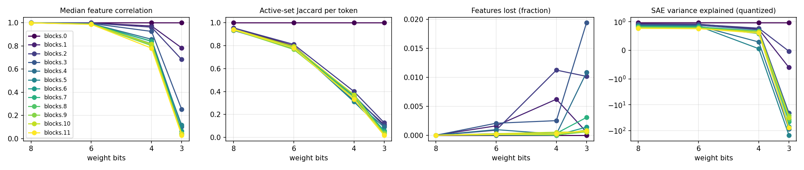
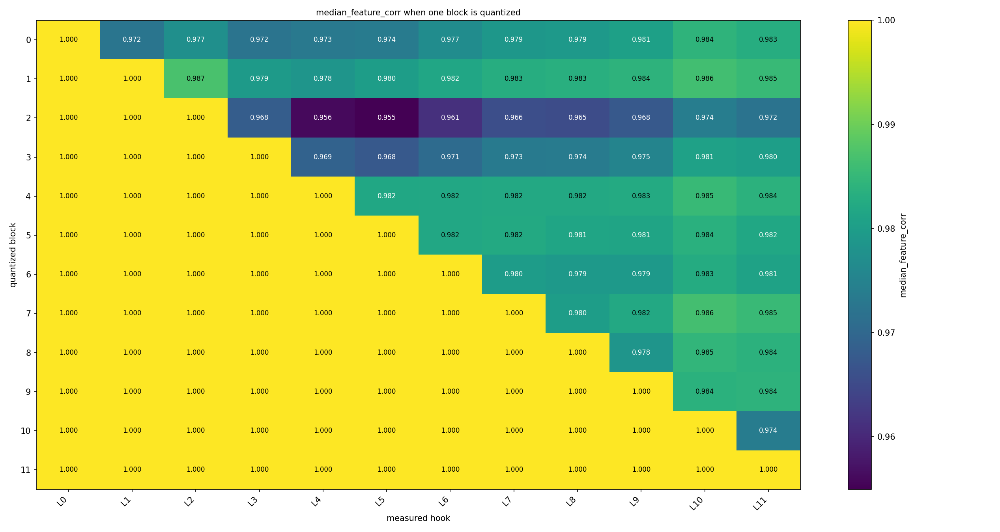
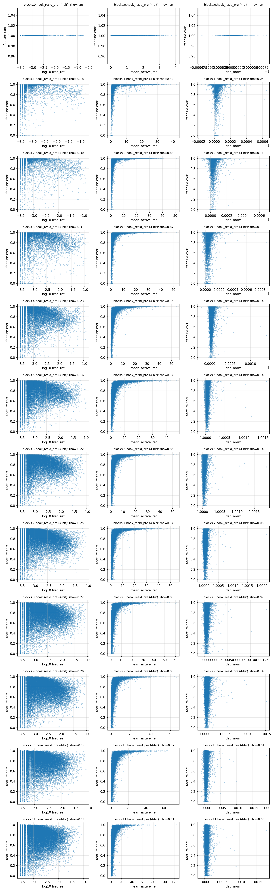
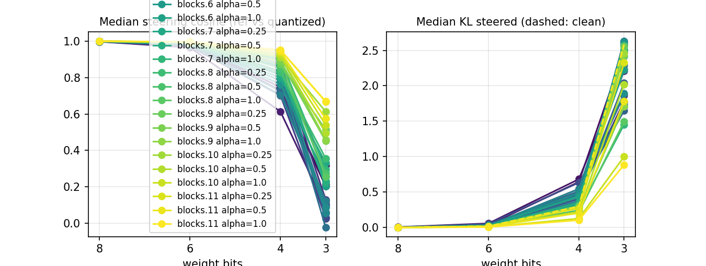

# quant-lens report

## Run config

| key | value |
|---|---|
| model | gpt2 |
| sae_release | gpt2-small-res-jb |
| hook_template | blocks.{layer}.hook_resid_pre |
| sae_id_template | blocks.{layer}.hook_resid_pre |
| layers | [0, 1, 2, 3, 4, 5, 6, 7, 8, 9, 10, 11] |
| bits | [8, 6, 4, 3] |
| scheme | rtn |
| group_size | None |
| act_bits | 8 |
| calib_seqs | 32 |
| dataset | NeelNanda/pile-10k |
| n_docs | 2000 |
| doc_offset | 0 |
| n_seqs | 128 |
| ctx | 128 |
| batch_size | 8 |
| out | results/gpt2_rtn_4bit |
| save_per_feature | False |
| analysis_bits | 4 |
| ablate_layers | True |
| fragility | True |
| fragility_n | 50 |
| steering | True |
| steer_features | 32 |
| steer_alphas | [0.25, 0.5, 1.0] |
| steer_seqs | 16 |

## Summary

One row per (hook, bit width). `median_feature_corr`: median over live features of the Pearson correlation of activations, reference vs quantized. `jaccard`: per-token overlap of active feature sets. `topk_overlap`: per-token overlap of the 10 strongest features. `lost_frac` / `new_frac`: features that stop firing / only fire after quantization. `fve_ref` / `fve_q`: residual-stream variance explained by the SAE. `logit_kl`, `top1_agree`: output drift on the same tokens.

| hook | bits | scheme | group_size | median_feature_corr | jaccard | topk_overlap | lost_frac | new_frac | fve_ref | fve_q | logit_kl | top1_agree |
|---|---|---|---|---|---|---|---|---|---|---|---|---|
| blocks.0.hook_resid_pre | 8 | rtn | 0 | 1 | 1 | 1 | 0 | 0 | 0.9648 | 0.9648 | 0.001137 | 0.9788 |
| blocks.1.hook_resid_pre | 8 | rtn | 0 | 0.9999 | 0.9557 | 0.9739 | 0 | 0 | 0.9271 | 0.9268 | 0.001137 | 0.9788 |
| blocks.2.hook_resid_pre | 8 | rtn | 0 | 0.9998 | 0.9558 | 0.976 | 0 | 0 | 0.9231 | 0.9226 | 0.001137 | 0.9788 |
| blocks.3.hook_resid_pre | 8 | rtn | 0 | 0.9996 | 0.9343 | 0.97 | 0 | 0 | 0.8957 | 0.8937 | 0.001137 | 0.9788 |
| blocks.4.hook_resid_pre | 8 | rtn | 0 | 0.9994 | 0.9336 | 0.9721 | 0 | 9.693e-05 | 0.8703 | 0.8683 | 0.001137 | 0.9788 |
| blocks.5.hook_resid_pre | 8 | rtn | 0 | 0.9993 | 0.9382 | 0.9745 | 0 | 0 | 0.8586 | 0.8568 | 0.001137 | 0.9788 |
| blocks.6.hook_resid_pre | 8 | rtn | 0 | 0.9993 | 0.9393 | 0.9741 | 0 | 0 | 0.8432 | 0.8416 | 0.001137 | 0.9788 |
| blocks.7.hook_resid_pre | 8 | rtn | 0 | 0.9993 | 0.9385 | 0.9734 | 0 | 0 | 0.8306 | 0.8291 | 0.001137 | 0.9788 |
| blocks.8.hook_resid_pre | 8 | rtn | 0 | 0.9992 | 0.9389 | 0.9744 | 0 | 0 | 0.8202 | 0.8198 | 0.001137 | 0.9788 |
| blocks.9.hook_resid_pre | 8 | rtn | 0 | 0.9992 | 0.938 | 0.9728 | 0 | 0 | 0.8054 | 0.805 | 0.001137 | 0.9788 |
| blocks.10.hook_resid_pre | 8 | rtn | 0 | 0.9992 | 0.944 | 0.9741 | 0 | 0 | 0.7703 | 0.7704 | 0.001137 | 0.9788 |
| blocks.11.hook_resid_pre | 8 | rtn | 0 | 0.9991 | 0.9407 | 0.9718 | 0 | 0 | 0.7766 | 0.7746 | 0.001137 | 0.9788 |
| blocks.0.hook_resid_pre | 6 | rtn | 0 | 1 | 1 | 1 | 0 | 0 | 0.9648 | 0.9648 | 0.01726 | 0.9209 |
| blocks.1.hook_resid_pre | 6 | rtn | 0 | 0.9989 | 0.799 | 0.8947 | 0.001624 | 0.002977 | 0.9271 | 0.9177 | 0.01726 | 0.9209 |
| blocks.2.hook_resid_pre | 6 | rtn | 0 | 0.9973 | 0.8114 | 0.8993 | 0.0008658 | 0.0002165 | 0.9231 | 0.9074 | 0.01726 | 0.9209 |
| blocks.3.hook_resid_pre | 6 | rtn | 0 | 0.9945 | 0.776 | 0.9026 | 0.002077 | 0.0002966 | 0.8957 | 0.8777 | 0.01726 | 0.9209 |
| blocks.4.hook_resid_pre | 6 | rtn | 0 | 0.9921 | 0.7839 | 0.9103 | 0.0009693 | 0.0003877 | 0.8703 | 0.8555 | 0.01726 | 0.9209 |
| blocks.5.hook_resid_pre | 6 | rtn | 0 | 0.991 | 0.7927 | 0.9133 | 0.0002141 | 7.138e-05 | 0.8586 | 0.8465 | 0.01726 | 0.9209 |
| blocks.6.hook_resid_pre | 6 | rtn | 0 | 0.9905 | 0.7859 | 0.9136 | 6.091e-05 | 6.091e-05 | 0.8432 | 0.8308 | 0.01726 | 0.9209 |
| blocks.7.hook_resid_pre | 6 | rtn | 0 | 0.9897 | 0.7769 | 0.9111 | 0.0002748 | 0 | 0.8306 | 0.8167 | 0.01726 | 0.9209 |
| blocks.8.hook_resid_pre | 6 | rtn | 0 | 0.9888 | 0.7815 | 0.912 | 5.103e-05 | 0 | 0.8202 | 0.8078 | 0.01726 | 0.9209 |
| blocks.9.hook_resid_pre | 6 | rtn | 0 | 0.9873 | 0.7671 | 0.9101 | 0.0001946 | 0 | 0.8054 | 0.7869 | 0.01726 | 0.9209 |
| blocks.10.hook_resid_pre | 6 | rtn | 0 | 0.9887 | 0.7932 | 0.9117 | 0.0002639 | 0 | 0.7703 | 0.7596 | 0.01726 | 0.9209 |
| blocks.11.hook_resid_pre | 6 | rtn | 0 | 0.9862 | 0.7797 | 0.9063 | 0.0001516 | 0 | 0.7766 | 0.7611 | 0.01726 | 0.9209 |
| blocks.0.hook_resid_pre | 4 | rtn | 0 | 1 | 1 | 1 | 0 | 0 | 0.9648 | 0.9648 | 0.3077 | 0.6964 |
| blocks.1.hook_resid_pre | 4 | rtn | 0 | 0.9724 | 0.3514 | 0.6265 | 0.006225 | 0.9748 | 0.9271 | 0.74 | 0.3077 | 0.6964 |
| blocks.2.hook_resid_pre | 4 | rtn | 0 | 0.9621 | 0.4003 | 0.6414 | 0.01126 | 0.1212 | 0.9231 | 0.7761 | 0.3077 | 0.6964 |
| blocks.3.hook_resid_pre | 4 | rtn | 0 | 0.9255 | 0.3639 | 0.6658 | 0.002522 | 0.1904 | 0.8957 | 0.7199 | 0.3077 | 0.6964 |
| blocks.4.hook_resid_pre | 4 | rtn | 0 | 0.8577 | 0.3214 | 0.6827 | 0.0001939 | 0.277 | 0.8703 | 0.2941 | 0.3077 | 0.6964 |
| blocks.5.hook_resid_pre | 4 | rtn | 0 | 0.819 | 0.3099 | 0.6788 | 0 | 0.1403 | 0.8586 | 0.05905 | 0.3077 | 0.6964 |
| blocks.6.hook_resid_pre | 4 | rtn | 0 | 0.841 | 0.3599 | 0.6833 | 0 | 0.04714 | 0.8432 | 0.5853 | 0.3077 | 0.6964 |
| blocks.7.hook_resid_pre | 4 | rtn | 0 | 0.8392 | 0.3735 | 0.6644 | 0.0003297 | 0.01885 | 0.8306 | 0.6797 | 0.3077 | 0.6964 |
| blocks.8.hook_resid_pre | 4 | rtn | 0 | 0.8126 | 0.3474 | 0.6671 | 5.103e-05 | 0.0174 | 0.8202 | 0.612 | 0.3077 | 0.6964 |
| blocks.9.hook_resid_pre | 4 | rtn | 0 | 0.8023 | 0.3485 | 0.6617 | 4.865e-05 | 0.008611 | 0.8054 | 0.6553 | 0.3077 | 0.6964 |
| blocks.10.hook_resid_pre | 4 | rtn | 0 | 0.8162 | 0.3709 | 0.6592 | 0.0005278 | 0.01378 | 0.7703 | 0.6582 | 0.3077 | 0.6964 |
| blocks.11.hook_resid_pre | 4 | rtn | 0 | 0.7805 | 0.3318 | 0.6351 | 0.0002526 | 0.01516 | 0.7766 | 0.6038 | 0.3077 | 0.6964 |
| blocks.0.hook_resid_pre | 3 | rtn | 0 | 1 | 1 | 1 | 0 | 0 | 0.9648 | 0.9648 | 3.139 | 0.1886 |
| blocks.1.hook_resid_pre | 3 | rtn | 0 | 0.7829 | 0.1112 | 0.3656 | 0.0005413 | 2.641 | 0.9271 | -0.596 | 3.139 | 0.1886 |
| blocks.2.hook_resid_pre | 3 | rtn | 0 | 0.6828 | 0.1282 | 0.3344 | 0.01017 | 0.9032 | 0.9231 | -0.02965 | 3.139 | 0.1886 |
| blocks.3.hook_resid_pre | 3 | rtn | 0 | 0.2514 | 0.0982 | 0.2382 | 0.01943 | 0.6878 | 0.8957 | -20.93 | 3.139 | 0.1886 |
| blocks.4.hook_resid_pre | 3 | rtn | 0 | 0.1011 | 0.08905 | 0.2307 | 0.01086 | 0.3964 | 0.8703 | -86.77 | 3.139 | 0.1886 |
| blocks.5.hook_resid_pre | 3 | rtn | 0 | 0.1158 | 0.05454 | 0.2022 | 0.0007138 | 0.1822 | 0.8586 | -152.5 | 3.139 | 0.1886 |
| blocks.6.hook_resid_pre | 3 | rtn | 0 | 0.06587 | 0.05715 | 0.1668 | 0.001401 | 0.09435 | 0.8432 | -71.34 | 3.139 | 0.1886 |
| blocks.7.hook_resid_pre | 3 | rtn | 0 | 0.04399 | 0.04976 | 0.1505 | 0.003077 | 0.05704 | 0.8306 | -45.79 | 3.139 | 0.1886 |
| blocks.8.hook_resid_pre | 3 | rtn | 0 | 0.03818 | 0.04168 | 0.1375 | 0.0009186 | 0.03404 | 0.8202 | -38.38 | 3.139 | 0.1886 |
| blocks.9.hook_resid_pre | 3 | rtn | 0 | 0.03428 | 0.03435 | 0.1282 | 0.0005838 | 0.02257 | 0.8054 | -26.46 | 3.139 | 0.1886 |
| blocks.10.hook_resid_pre | 3 | rtn | 0 | 0.04257 | 0.0241 | 0.1226 | 0.0005806 | 0.04861 | 0.7703 | -31.69 | 3.139 | 0.1886 |
| blocks.11.hook_resid_pre | 3 | rtn | 0 | 0.02829 | 0.01807 | 0.09345 | 0.0008084 | 0.03688 | 0.7766 | -78.25 | 3.139 | 0.1886 |

## Layer ablation

Each row quantizes one transformer block and keeps the rest in full precision; columns are the hooks where features are compared, cells one metric (`median_feature_corr` by default). Long-format data is in `ablation.csv`.

| quantized_block | blocks.0.hook_resid_pre | blocks.1.hook_resid_pre | blocks.2.hook_resid_pre | blocks.3.hook_resid_pre | blocks.4.hook_resid_pre | blocks.5.hook_resid_pre | blocks.6.hook_resid_pre | blocks.7.hook_resid_pre | blocks.8.hook_resid_pre | blocks.9.hook_resid_pre | blocks.10.hook_resid_pre | blocks.11.hook_resid_pre |
|---|---|---|---|---|---|---|---|---|---|---|---|---|
| 0 | 1 | 0.9724 | 0.9775 | 0.9723 | 0.9732 | 0.9737 | 0.9769 | 0.9787 | 0.9793 | 0.9805 | 0.9842 | 0.9831 |
| 1 | 1 | 1 | 0.987 | 0.9795 | 0.9785 | 0.98 | 0.9816 | 0.983 | 0.9834 | 0.984 | 0.9863 | 0.9853 |
| 2 | 1 | 1 | 1 | 0.9682 | 0.956 | 0.955 | 0.9612 | 0.9658 | 0.9653 | 0.9676 | 0.974 | 0.9721 |
| 3 | 1 | 1 | 1 | 1 | 0.9692 | 0.9675 | 0.9706 | 0.9734 | 0.9737 | 0.9753 | 0.9808 | 0.9801 |
| 4 | 1 | 1 | 1 | 1 | 1 | 0.9818 | 0.982 | 0.9822 | 0.9822 | 0.9825 | 0.9853 | 0.984 |
| 5 | 1 | 1 | 1 | 1 | 1 | 1 | 0.982 | 0.9822 | 0.9814 | 0.9812 | 0.9836 | 0.9819 |
| 6 | 1 | 1 | 1 | 1 | 1 | 1 | 1 | 0.9798 | 0.9792 | 0.9794 | 0.9827 | 0.9809 |
| 7 | 1 | 1 | 1 | 1 | 1 | 1 | 1 | 1 | 0.9799 | 0.9822 | 0.9865 | 0.9854 |
| 8 | 1 | 1 | 1 | 1 | 1 | 1 | 1 | 1 | 1 | 0.9784 | 0.9846 | 0.984 |
| 9 | 1 | 1 | 1 | 1 | 1 | 1 | 1 | 1 | 1 | 1 | 0.9836 | 0.984 |
| 10 | 1 | 1 | 1 | 1 | 1 | 1 | 1 | 1 | 1 | 1 | 1 | 0.9739 |
| 11 | 1 | 1 | 1 | 1 | 1 | 1 | 1 | 1 | 1 | 1 | 1 | 1 |

## Feature fragility

`corr`: Pearson correlation of one feature's activations, reference vs quantized. `freq_ref`: fraction of tokens it fires on; `mean_active_ref`: mean activation where it fires. `rho_*`: Spearman rank correlation of `corr` with that property over alive features (positive: larger values are more robust). Fragile features have the lowest `corr`, robust the highest; `rank` 0 is the most extreme.

| hook | layer | bits | n_alive | median_corr | rho_log10_freq_ref | rho_mean_active_ref | rho_dec_norm |
|---|---|---|---|---|---|---|---|
| blocks.0.hook_resid_pre | 0 | 4 | 6434 | 1 |  |  |  |
| blocks.1.hook_resid_pre | 1 | 4 | 3672 | 0.9725 | -0.1755 | 0.8383 | 0.05056 |
| blocks.2.hook_resid_pre | 2 | 4 | 4568 | 0.9621 | -0.2995 | 0.8802 | 0.1144 |
| blocks.3.hook_resid_pre | 3 | 4 | 6725 | 0.9255 | -0.3061 | 0.8714 | 0.1036 |
| blocks.4.hook_resid_pre | 4 | 4 | 10315 | 0.8577 | -0.2262 | 0.8584 | 0.1363 |
| blocks.5.hook_resid_pre | 5 | 4 | 14009 | 0.819 | -0.1579 | 0.8439 | 0.1405 |
| blocks.6.hook_resid_pre | 6 | 4 | 16418 | 0.841 | -0.216 | 0.8452 | 0.1398 |
| blocks.7.hook_resid_pre | 7 | 4 | 18191 | 0.8392 | -0.253 | 0.8388 | 0.0615 |
| blocks.8.hook_resid_pre | 8 | 4 | 19595 | 0.8126 | -0.2202 | 0.8306 | 0.07089 |
| blocks.9.hook_resid_pre | 9 | 4 | 20554 | 0.8023 | -0.1976 | 0.8349 | 0.1432 |
| blocks.10.hook_resid_pre | 10 | 4 | 18937 | 0.8162 | -0.1742 | 0.8245 | 0.01401 |
| blocks.11.hook_resid_pre | 11 | 4 | 19787 | 0.7805 | -0.1076 | 0.8144 | 0.04678 |

### blocks.0.hook_resid_pre: fragile

| hook | kind | rank | feature | corr | freq_ref | mean_active_ref | neuronpedia | contexts |
|---|---|---|---|---|---|---|---|---|
| blocks.0.hook_resid_pre | fragile | 0 | 2 | 1 | 0.0009227 | 0.06896 | [link](https://www.neuronpedia.org/gpt2-small/0-res-jb/2) | the Tastiest” Post-«mortem» \| majority of women reported no regular problems or… |
| blocks.0.hook_resid_pre | fragile | 1 | 3 | 1 | 0.0004306 | 0.04672 | [link](https://www.neuronpedia.org/gpt2-small/0-res-jb/3) | <datatype>«DT» \| <datatype>«DT» \| <datatype>«DT» |
| blocks.0.hook_resid_pre | fragile | 2 | 5 | 1 | 0.0003691 | 1.82 | [link](https://www.neuronpedia.org/gpt2-small/0-res-jb/5) | fast enough.\n\nEven though I« worked» \| comfortable and answered all questions… |
| blocks.0.hook_resid_pre | fragile | 3 | 9 | 1 | 0.0007382 | 0.1096 | [link](https://www.neuronpedia.org/gpt2-small/0-res-jb/9) | , Manuel Lanzini ruptured his« anterior» \| }{d\lambda}\big(\frac«{\» \| n$ for $… |
| blocks.0.hook_resid_pre | fragile | 4 | 18 | 1 | 0.0006152 | 2.878 | [link](https://www.neuronpedia.org/gpt2-small/0-res-jb/18) | <\|endoftext\|>My initial« idea» \| the concept, as it involved into the« idea» \| … |
| blocks.0.hook_resid_pre | fragile | 5 | 19 | 1 | 0.0005536 | 0.06124 | [link](https://www.neuronpedia.org/gpt2-small/0-res-jb/19) | Women, Special Provision and the Debate on« Equality» \| , especially given that… |
| blocks.0.hook_resid_pre | fragile | 6 | 24 | 1 | 0.0005536 | 0.08663 | [link](https://www.neuronpedia.org/gpt2-small/0-res-jb/24) | <\|endoftext\|>. In the latter case, the« chrom» \| for bone regeneration.\nNanost… |
| blocks.0.hook_resid_pre | fragile | 7 | 25 | 1 | 0.0004306 | 0.1996 | [link](https://www.neuronpedia.org/gpt2-small/0-res-jb/25) | la curiosidad y no enti«endo» \| PCI), and this treatment has increased« exponen… |
| blocks.0.hook_resid_pre | fragile | 8 | 34 | 1 | 0.0004306 | 0.1628 | [link](https://www.neuronpedia.org/gpt2-small/0-res-jb/34) | <description>Protection Ind«icator» \| <description>Student Ind«icator» \| <descr… |
| blocks.0.hook_resid_pre | fragile | 9 | 40 | 1 | 0.0003076 | 0.7051 | [link](https://www.neuronpedia.org/gpt2-small/0-res-jb/40) | namely an absorbent core enclosed within the« combination» \| issues, or the O/R… |

### blocks.0.hook_resid_pre: robust

| hook | kind | rank | feature | corr | freq_ref | mean_active_ref | neuronpedia | contexts |
|---|---|---|---|---|---|---|---|---|
| blocks.0.hook_resid_pre | robust | 0 | 24570 | 1 | 0.00326 | 0.1809 | [link](https://www.neuronpedia.org/gpt2-small/0-res-jb/24570) | <field min«Occ» \| <field min«Occ» \| field minOccurs="0" max«Occ» |
| blocks.0.hook_resid_pre | robust | 1 | 24569 | 1 | 0.001784 | 2.175 | [link](https://www.neuronpedia.org/gpt2-small/0-res-jb/24569) | would allow women to walk around and get« some» \| \n\nYour query DSL looks rath… |
| blocks.0.hook_resid_pre | robust | 2 | 24566 | 1 | 0.0003691 | 0.5767 | [link](https://www.neuronpedia.org/gpt2-small/0-res-jb/24566) | only real solution was through the use of« artificial» \| to protect the health … |
| blocks.0.hook_resid_pre | robust | 3 | 24565 | 1 | 0.0003691 | 0.09795 | [link](https://www.neuronpedia.org/gpt2-small/0-res-jb/24565) | more I thought about it the more it« sounded» \| Sequel gem, or Arel.« Interesti… |
| blocks.0.hook_resid_pre | robust | 4 | 24563 | 1 | 0.0006152 | 0.7551 | [link](https://www.neuronpedia.org/gpt2-small/0-res-jb/24563) | mean "characterized by being opposed to« fact» \| a DrivingBloodTestResult colum… |
| blocks.0.hook_resid_pre | robust | 5 | 24562 | 1 | 0.0005536 | 0.1398 | [link](https://www.neuronpedia.org/gpt2-small/0-res-jb/24562) | wearer. Such extension and expansion about the« wearer» \| articles should comfo… |
| blocks.0.hook_resid_pre | robust | 6 | 24560 | 1 | 0.0003076 | 0.2948 | [link](https://www.neuronpedia.org/gpt2-small/0-res-jb/24560) | , NVs (which are truly An«cill» \| , and are the equivalent of the an«cill» \| an… |
| blocks.0.hook_resid_pre | robust | 7 | 24559 | 1 | 0.0003691 | 0.09752 | [link](https://www.neuronpedia.org/gpt2-small/0-res-jb/24559) | é que si quisiera empe«zar» \| College in New York City\n\nPed«iatric» \| \n}\n.a… |
| blocks.0.hook_resid_pre | robust | 8 | 24547 | 1 | 0.0004921 | 0.1556 | [link](https://www.neuronpedia.org/gpt2-small/0-res-jb/24547) | of 85% with the higher efficiency fore«seen» \| que no es del todo erró«nea» \| C… |
| blocks.0.hook_resid_pre | robust | 9 | 24545 | 1 | 0.0008612 | 0.05869 | [link](https://www.neuronpedia.org/gpt2-small/0-res-jb/24545) | when resting for a bit.\n\n«Design» \| very low incomes.<\|endoftext\|><\|endoftext… |

### blocks.1.hook_resid_pre: fragile

| hook | kind | rank | feature | corr | freq_ref | mean_active_ref | neuronpedia | contexts |
|---|---|---|---|---|---|---|---|---|
| blocks.1.hook_resid_pre | fragile | 0 | 9728 | -0.0008657 | 0.0007382 | 0.8761 | [link](https://www.neuronpedia.org/gpt2-small/1-res-jb/9728) | "Object Role Modeling" and C«QL» \| DL. Since you can already transform C«QL» \| … |
| blocks.1.hook_resid_pre | fragile | 1 | 18995 | -0.000844 | 0.0004306 | 0.2738 | [link](https://www.neuronpedia.org/gpt2-small/1-res-jb/18995) | tissue. The subject invention discloses an« absorb» \| include an absorbent pad … |
| blocks.1.hook_resid_pre | fragile | 2 | 1072 | -0.0005403 | 0.0004306 | 0.2401 | [link](https://www.neuronpedia.org/gpt2-small/1-res-jb/1072) | the outer cover, and thence the absorb«ent» \| superabsorbent particles and othe… |
| blocks.1.hook_resid_pre | fragile | 3 | 20514 | -0.0004831 | 0.005844 | 0.09039 | [link](https://www.neuronpedia.org/gpt2-small/1-res-jb/20514) | icate Patient</description> \n « » \| Patient</description> \n « » \| \n « » |
| blocks.1.hook_resid_pre | fragile | 4 | 14420 | -0.0003984 | 0.0003076 | 0.4544 | [link](https://www.neuronpedia.org/gpt2-small/1-res-jb/14420) | datatype>IS</datat«ype» \| datatype>IS</datat«ype» \| <\|endoftext\|>IS</datat«ype» |
| blocks.1.hook_resid_pre | fragile | 5 | 23119 | -0.0003038 | 0.00123 | 0.2153 | [link](https://www.neuronpedia.org/gpt2-small/1-res-jb/23119) | be just me and my short memory -«_-» \| counter > 0) {\n « » \| (counter > 0) {\n… |
| blocks.1.hook_resid_pre | fragile | 6 | 13669 | -0.0002931 | 0.0009227 | 0.1755 | [link](https://www.neuronpedia.org/gpt2-small/1-res-jb/13669) | " maxOccurs="0"> «\n» \| " maxOccurs="0"> «\n» \| " maxOccurs="0"> «\n» |
| blocks.1.hook_resid_pre | fragile | 7 | 7590 | -0.0002629 | 0.001046 | 0.2836 | [link](https://www.neuronpedia.org/gpt2-small/1-res-jb/7590) | .\n\nIn training with Argentina,« Manuel» \| simple as possible. In that way,« j… |
| blocks.1.hook_resid_pre | fragile | 8 | 10970 | -0.0002203 | 0.0003691 | 0.05164 | [link](https://www.neuronpedia.org/gpt2-small/1-res-jb/10970) | 1.15</name> \n« » \| 1.21</name> \n« » \| plicate Patient</description> \n« » |
| blocks.1.hook_resid_pre | fragile | 9 | 2030 | -0.0002072 | 0.0006152 | 0.1143 | [link](https://www.neuronpedia.org/gpt2-small/1-res-jb/2030) | <name>PD1«.» \| <name>PD1«.» \| <name>PD1«.» |

### blocks.1.hook_resid_pre: robust

| hook | kind | rank | feature | corr | freq_ref | mean_active_ref | neuronpedia | contexts |
|---|---|---|---|---|---|---|---|---|
| blocks.1.hook_resid_pre | robust | 0 | 2453 | 1 | 0.0003076 | 24.39 | [link](https://www.neuronpedia.org/gpt2-small/1-res-jb/2453) | ol' Dung was lurking in the« pub» \| \nSo, he was banned from the« pub» \| , he j… |
| blocks.1.hook_resid_pre | robust | 1 | 10708 | 1 | 0.0003076 | 36.92 | [link](https://www.neuronpedia.org/gpt2-small/1-res-jb/10708) | which he received a letter from Werner He«isen» \| .\n\nFor example, the He«isen… |
| blocks.1.hook_resid_pre | robust | 2 | 19199 | 1 | 0.0003076 | 25.62 | [link](https://www.neuronpedia.org/gpt2-small/1-res-jb/19199) | = -1 -> En este caso« ya» \| e lo que realizas con javascript« ya» \| es de hacer… |
| blocks.1.hook_resid_pre | robust | 3 | 18739 | 1 | 0.0003076 | 16.09 | [link](https://www.neuronpedia.org/gpt2-small/1-res-jb/18739) | i porque es como funciona« intern» \| ce un metodo simple de resta« intern» \| un… |
| blocks.1.hook_resid_pre | robust | 4 | 4307 | 1 | 0.0005536 | 29.79 | [link](https://www.neuronpedia.org/gpt2-small/1-res-jb/4307) | been shown to improve outcomes in CAD is« exercise» \| survival and the potentia… |
| blocks.1.hook_resid_pre | robust | 5 | 9611 | 1 | 0.001292 | 31.36 | [link](https://www.neuronpedia.org/gpt2-small/1-res-jb/9611) | <field« min» \| <field« min» \| <field« min» |
| blocks.1.hook_resid_pre | robust | 6 | 20555 | 1 | 0.0003076 | 29.14 | [link](https://www.neuronpedia.org/gpt2-small/1-res-jb/20555) | completely different way than using Python within a« shell» \| a file as an argu… |
| blocks.1.hook_resid_pre | robust | 7 | 1833 | 1 | 0.0005536 | 42.05 | [link](https://www.neuronpedia.org/gpt2-small/1-res-jb/1833) | for clinical use.<\|endoftext\|><\|endoftext\|>Benjamin« Lok» \| lead researcher and… |
| blocks.1.hook_resid_pre | robust | 8 | 1838 | 1 | 0.0003691 | 16.61 | [link](https://www.neuronpedia.org/gpt2-small/1-res-jb/1838) | neurons and SYNAPSES abilities to« generate» \| work during their menstrual peri… |
| blocks.1.hook_resid_pre | robust | 9 | 2719 | 0.9999 | 0.0003691 | 27.21 | [link](https://www.neuronpedia.org/gpt2-small/1-res-jb/2719) | insurance companies' businesses, I'd be« pretty» \| and I got to say, it is« pre… |

### blocks.2.hook_resid_pre: fragile

| hook | kind | rank | feature | corr | freq_ref | mean_active_ref | neuronpedia | contexts |
|---|---|---|---|---|---|---|---|---|
| blocks.2.hook_resid_pre | fragile | 0 | 4603 | -0.0003826 | 0.0007382 | 0.2607 | [link](https://www.neuronpedia.org/gpt2-small/2-res-jb/4603) | <field minOcc«urs» \| <field minOcc«urs» \| <field minOcc«urs» |
| blocks.2.hook_resid_pre | fragile | 1 | 1487 | -0.0002855 | 0.0009843 | 0.1376 | [link](https://www.neuronpedia.org/gpt2-small/2-res-jb/1487) | <datat«ype» \| <datat«ype» \| atype>XON</datat«ype» |
| blocks.2.hook_resid_pre | fragile | 2 | 1475 | -0.0002772 | 0.0009227 | 0.1777 | [link](https://www.neuronpedia.org/gpt2-small/2-res-jb/1475) | about where West Ham are set to be« based» \| practice raised a number of issues… |
| blocks.2.hook_resid_pre | fragile | 3 | 19647 | -0.0002756 | 0.0007997 | 0.3182 | [link](https://www.neuronpedia.org/gpt2-small/2-res-jb/19647) | <field minOccurs«="» \| <field minOccurs«="» \| <field minOccurs«="» |
| blocks.2.hook_resid_pre | fragile | 4 | 1300 | -0.000275 | 0.0004921 | 0.2313 | [link](https://www.neuronpedia.org/gpt2-small/2-res-jb/1300) | segment> \n<\|endoftext\|><\|endoftext\|>Article« content» \| \n\nAvailable to downl… |
| blocks.2.hook_resid_pre | fragile | 5 | 4552 | -0.0002742 | 0.0004306 | 0.3214 | [link](https://www.neuronpedia.org/gpt2-small/2-res-jb/4552) | as possible. In that way, j«OO» \| abstraction framework. I was wondering whethe… |
| blocks.2.hook_resid_pre | fragile | 6 | 4991 | -0.0002659 | 0.0003691 | 0.4296 | [link](https://www.neuronpedia.org/gpt2-small/2-res-jb/4991) | :\n• employers have a responsibility to« protect» \| same as men or by making pr… |
| blocks.2.hook_resid_pre | fragile | 7 | 23273 | -0.0002555 | 0.001722 | 0.2043 | [link](https://www.neuronpedia.org/gpt2-small/2-res-jb/23273) | >Military Rank/Grade</description>« » \| ype>IS</datatype>« » \| ype>IS</datatype… |
| blocks.2.hook_resid_pre | fragile | 8 | 2383 | -0.0002257 | 0.0004921 | 0.1032 | [link](https://www.neuronpedia.org/gpt2-small/2-res-jb/2383) | datatype>DT</datat«ype» \| more than four years later, Rose admitted« publicly» … |
| blocks.2.hook_resid_pre | fragile | 9 | 964 | -0.0002235 | 0.001107 | 0.4081 | [link](https://www.neuronpedia.org/gpt2-small/2-res-jb/964) | <datat«ype» \| <datat«ype» \| <datat«ype» |

### blocks.2.hook_resid_pre: robust

| hook | kind | rank | feature | corr | freq_ref | mean_active_ref | neuronpedia | contexts |
|---|---|---|---|---|---|---|---|---|
| blocks.2.hook_resid_pre | robust | 0 | 20592 | 1 | 0.0003076 | 6.668 | [link](https://www.neuronpedia.org/gpt2-small/2-res-jb/20592) | the video presentation on the CQL Introduction« page» \| <field minOccurs«="» \| … |
| blocks.2.hook_resid_pre | robust | 1 | 858 | 1 | 0.0004921 | 50.58 | [link](https://www.neuronpedia.org/gpt2-small/2-res-jb/858) | for clinical use.<\|endoftext\|><\|endoftext\|>Benjamin« Lok» \| lead researcher and… |
| blocks.2.hook_resid_pre | robust | 2 | 8791 | 1 | 0.0003076 | 14.92 | [link](https://www.neuronpedia.org/gpt2-small/2-res-jb/8791) | know the state of a plate (who« owns» \| Fishing Charters\n\nAs a family« owned»… |
| blocks.2.hook_resid_pre | robust | 3 | 4047 | 1 | 0.0003691 | 17.12 | [link](https://www.neuronpedia.org/gpt2-small/2-res-jb/4047) | “Lifes a game but« fishing» \| … continue reading<\|endoftext\|><\|endoftext\|>About… |
| blocks.2.hook_resid_pre | robust | 4 | 22066 | 1 | 0.0003691 | 28.41 | [link](https://www.neuronpedia.org/gpt2-small/2-res-jb/22066) | � mode).\n\nYou get points« every» \| about. I’ll go through« every» \| your stay… |
| blocks.2.hook_resid_pre | robust | 5 | 11516 | 1 | 0.0003076 | 14.4 | [link](https://www.neuronpedia.org/gpt2-small/2-res-jb/11516) | to have numerous physiological benefits, and a« growing» \| ic material surface … |
| blocks.2.hook_resid_pre | robust | 6 | 21227 | 1 | 0.0006152 | 31.1 | [link](https://www.neuronpedia.org/gpt2-small/2-res-jb/21227) | <\|endoftext\|> 2000 with« only» \| game that you can complete in one day« only» \|… |
| blocks.2.hook_resid_pre | robust | 7 | 1764 | 0.9999 | 0.0003076 | 35.41 | [link](https://www.neuronpedia.org/gpt2-small/2-res-jb/1764) | <\|endoftext\|> depends on the« business» \| problem. Personally, I think if your«… |
| blocks.2.hook_resid_pre | robust | 8 | 20897 | 0.9999 | 0.0003691 | 35.02 | [link](https://www.neuronpedia.org/gpt2-small/2-res-jb/20897) | part of the measurement apparatus... / inter«fer» \| and it used MachZenhder Int… |
| blocks.2.hook_resid_pre | robust | 9 | 2709 | 0.9999 | 0.0003076 | 12.89 | [link](https://www.neuronpedia.org/gpt2-small/2-res-jb/2709) | <\|endoftext\|>\n«ANC» \| ES, QUBITS & AS,« ANC» \| nder interferometry, which also… |

### blocks.3.hook_resid_pre: fragile

| hook | kind | rank | feature | corr | freq_ref | mean_active_ref | neuronpedia | contexts |
|---|---|---|---|---|---|---|---|---|
| blocks.3.hook_resid_pre | fragile | 0 | 20240 | -0.001694 | 0.005967 | 0.7071 | [link](https://www.neuronpedia.org/gpt2-small/3-res-jb/20240) | 0" maxOccurs="0">« » \| ype>DT</datatype>« » \| ype>DT</datatype>« » |
| blocks.3.hook_resid_pre | fragile | 1 | 16690 | -0.001176 | 0.0004921 | 0.4586 | [link](https://www.neuronpedia.org/gpt2-small/3-res-jb/16690) | <\|endoftext\|>« » \| <\|endoftext\|>« » \| 0" maxOccurs="0">« » |
| blocks.3.hook_resid_pre | fragile | 2 | 10295 | -0.001044 | 0.002953 | 0.2958 | [link](https://www.neuronpedia.org/gpt2-small/3-res-jb/10295) | <description>Military Status</description>« » \| >Military Rank/Grade</descripti… |
| blocks.3.hook_resid_pre | fragile | 3 | 21508 | -0.0006306 | 0.0004306 | 0.3018 | [link](https://www.neuronpedia.org/gpt2-small/3-res-jb/21508) | &amp; ID No.</description>« » \| Immunization Registry Status</description>« » \|… |
| blocks.3.hook_resid_pre | fragile | 4 | 12099 | -0.0004852 | 0.001353 | 0.2889 | [link](https://www.neuronpedia.org/gpt2-small/3-res-jb/12099) | </field>« » \| </field>« » \| 0" maxOccurs="0">« » |
| blocks.3.hook_resid_pre | fragile | 5 | 12209 | -0.000419 | 0.0003691 | 0.4045 | [link](https://www.neuronpedia.org/gpt2-small/3-res-jb/12209) | <description>Military Status</description>« » \| >Military Rank/Grade</descripti… |
| blocks.3.hook_resid_pre | fragile | 6 | 18757 | -0.0003925 | 0.0005536 | 0.1173 | [link](https://www.neuronpedia.org/gpt2-small/3-res-jb/18757) | description>Organ Donor Code</description«>» \| description>Military Rank/Grade<… |
| blocks.3.hook_resid_pre | fragile | 7 | 15199 | -0.0003589 | 0.00283 | 0.3582 | [link](https://www.neuronpedia.org/gpt2-small/3-res-jb/15199) | >Military Rank/Grade</description>« » \| ype>DT</datatype>« » \| <description>Mil… |
| blocks.3.hook_resid_pre | fragile | 8 | 2635 | -0.0003339 | 0.0004306 | 0.6455 | [link](https://www.neuronpedia.org/gpt2-small/3-res-jb/2635) | from ESPN.com\nAll-Cent«ury» \| \nThe nominees for the All-Cent«ury» \| , the Maj… |
| blocks.3.hook_resid_pre | fragile | 9 | 288 | -0.0003332 | 0.0003076 | 1.05 | [link](https://www.neuronpedia.org/gpt2-small/3-res-jb/288) | e lo que realizas con javascript« ya» \| hace la operacion tu valor« ya» \| = -1 … |

### blocks.3.hook_resid_pre: robust

| hook | kind | rank | feature | corr | freq_ref | mean_active_ref | neuronpedia | contexts |
|---|---|---|---|---|---|---|---|---|
| blocks.3.hook_resid_pre | robust | 0 | 8616 | 0.9999 | 0.0004306 | 20.75 | [link](https://www.neuronpedia.org/gpt2-small/3-res-jb/8616) | \nConcept\n\nWorking over the« theme» \| . I was confident I could fit any« them… |
| blocks.3.hook_resid_pre | robust | 1 | 7345 | 0.9999 | 0.0003691 | 27.63 | [link](https://www.neuronpedia.org/gpt2-small/3-res-jb/7345) | numero por cada iteracion dent«ro» \| comienza desde 10 y dent«ro» \| also evolve… |
| blocks.3.hook_resid_pre | robust | 2 | 20623 | 0.9999 | 0.0003076 | 21.41 | [link](https://www.neuronpedia.org/gpt2-small/3-res-jb/20623) | people is always better than eating alone,« especially» \| with a simple HUD fro… |
| blocks.3.hook_resid_pre | robust | 3 | 9614 | 0.9999 | 0.005721 | 44.76 | [link](https://www.neuronpedia.org/gpt2-small/3-res-jb/9614) | <description>Publicity Code Effective Date«</» \| <\|endoftext\|> <description>Liv… |
| blocks.3.hook_resid_pre | robust | 4 | 18393 | 0.9999 | 0.0003691 | 38.96 | [link](https://www.neuronpedia.org/gpt2-small/3-res-jb/18393) | el University and the Universities of Wisconsin and« Florida» \| used by medical… |
| blocks.3.hook_resid_pre | robust | 5 | 9485 | 0.9998 | 0.0003076 | 19.78 | [link](https://www.neuronpedia.org/gpt2-small/3-res-jb/9485) | ament in his right knee and football.«l» \| , features and exclusives from footb… |
| blocks.3.hook_resid_pre | robust | 6 | 13344 | 0.9998 | 0.0003076 | 10.16 | [link](https://www.neuronpedia.org/gpt2-small/3-res-jb/13344) | obviamente tengo la« cur» \| a operacion ya que es lo que« prim» \| ieres en el c… |
| blocks.3.hook_resid_pre | robust | 7 | 10257 | 0.9998 | 0.0003691 | 27.26 | [link](https://www.neuronpedia.org/gpt2-small/3-res-jb/10257) | about. I’ll go through« every» \| your stay. We can not guarantee fish« every» \|… |
| blocks.3.hook_resid_pre | robust | 8 | 23004 | 0.9998 | 0.0005536 | 22.74 | [link](https://www.neuronpedia.org/gpt2-small/3-res-jb/23004) | <\|endoftext\|>« des» \| impresión de la variable es« des» \| la variable es desde … |
| blocks.3.hook_resid_pre | robust | 9 | 9574 | 0.9998 | 0.0003076 | 8.606 | [link](https://www.neuronpedia.org/gpt2-small/3-res-jb/9574) | a top-down view. I was« confident» \| needs a prostate exam — Patrick becomes qu… |

### blocks.4.hook_resid_pre: fragile

| hook | kind | rank | feature | corr | freq_ref | mean_active_ref | neuronpedia | contexts |
|---|---|---|---|---|---|---|---|---|
| blocks.4.hook_resid_pre | fragile | 0 | 2591 | -0.001152 | 0.001107 | 0.7303 | [link](https://www.neuronpedia.org/gpt2-small/4-res-jb/2591) | that the vast majority of women reported no« regular» \| <field minOcc«urs» \| <f… |
| blocks.4.hook_resid_pre | fragile | 1 | 4052 | -0.0006682 | 0.0009843 | 0.3042 | [link](https://www.neuronpedia.org/gpt2-small/4-res-jb/4052) | datatype>IS</datat«ype» \| datatype>IS</datat«ype» \| datatype>IS</datat«ype» |
| blocks.4.hook_resid_pre | fragile | 2 | 13853 | -0.000524 | 0.0003076 | 0.3494 | [link](https://www.neuronpedia.org/gpt2-small/4-res-jb/13853) | using a Mach-Zehnder inter«fer» \| Hence Mach-Zehnder inter«fer» \| and it used M… |
| blocks.4.hook_resid_pre | fragile | 3 | 22740 | -0.0005072 | 0.002891 | 0.296 | [link](https://www.neuronpedia.org/gpt2-small/4-res-jb/22740) | </description> \n « » \| atype> \n « » \| <\|endoftext\|> variable\n « » |
| blocks.4.hook_resid_pre | fragile | 4 | 2756 | -0.000504 | 0.0007997 | 0.2785 | [link](https://www.neuronpedia.org/gpt2-small/4-res-jb/2756) | description>Publicity Code</description>« » \| <\|endoftext\|>« others» \| ization … |
| blocks.4.hook_resid_pre | fragile | 5 | 9289 | -0.0004479 | 0.0004921 | 0.4178 | [link](https://www.neuronpedia.org/gpt2-small/4-res-jb/9289) | 0" maxOccurs="0">« » \| 0" maxOccurs="0">« » \| 0" maxOccurs="0">« » |
| blocks.4.hook_resid_pre | fragile | 6 | 20326 | -0.0003498 | 0.0003691 | 0.3976 | [link](https://www.neuronpedia.org/gpt2-small/4-res-jb/20326) | "50% 50%",\n « » \| <\|endoftext\|> a thirty-«man» \| that Patrick's having."\n\nA«… |
| blocks.4.hook_resid_pre | fragile | 7 | 6326 | -0.0003363 | 0.0003691 | 0.8521 | [link](https://www.neuronpedia.org/gpt2-small/4-res-jb/6326) | benefit from optimal medical therapy in lieu of« PCI» \| iveness of PCI, the ext… |
| blocks.4.hook_resid_pre | fragile | 8 | 10514 | -0.0002753 | 0.0003691 | 0.4462 | [link](https://www.neuronpedia.org/gpt2-small/4-res-jb/10514) | until after the World Cup.\n\n«(» \| <\|endoftext\|> Florida professor says.« "» \|… |
| blocks.4.hook_resid_pre | fragile | 9 | 537 | -0.0002681 | 0.0008612 | 1.086 | [link](https://www.neuronpedia.org/gpt2-small/4-res-jb/537) | \n\nIn 1999, the Major League« Baseball» \| manac\n\nCategory:1999 Major League«… |

### blocks.4.hook_resid_pre: robust

| hook | kind | rank | feature | corr | freq_ref | mean_active_ref | neuronpedia | contexts |
|---|---|---|---|---|---|---|---|---|
| blocks.4.hook_resid_pre | robust | 0 | 8352 | 0.9998 | 0.0003076 | 14.66 | [link](https://www.neuronpedia.org/gpt2-small/4-res-jb/8352) | The quantum computer may be physically implemented in« arbitrary» \| states that… |
| blocks.4.hook_resid_pre | robust | 1 | 11103 | 0.9998 | 0.005598 | 39.55 | [link](https://www.neuronpedia.org/gpt2-small/4-res-jb/11103) | <\|endoftext\|> <name>PD1.6«</» \| <\|endoftext\|>elements> \n«</» \| <\|endoftext\|>18… |
| blocks.4.hook_resid_pre | robust | 2 | 9938 | 0.9998 | 0.0007382 | 33.91 | [link](https://www.neuronpedia.org/gpt2-small/4-res-jb/9938) | I've learned the nitrogen vacancies used in« Mem» \| a search for Intersystem cr… |
| blocks.4.hook_resid_pre | robust | 3 | 4207 | 0.9997 | 0.0003076 | 31.48 | [link](https://www.neuronpedia.org/gpt2-small/4-res-jb/4207) | son […]\n\nWhen we arrived the« crew» \| of our islands, our waters and our« cre… |
| blocks.4.hook_resid_pre | robust | 4 | 23058 | 0.9997 | 0.0003076 | 16.26 | [link](https://www.neuronpedia.org/gpt2-small/4-res-jb/23058) | and thence the absorbent pad, can« tear» \| a forming tissue and a barrier tissu… |
| blocks.4.hook_resid_pre | robust | 5 | 856 | 0.9997 | 0.001292 | 29.73 | [link](https://www.neuronpedia.org/gpt2-small/4-res-jb/856) | <field« min» \| <field« min» \| <field« min» |
| blocks.4.hook_resid_pre | robust | 6 | 6080 | 0.9997 | 0.0003076 | 16.34 | [link](https://www.neuronpedia.org/gpt2-small/4-res-jb/6080) | Fishing Charters\n\nAs a family« owned» \| the bottom to indicate your credits a… |
| blocks.4.hook_resid_pre | robust | 7 | 11423 | 0.9996 | 0.0003076 | 22.48 | [link](https://www.neuronpedia.org/gpt2-small/4-res-jb/11423) | manner.\n\n"Students have to« talk» \| but doesn't mean Aberforth won't« talk» \|… |
| blocks.4.hook_resid_pre | robust | 8 | 24427 | 0.9996 | 0.0007997 | 41.21 | [link](https://www.neuronpedia.org/gpt2-small/4-res-jb/24427) | \n\nThe robot's name is "«Patrick» \| the advantages of a simulator."\n\n«Patric… |
| blocks.4.hook_resid_pre | robust | 9 | 8660 | 0.9996 | 0.0004921 | 11.66 | [link](https://www.neuronpedia.org/gpt2-small/4-res-jb/8660) | ...except when it's West Ham Q«&» \| back, relax and enjoy our weekly Q«&» \| to … |

### blocks.5.hook_resid_pre: fragile

| hook | kind | rank | feature | corr | freq_ref | mean_active_ref | neuronpedia | contexts |
|---|---|---|---|---|---|---|---|---|
| blocks.5.hook_resid_pre | fragile | 0 | 13970 | -0.0008081 | 0.003691 | 0.2977 | [link](https://www.neuronpedia.org/gpt2-small/5-res-jb/13970) | </name> \n « » \| </description> \n « » \| description> \n « » |
| blocks.5.hook_resid_pre | fragile | 1 | 10029 | -0.0005055 | 0.0004921 | 1.368 | [link](https://www.neuronpedia.org/gpt2-small/5-res-jb/10029) | Union conducted extensive investigations into the impact of« menstru» \| tension… |
| blocks.5.hook_resid_pre | fragile | 2 | 274 | -0.0004884 | 0.0009843 | 0.3096 | [link](https://www.neuronpedia.org/gpt2-small/5-res-jb/274) | datatype>IS</datat«ype» \| datatype>CE</datat«ype» \| datatype>DT</datat«ype» |
| blocks.5.hook_resid_pre | fragile | 3 | 16607 | -0.0004715 | 0.0003691 | 1.036 | [link](https://www.neuronpedia.org/gpt2-small/5-res-jb/16607) | every plate you own.\n\nOver« time» \| end, I didn’t have« time» \| a al forno. B… |
| blocks.5.hook_resid_pre | fragile | 4 | 5799 | -0.0004443 | 0.001046 | 0.3259 | [link](https://www.neuronpedia.org/gpt2-small/5-res-jb/5799) | <field minOcc«urs» \| <field minOcc«urs» \| <field minOcc«urs» |
| blocks.5.hook_resid_pre | fragile | 5 | 4834 | -0.0003323 | 0.0003076 | 0.4087 | [link](https://www.neuronpedia.org/gpt2-small/5-res-jb/4834) | de 10 colocaría el cont«ador» \| community's expectations.\n\nCliff«ord» \| y den… |
| blocks.5.hook_resid_pre | fragile | 6 | 14702 | -0.0002776 | 0.0003076 | 0.2452 | [link](https://www.neuronpedia.org/gpt2-small/5-res-jb/14702) | necessary, women could be transferred to different« tasks» \| an add-drop struct… |
| blocks.5.hook_resid_pre | fragile | 7 | 15199 | -0.00027 | 0.0004921 | 1.79 | [link](https://www.neuronpedia.org/gpt2-small/5-res-jb/15199) | .\n\nand the no-cl«oning» \| state..\n\nThe no-cl«oning» \| huge amount of meanin… |
| blocks.5.hook_resid_pre | fragile | 8 | 10544 | -0.0001291 | 0.0004306 | 0.3999 | [link](https://www.neuronpedia.org/gpt2-small/5-res-jb/10544) | <datatype>DT</dat«at» \| <datatype>DT</dat«at» \| <datatype>DT</dat«at» |
| blocks.5.hook_resid_pre | fragile | 9 | 12423 | -0.0001172 | 0.0004306 | 0.2292 | [link](https://www.neuronpedia.org/gpt2-small/5-res-jb/12423) | ," he says.\n\nBut why« not» \| \n « <» \| \n « <» |

### blocks.5.hook_resid_pre: robust

| hook | kind | rank | feature | corr | freq_ref | mean_active_ref | neuronpedia | contexts |
|---|---|---|---|---|---|---|---|---|
| blocks.5.hook_resid_pre | robust | 0 | 16859 | 0.9995 | 0.0003076 | 26.55 | [link](https://www.neuronpedia.org/gpt2-small/5-res-jb/16859) | your trip becomes the best memory of your« vacation» \| the principle of complem… |
| blocks.5.hook_resid_pre | robust | 1 | 11393 | 0.9995 | 0.0004306 | 22.25 | [link](https://www.neuronpedia.org/gpt2-small/5-res-jb/11393) | . I was confident I could fit any« theme» \| \nConcept\n\nWorking over the« them… |
| blocks.5.hook_resid_pre | robust | 2 | 4471 | 0.9994 | 0.0003691 | 17.26 | [link](https://www.neuronpedia.org/gpt2-small/5-res-jb/4471) | implant surfaces. The current trends discussed within« fore» \| efficiency of 85… |
| blocks.5.hook_resid_pre | robust | 3 | 10867 | 0.9994 | 0.06447 | 27.79 | [link](https://www.neuronpedia.org/gpt2-small/5-res-jb/10867) | <\|endoftext\|>47a1",\n« » \| <\|endoftext\|> variable\n« » \| an inappropriate setti… |
| blocks.5.hook_resid_pre | robust | 4 | 21217 | 0.9993 | 0.0004306 | 46.77 | [link](https://www.neuronpedia.org/gpt2-small/5-res-jb/21217) | this link..\n\nA composite optical« micro» \| <\|endoftext\|>ica« micro» \| -galler… |
| blocks.5.hook_resid_pre | robust | 5 | 21064 | 0.9993 | 0.0007382 | 39.12 | [link](https://www.neuronpedia.org/gpt2-small/5-res-jb/21064) | <\|endoftext\|> which was used to measure a« wave» \| was sent in the phase.. of a… |
| blocks.5.hook_resid_pre | robust | 6 | 16078 | 0.9992 | 0.0003691 | 7.24 | [link](https://www.neuronpedia.org/gpt2-small/5-res-jb/16078) | . In the latter case, the chrom«oph» \| infty \frac{d}{d«\» \| O/RM tool (which a… |
| blocks.5.hook_resid_pre | robust | 7 | 4207 | 0.9992 | 0.0003076 | 13.9 | [link](https://www.neuronpedia.org/gpt2-small/5-res-jb/4207) | who’s conquering it and how« much» \| you’re zoomed out too« much» \| was oversco… |
| blocks.5.hook_resid_pre | robust | 8 | 2954 | 0.9992 | 0.0003076 | 22.89 | [link](https://www.neuronpedia.org/gpt2-small/5-res-jb/2954) | microcavity, in which nitrogen« vacancy» \| MEMRISTORS.. where the« vacancies» \|… |
| blocks.5.hook_resid_pre | robust | 9 | 11241 | 0.9992 | 0.0007382 | 11.84 | [link](https://www.neuronpedia.org/gpt2-small/5-res-jb/11241) | strength, visual acuity, and knee« joint» \| limb strength and visual acuity or … |

### blocks.6.hook_resid_pre: fragile

| hook | kind | rank | feature | corr | freq_ref | mean_active_ref | neuronpedia | contexts |
|---|---|---|---|---|---|---|---|---|
| blocks.6.hook_resid_pre | fragile | 0 | 9185 | -0.0008411 | 0.001107 | 1.439 | [link](https://www.neuronpedia.org/gpt2-small/6-res-jb/9185) | datatype>IS</datat«ype» \| atype>CX</datat«ype» \| atype>XCN</datat«ype» |
| blocks.6.hook_resid_pre | fragile | 1 | 12047 | -0.0005707 | 0.0008612 | 0.5372 | [link](https://www.neuronpedia.org/gpt2-small/6-res-jb/12047) | \n « </» \| \n « </» \| \n « </» |
| blocks.6.hook_resid_pre | fragile | 2 | 6207 | -0.0002449 | 0.0003076 | 0.7433 | [link](https://www.neuronpedia.org/gpt2-small/6-res-jb/6207) | more of which you will find out about« later» \| a game that you can complete in… |
| blocks.6.hook_resid_pre | fragile | 3 | 17300 | -0.0002426 | 0.0003076 | 0.6509 | [link](https://www.neuronpedia.org/gpt2-small/6-res-jb/17300) | used to extend the outer cover, and« thence» \| TABLE...), and jOOQ can« reverse… |
| blocks.6.hook_resid_pre | fragile | 4 | 13805 | -0.0002219 | 0.001169 | 0.4442 | [link](https://www.neuronpedia.org/gpt2-small/6-res-jb/13805) | description> \n « » \| > \n « » \| </description> \n « » |
| blocks.6.hook_resid_pre | fragile | 5 | 8131 | -0.0002209 | 0.0007382 | 0.2322 | [link](https://www.neuronpedia.org/gpt2-small/6-res-jb/8131) | salad, and wine was on the table« in» \| </field> «\n» \| , but unlikely given Ab… |
| blocks.6.hook_resid_pre | fragile | 6 | 14392 | -0.0002124 | 0.0004921 | 3.208 | [link](https://www.neuronpedia.org/gpt2-small/6-res-jb/14392) | , Gray apologized a few days later.« » \| meade looking for the tiara.« » \| just… |
| blocks.6.hook_resid_pre | fragile | 7 | 9829 | -0.0002047 | 0.0006152 | 1.013 | [link](https://www.neuronpedia.org/gpt2-small/6-res-jb/9829) | 's interview became controversial, with some arguing« that» \| problems or abnor… |
| blocks.6.hook_resid_pre | fragile | 8 | 13697 | -0.0001781 | 0.0003076 | 0.7393 | [link](https://www.neuronpedia.org/gpt2-small/6-res-jb/13697) | <name«>» \| <name«>» \| <name«>» |
| blocks.6.hook_resid_pre | fragile | 9 | 24160 | -0.0001503 | 0.0006767 | 1.829 | [link](https://www.neuronpedia.org/gpt2-small/6-res-jb/24160) | without stepping in, the more they�«�» \| somehow. So far, I haven�«�» \| There’s… |

### blocks.6.hook_resid_pre: robust

| hook | kind | rank | feature | corr | freq_ref | mean_active_ref | neuronpedia | contexts |
|---|---|---|---|---|---|---|---|---|
| blocks.6.hook_resid_pre | robust | 0 | 18649 | 0.9999 | 0.0003076 | 32.21 | [link](https://www.neuronpedia.org/gpt2-small/6-res-jb/18649) | to do this right now."\n\n«Once» \| with a number of credits).\n\n«Once» \| as yo… |
| blocks.6.hook_resid_pre | robust | 1 | 1191 | 0.9998 | 0.0003076 | 9.256 | [link](https://www.neuronpedia.org/gpt2-small/6-res-jb/1191) | <\|endoftext\|>« can» \| <\|endoftext\|>« can» \| <\|endoftext\|>ual"« does» |
| blocks.6.hook_resid_pre | robust | 2 | 9061 | 0.9998 | 0.0003076 | 15.91 | [link](https://www.neuronpedia.org/gpt2-small/6-res-jb/9061) | porque es como funciona intern«ament» \| un metodo simple de resta intern«ament»… |
| blocks.6.hook_resid_pre | robust | 3 | 9178 | 0.9998 | 0.0003076 | 31.94 | [link](https://www.neuronpedia.org/gpt2-small/6-res-jb/9178) | son […]\n\nWhen we arrived the« crew» \| of our islands, our waters and our« cre… |
| blocks.6.hook_resid_pre | robust | 4 | 16733 | 0.9997 | 0.0004306 | 13.66 | [link](https://www.neuronpedia.org/gpt2-small/6-res-jb/16733) | programa y aunque no es« del» \| ienza desde 10 y dentro« del» \| \n¿Porqué en« e… |
| blocks.6.hook_resid_pre | robust | 5 | 7081 | 0.9995 | 0.0004921 | 26.73 | [link](https://www.neuronpedia.org/gpt2-small/6-res-jb/7081) | part of the measurement apparatus... / inter«fer» \| and it used MachZenhder Int… |
| blocks.6.hook_resid_pre | robust | 6 | 13756 | 0.9995 | 0.0006152 | 21.24 | [link](https://www.neuronpedia.org/gpt2-small/6-res-jb/13756) | <\|endoftext\|>\nWhy was Mund«ung» \| Rowling: You see Aberforth meeting Mund«ung»… |
| blocks.6.hook_resid_pre | robust | 7 | 14852 | 0.9995 | 0.0003076 | 11.66 | [link](https://www.neuronpedia.org/gpt2-small/6-res-jb/14852) | ’ll help a little. Go« ahead» \| would work, so I decided to go« with» \| �ll hel… |
| blocks.6.hook_resid_pre | robust | 8 | 14575 | 0.9994 | 0.0007382 | 33.05 | [link](https://www.neuronpedia.org/gpt2-small/6-res-jb/14575) | is not just yet another O/RM« tool» \| . It's really a low-level« tool» \| and wh… |
| blocks.6.hook_resid_pre | robust | 9 | 19911 | 0.9993 | 0.0003076 | 39.89 | [link](https://www.neuronpedia.org/gpt2-small/6-res-jb/19911) | <\|endoftext\|> with« Ham» \| Anderson and Marlon Santos, while the« Ham» \| never … |

### blocks.7.hook_resid_pre: fragile

| hook | kind | rank | feature | corr | freq_ref | mean_active_ref | neuronpedia | contexts |
|---|---|---|---|---|---|---|---|---|
| blocks.7.hook_resid_pre | fragile | 0 | 5961 | -0.0005858 | 0.0003076 | 0.5146 | [link](https://www.neuronpedia.org/gpt2-small/7-res-jb/5961) | All-Century Team was chosen by« popular» \| description>Protection Indicator</de… |
| blocks.7.hook_resid_pre | fragile | 1 | 23449 | -0.0004242 | 0.0008612 | 1.165 | [link](https://www.neuronpedia.org/gpt2-small/7-res-jb/23449) | without stepping in, the more they�«�» \| to understand.\n\nThat doesn�«�» \| pro… |
| blocks.7.hook_resid_pre | fragile | 2 | 6952 | -0.0003407 | 0.0008612 | 1.779 | [link](https://www.neuronpedia.org/gpt2-small/7-res-jb/6952) | There’s a lot I�«�» \| somehow. So far, I haven�«�» \| without stepping in, the m… |
| blocks.7.hook_resid_pre | fragile | 3 | 15037 | -0.0003172 | 0.0009843 | 1.101 | [link](https://www.neuronpedia.org/gpt2-small/7-res-jb/15037) | <field minOccurs="0"« max» \| <field minOccurs="0"« max» \| <field minOccurs="0"«… |
| blocks.7.hook_resid_pre | fragile | 4 | 22018 | -0.0003084 | 0.0006767 | 0.425 | [link](https://www.neuronpedia.org/gpt2-small/7-res-jb/22018) | " maxOccurs="0"> «\n» \| " maxOccurs="0"> «\n» \| " maxOccurs="0"> «\n» |
| blocks.7.hook_resid_pre | fragile | 5 | 21546 | -0.0002808 | 0.002092 | 0.5123 | [link](https://www.neuronpedia.org/gpt2-small/7-res-jb/21546) | <name>PD«1» \| Aberforth meeting Mundungus in H«ogs» \| ORM Foundation?\n\n"commo… |
| blocks.7.hook_resid_pre | fragile | 6 | 1127 | -0.000279 | 0.0003076 | 1.354 | [link](https://www.neuronpedia.org/gpt2-small/7-res-jb/1127) | conditions (not sitting down or standing up« in» \| Facebook\n\n[/np_storybar«]»… |
| blocks.7.hook_resid_pre | fragile | 7 | 14380 | -0.0002724 | 0.0004306 | 2.48 | [link](https://www.neuronpedia.org/gpt2-small/7-res-jb/14380) | base name as an argument and use $«1» \| -f 1 -d '.' $«1» \| among pitchers), Chr… |
| blocks.7.hook_resid_pre | fragile | 8 | 2711 | -0.0002613 | 0.0006152 | 1.331 | [link](https://www.neuronpedia.org/gpt2-small/7-res-jb/2711) | Follow Financial Post” link=�«�» \| <datatype>ID</dat«at» \| <datatype>CE</dat«at» |
| blocks.7.hook_resid_pre | fragile | 9 | 8583 | -0.000259 | 0.0003076 | 0.4872 | [link](https://www.neuronpedia.org/gpt2-small/7-res-jb/8583) | "image": "",\n« » \| � Post-mortem”\n\n«d» \| discloses an absorbent article gene… |

### blocks.7.hook_resid_pre: robust

| hook | kind | rank | feature | corr | freq_ref | mean_active_ref | neuronpedia | contexts |
|---|---|---|---|---|---|---|---|---|
| blocks.7.hook_resid_pre | robust | 0 | 956 | 0.9999 | 0.0003076 | 12.81 | [link](https://www.neuronpedia.org/gpt2-small/7-res-jb/956) | the extremely flexible syntax of Ruby wasn't« up» \| the extremely flexible synt… |
| blocks.7.hook_resid_pre | robust | 1 | 13577 | 0.9998 | 0.0003691 | 7.487 | [link](https://www.neuronpedia.org/gpt2-small/7-res-jb/13577) | with in the first place that made him« loyal» \| in the first place that made hi… |
| blocks.7.hook_resid_pre | robust | 2 | 2813 | 0.9998 | 0.0003076 | 33.75 | [link](https://www.neuronpedia.org/gpt2-small/7-res-jb/2813) | with a number of credits).\n\n«Once» \| to do this right now."\n\n«Once» \| as yo… |
| blocks.7.hook_resid_pre | robust | 3 | 15292 | 0.9997 | 0.0005536 | 15.7 | [link](https://www.neuronpedia.org/gpt2-small/7-res-jb/15292) | the principle of complementarity during a skiing« vacation» \| your trip becomes… |
| blocks.7.hook_resid_pre | robust | 4 | 10955 | 0.9997 | 0.0003691 | 14.7 | [link](https://www.neuronpedia.org/gpt2-small/7-res-jb/10955) | primero te imprimira la variable« ant» \| console.log(counter); // Lee« ant» \| <… |
| blocks.7.hook_resid_pre | robust | 5 | 17434 | 0.9997 | 0.0003076 | 16.22 | [link](https://www.neuronpedia.org/gpt2-small/7-res-jb/17434) | better than eating alone, especially when the« food» \| especially when the food… |
| blocks.7.hook_resid_pre | robust | 6 | 8926 | 0.9996 | 0.0004306 | 31.73 | [link](https://www.neuronpedia.org/gpt2-small/7-res-jb/8926) | el University and the Universities of Wisconsin and« Florida» \| <\|endoftext\|>« … |
| blocks.7.hook_resid_pre | robust | 7 | 1681 | 0.9996 | 0.0005536 | 11.07 | [link](https://www.neuronpedia.org/gpt2-small/7-res-jb/1681) | \n\nAgainst the provision:\n•« employers» \| \n\nFor the provision:\n•« employer… |
| blocks.7.hook_resid_pre | robust | 8 | 8096 | 0.9996 | 0.0003076 | 41.24 | [link](https://www.neuronpedia.org/gpt2-small/7-res-jb/8096) | to make it work? Are you the« b» \| the concept also evolved to use an Italian« … |
| blocks.7.hook_resid_pre | robust | 9 | 8727 | 0.9995 | 0.0003076 | 18.34 | [link](https://www.neuronpedia.org/gpt2-small/7-res-jb/8727) | constraints" (although with a« much» \| I personally find statically-typed langu… |

### blocks.8.hook_resid_pre: fragile

| hook | kind | rank | feature | corr | freq_ref | mean_active_ref | neuronpedia | contexts |
|---|---|---|---|---|---|---|---|---|
| blocks.8.hook_resid_pre | fragile | 0 | 916 | -0.0005517 | 0.0003691 | 0.331 | [link](https://www.neuronpedia.org/gpt2-small/8-res-jb/916) | <name«>» \| <name«>» \| <name«>» |
| blocks.8.hook_resid_pre | fragile | 1 | 23996 | -0.0005019 | 0.001046 | 1.828 | [link](https://www.neuronpedia.org/gpt2-small/8-res-jb/23996) | <field minOcc«urs» \| <field minOcc«urs» \| <field minOcc«urs» |
| blocks.8.hook_resid_pre | fragile | 2 | 9100 | -0.0004885 | 0.0008612 | 3.03 | [link](https://www.neuronpedia.org/gpt2-small/8-res-jb/9100) | .\n\nOne other solution that didn«�» \| people to understand.\n\nThat doesn«�» \|… |
| blocks.8.hook_resid_pre | fragile | 3 | 18700 | -0.0003715 | 0.0006152 | 1.956 | [link](https://www.neuronpedia.org/gpt2-small/8-res-jb/18700) | .\n\nCarlos, Carlos�«�» \| one of them die (think Battlefield�«�» \| the provisio… |
| blocks.8.hook_resid_pre | fragile | 4 | 17872 | -0.000352 | 0.001046 | 0.891 | [link](https://www.neuronpedia.org/gpt2-small/8-res-jb/17872) | « <» \| « <» \| « <» |
| blocks.8.hook_resid_pre | fragile | 5 | 3171 | -0.0003369 | 0.0003076 | 0.1454 | [link](https://www.neuronpedia.org/gpt2-small/8-res-jb/3171) | his paper on the uncertainty principle for publication«,» \| returning from his … |
| blocks.8.hook_resid_pre | fragile | 6 | 2984 | -0.0003331 | 0.0006152 | 0.6557 | [link](https://www.neuronpedia.org/gpt2-small/8-res-jb/2984) | <name>PD1.«17» \| </field«>» \| <name>PD1.«21» |
| blocks.8.hook_resid_pre | fragile | 7 | 6687 | -0.000303 | 0.0003076 | 0.6298 | [link](https://www.neuronpedia.org/gpt2-small/8-res-jb/6687) | CQL into SQL DDL statements («CRE» \| into SQL DDL statements (CREATE« TABLE» \| … |
| blocks.8.hook_resid_pre | fragile | 8 | 2690 | -0.000299 | 0.0004306 | 2.519 | [link](https://www.neuronpedia.org/gpt2-small/8-res-jb/2690) | ": "cover"\n }\n«}» \| pués realiza operación\n«}» \| <\|endoftext\|>\n\n• Facebook… |
| blocks.8.hook_resid_pre | fragile | 9 | 9301 | -0.0002958 | 0.0005536 | 1.478 | [link](https://www.neuronpedia.org/gpt2-small/8-res-jb/9301) | ) {\n counter--«;» \| {\n counter--;«\n» \| ado:\n10\n9\n8«\n» |

### blocks.8.hook_resid_pre: robust

| hook | kind | rank | feature | corr | freq_ref | mean_active_ref | neuronpedia | contexts |
|---|---|---|---|---|---|---|---|---|
| blocks.8.hook_resid_pre | robust | 0 | 10221 | 0.9997 | 0.0004921 | 23.87 | [link](https://www.neuronpedia.org/gpt2-small/8-res-jb/10221) | with a number of credits).\n\n«Once» \| as your own pasta kill.\n\n«Once» \| to d… |
| blocks.8.hook_resid_pre | robust | 1 | 8234 | 0.9995 | 0.0003691 | 8.872 | [link](https://www.neuronpedia.org/gpt2-small/8-res-jb/8234) | honesty, its been fairly quiet. Last« week» \| a nice barracuda. The next« day» … |
| blocks.8.hook_resid_pre | robust | 2 | 12243 | 0.9995 | 0.0005536 | 15.56 | [link](https://www.neuronpedia.org/gpt2-small/8-res-jb/12243) | it's where I'm heading with the« Active» \| it's where I'm heading with the« Act… |
| blocks.8.hook_resid_pre | robust | 3 | 20705 | 0.9995 | 0.001107 | 32.82 | [link](https://www.neuronpedia.org/gpt2-small/8-res-jb/20705) | and other experiments show that some effects of« wave» \| <\|endoftext\|> which wa… |
| blocks.8.hook_resid_pre | robust | 4 | 17853 | 0.9994 | 0.0003076 | 14.1 | [link](https://www.neuronpedia.org/gpt2-small/8-res-jb/17853) | Fame broadcaster Vin Scully, NBC Sports'« Jim» \| around and get some exercise.\… |
| blocks.8.hook_resid_pre | robust | 5 | 10386 | 0.9994 | 0.0003076 | 34.9 | [link](https://www.neuronpedia.org/gpt2-small/8-res-jb/10386) | <description>Place of« W» \| We were successful in landing a nice size« W» \| ) m… |
| blocks.8.hook_resid_pre | robust | 6 | 5353 | 0.9994 | 0.001353 | 23.21 | [link](https://www.neuronpedia.org/gpt2-small/8-res-jb/5353) | <field« min» \| <field« min» \| <field« min» |
| blocks.8.hook_resid_pre | robust | 7 | 1458 | 0.9993 | 0.0004921 | 23.4 | [link](https://www.neuronpedia.org/gpt2-small/8-res-jb/1458) | <\|endoftext\|>assuming the« ban» \| in DH.\nSo, he was« banned» \| \nA:\n\nwhy was… |
| blocks.8.hook_resid_pre | robust | 8 | 7294 | 0.9992 | 0.0003076 | 22.29 | [link](https://www.neuronpedia.org/gpt2-small/8-res-jb/7294) | . That control goes against what evolution is« supposed» \| , when ordering some… |
| blocks.8.hook_resid_pre | robust | 9 | 19415 | 0.9992 | 0.0008612 | 42.68 | [link](https://www.neuronpedia.org/gpt2-small/8-res-jb/19415) | the advantages of a simulator."\n\n«Patrick» \| \n\nThe robot's name is "«Patric… |

### blocks.9.hook_resid_pre: fragile

| hook | kind | rank | feature | corr | freq_ref | mean_active_ref | neuronpedia | contexts |
|---|---|---|---|---|---|---|---|---|
| blocks.9.hook_resid_pre | fragile | 0 | 6051 | -0.0004228 | 0.0003691 | 1.185 | [link](https://www.neuronpedia.org/gpt2-small/9-res-jb/6051) | (where ORM does stand for Object«/» \| (where ORM does stand for Object«/» \| �”]… |
| blocks.9.hook_resid_pre | fragile | 1 | 5735 | -0.0004169 | 0.0007382 | 2.548 | [link](https://www.neuronpedia.org/gpt2-small/9-res-jb/5735) | using phase.\n\nQuote:\n«\n» \| <\|endoftext\|>?\n«\n» \| is itself still a classic… |
| blocks.9.hook_resid_pre | fragile | 2 | 22637 | -0.0004101 | 0.0003691 | 0.7372 | [link](https://www.neuronpedia.org/gpt2-small/9-res-jb/22637) | el University and the Universities of Wisconsin and« Florida» \| Invent Midnight… |
| blocks.9.hook_resid_pre | fragile | 3 | 5547 | -0.000386 | 0.0004306 | 0.4306 | [link](https://www.neuronpedia.org/gpt2-small/9-res-jb/5547) | <\|endoftext\|>« Monster» \| o quieres restar un num«ero» \| porque es como funcion… |
| blocks.9.hook_resid_pre | fragile | 4 | 9411 | -0.0003348 | 0.0003076 | 0.2397 | [link](https://www.neuronpedia.org/gpt2-small/9-res-jb/9411) | que es lo que primero lee« javascript» \| dos partes. Para cuando« javascript» \|… |
| blocks.9.hook_resid_pre | fragile | 5 | 382 | -0.0003323 | 0.0006152 | 0.3744 | [link](https://www.neuronpedia.org/gpt2-small/9-res-jb/382) | \n « </» \| \n « </» \| {\n console.log«(» |
| blocks.9.hook_resid_pre | fragile | 6 | 22093 | -0.0002968 | 0.0004306 | 2.063 | [link](https://www.neuronpedia.org/gpt2-small/9-res-jb/22093) | ...), and jOOQ can reverse«-» \| .as-console-wrapper { max«-» \| as the hideous o… |
| blocks.9.hook_resid_pre | fragile | 7 | 8208 | -0.000276 | 0.0003691 | 0.6203 | [link](https://www.neuronpedia.org/gpt2-small/9-res-jb/8208) | urs="0" maxOccurs="«0» \| achieving counterfactual computational efficiency of 8… |
| blocks.9.hook_resid_pre | fragile | 8 | 7560 | -0.0002573 | 0.0005536 | 1.295 | [link](https://www.neuronpedia.org/gpt2-small/9-res-jb/7560) | and in the press, are unlikely to« reach» \| on the TV and in the press,« are» \|… |
| blocks.9.hook_resid_pre | fragile | 9 | 18896 | -0.0002432 | 0.0003076 | 1.414 | [link](https://www.neuronpedia.org/gpt2-small/9-res-jb/18896) | <\|endoftext\|>?\n\nRe: j«OO» \| the absorbent pad.<\|endoftext\|><\|endoftext\|>j«OO»… |

### blocks.9.hook_resid_pre: robust

| hook | kind | rank | feature | corr | freq_ref | mean_active_ref | neuronpedia | contexts |
|---|---|---|---|---|---|---|---|---|
| blocks.9.hook_resid_pre | robust | 0 | 19800 | 0.9995 | 0.0004921 | 26.83 | [link](https://www.neuronpedia.org/gpt2-small/9-res-jb/19800) | to do this right now."\n\n«Once» \| with a number of credits).\n\n«Once» \| as yo… |
| blocks.9.hook_resid_pre | robust | 1 | 10714 | 0.9995 | 0.0004306 | 24.45 | [link](https://www.neuronpedia.org/gpt2-small/9-res-jb/10714) | of our islands, our waters and our« crew» \| son […]\n\nWhen we arrived the« cre… |
| blocks.9.hook_resid_pre | robust | 2 | 18473 | 0.9993 | 0.0003076 | 24.96 | [link](https://www.neuronpedia.org/gpt2-small/9-res-jb/18473) | A student interacting with "Patrick" («Courtesy» \| ate exam program, "Patrick" … |
| blocks.9.hook_resid_pre | robust | 3 | 1940 | 0.9993 | 0.001107 | 35.69 | [link](https://www.neuronpedia.org/gpt2-small/9-res-jb/1940) | modificarlos o simplemente« imp» \| qué en este loop de JavaScript la« imp» \| <\|… |
| blocks.9.hook_resid_pre | robust | 4 | 18542 | 0.9993 | 0.0003691 | 53.05 | [link](https://www.neuronpedia.org/gpt2-small/9-res-jb/18542) | primate faecal analysis.\n«Mac» \| to ‘Equality’ («Mac» \| ?\n\nThe following wor… |
| blocks.9.hook_resid_pre | robust | 5 | 15373 | 0.9992 | 0.0005536 | 26.5 | [link](https://www.neuronpedia.org/gpt2-small/9-res-jb/15373) | <\|endoftext\|> with« Ham» \| Anderson and Marlon Santos, while the« Ham» \| never … |
| blocks.9.hook_resid_pre | robust | 6 | 5481 | 0.9992 | 0.0009843 | 41.09 | [link](https://www.neuronpedia.org/gpt2-small/9-res-jb/5481) | and other experiments show that some effects of« wave» \| \n\nMEMRISTORS utilize… |
| blocks.9.hook_resid_pre | robust | 7 | 8665 | 0.9992 | 0.0003076 | 20.29 | [link](https://www.neuronpedia.org/gpt2-small/9-res-jb/8665) | about the possibility of offering women in employment« paid» \| likely to appoin… |
| blocks.9.hook_resid_pre | robust | 8 | 14758 | 0.9991 | 0.0003691 | 11.25 | [link](https://www.neuronpedia.org/gpt2-small/9-res-jb/14758) | MONTEFORTE/AFP/Getty« Images» \| after the World Cup.\n\n(«Image» \| PO MONTEFORT… |
| blocks.9.hook_resid_pre | robust | 9 | 20674 | 0.9991 | 0.0008612 | 43.44 | [link](https://www.neuronpedia.org/gpt2-small/9-res-jb/20674) | the advantages of a simulator."\n\n«Patrick» \| \n\nPostate exam program, "«Patr… |

### blocks.10.hook_resid_pre: fragile

| hook | kind | rank | feature | corr | freq_ref | mean_active_ref | neuronpedia | contexts |
|---|---|---|---|---|---|---|---|---|
| blocks.10.hook_resid_pre | fragile | 0 | 6163 | -0.0013 | 0.01606 | 2.653 | [link](https://www.neuronpedia.org/gpt2-small/10-res-jb/6163) | « » \| « » \| « » |
| blocks.10.hook_resid_pre | fragile | 1 | 12978 | -0.0004344 | 0.0003076 | 0.4692 | [link](https://www.neuronpedia.org/gpt2-small/10-res-jb/12978) | iteracion sucede que primero« te» \| ieres en el caso de que« prim» \| ieres cons… |
| blocks.10.hook_resid_pre | fragile | 2 | 17415 | -0.0003933 | 0.0004306 | 1.277 | [link](https://www.neuronpedia.org/gpt2-small/10-res-jb/17415) | . Bryan was a student of Terry's« at» \| \nIn HBP, he's speaking« to» \| 's Army,… |
| blocks.10.hook_resid_pre | fragile | 3 | 5742 | -0.0003282 | 0.0004306 | 0.5492 | [link](https://www.neuronpedia.org/gpt2-small/10-res-jb/5742) | <field minOccurs="0«"» \| in 2001: A Space Odyssey of course«)» \| support time, … |
| blocks.10.hook_resid_pre | fragile | 4 | 17890 | -0.0003129 | 0.0003076 | 1.387 | [link](https://www.neuronpedia.org/gpt2-small/10-res-jb/17890) | ballots.\n\nThe top two vote«-» \| January 1922\n\nDecree ‘«On» \| needs by phone… |
| blocks.10.hook_resid_pre | fragile | 5 | 4606 | -0.0003075 | 0.0004306 | 0.6148 | [link](https://www.neuronpedia.org/gpt2-small/10-res-jb/4606) | , 1999), based on extensive research conducted« for» \| example of this loss of … |
| blocks.10.hook_resid_pre | fragile | 6 | 1851 | -0.0002981 | 0.0003076 | 2.303 | [link](https://www.neuronpedia.org/gpt2-small/10-res-jb/1851) | atype>XON</datat«ype» \| datatype>IS</datat«ype» \| datatype>CE</datat«ype» |
| blocks.10.hook_resid_pre | fragile | 7 | 9606 | -0.000278 | 0.0003076 | 0.6897 | [link](https://www.neuronpedia.org/gpt2-small/10-res-jb/9606) | selling stuff he stole from Sirius' place«:» \| the pub. \nAnyone with something… |
| blocks.10.hook_resid_pre | fragile | 8 | 17990 | -0.0002752 | 0.0003691 | 2.502 | [link](https://www.neuronpedia.org/gpt2-small/10-res-jb/17990) | and in the press, are unlikely to« reach» \| in the press, are unlikely to reach… |
| blocks.10.hook_resid_pre | fragile | 9 | 13402 | -0.0002661 | 0.0003076 | 0.6658 | [link](https://www.neuronpedia.org/gpt2-small/10-res-jb/13402) | ’ Bistro’s« founder» \| for sick leave.\n\nThe official« research» \| t seen any … |

### blocks.10.hook_resid_pre: robust

| hook | kind | rank | feature | corr | freq_ref | mean_active_ref | neuronpedia | contexts |
|---|---|---|---|---|---|---|---|---|
| blocks.10.hook_resid_pre | robust | 0 | 16714 | 0.9998 | 0.0004306 | 13.6 | [link](https://www.neuronpedia.org/gpt2-small/10-res-jb/16714) | she’s doing. Instead of« jumping» \| allow them to do on their own without« step… |
| blocks.10.hook_resid_pre | robust | 1 | 11951 | 0.9998 | 0.0003076 | 29.77 | [link](https://www.neuronpedia.org/gpt2-small/10-res-jb/11951) | ate exam program, "Patrick" («Courtesy» \| A student interacting with "Patrick" … |
| blocks.10.hook_resid_pre | robust | 2 | 2497 | 0.9997 | 0.0003076 | 16.67 | [link](https://www.neuronpedia.org/gpt2-small/10-res-jb/2497) | " states by means such as the Quantum« Zen» \| la condición por lo cual« nun» \| … |
| blocks.10.hook_resid_pre | robust | 3 | 17278 | 0.9996 | 0.0003691 | 20.18 | [link](https://www.neuronpedia.org/gpt2-small/10-res-jb/17278) | as that store values.. and may or« may» \| cillas that store values.. and may« o… |
| blocks.10.hook_resid_pre | robust | 4 | 16752 | 0.9996 | 0.0003076 | 27.97 | [link](https://www.neuronpedia.org/gpt2-small/10-res-jb/16752) | compounding of momentum or trends in the« market» \| Three signs bubbles are bre… |
| blocks.10.hook_resid_pre | robust | 5 | 17742 | 0.9996 | 0.0003076 | 43.98 | [link](https://www.neuronpedia.org/gpt2-small/10-res-jb/17742) | in space towards a monolith or a« space» \| baby (all based in 2001: A« Space» \|… |
| blocks.10.hook_resid_pre | robust | 6 | 5868 | 0.9994 | 0.0003076 | 32.52 | [link](https://www.neuronpedia.org/gpt2-small/10-res-jb/5868) | ?\n\nThe following works fine on« Mac» \| primate faecal analysis.\n«Mac» \| to ‘… |
| blocks.10.hook_resid_pre | robust | 7 | 20411 | 0.9994 | 0.0003076 | 11.49 | [link](https://www.neuronpedia.org/gpt2-small/10-res-jb/20411) | was writing the game. It was,« again» \| browser, or Three signs bubbles are bre… |
| blocks.10.hook_resid_pre | robust | 8 | 24283 | 0.9994 | 0.0003076 | 26.13 | [link](https://www.neuronpedia.org/gpt2-small/10-res-jb/24283) | me!<\|endoftext\|><\|endoftext\|>Standardised protocol for« pr» \| <\|endoftext\|>« pr… |
| blocks.10.hook_resid_pre | robust | 9 | 18948 | 0.9994 | 0.0003076 | 33.65 | [link](https://www.neuronpedia.org/gpt2-small/10-res-jb/18948) | todo errónea eso no« su» \| 1 en esa misma iteracion« su» \| ación\n}\n\nEsto« su» |

### blocks.11.hook_resid_pre: fragile

| hook | kind | rank | feature | corr | freq_ref | mean_active_ref | neuronpedia | contexts |
|---|---|---|---|---|---|---|---|---|
| blocks.11.hook_resid_pre | fragile | 0 | 17083 | -0.001403 | 0.005536 | 2.361 | [link](https://www.neuronpedia.org/gpt2-small/11-res-jb/17083) | .14</name> \n « » \| </datatype> \n « » \| Occurs="0"> \n « » |
| blocks.11.hook_resid_pre | fragile | 1 | 17113 | -0.0006631 | 0.0007997 | 0.8188 | [link](https://www.neuronpedia.org/gpt2-small/11-res-jb/17113) | will be used in more medical schools across« the» \| 2007 that were backstopped … |
| blocks.11.hook_resid_pre | fragile | 2 | 17245 | -0.0005339 | 0.0003691 | 1.165 | [link](https://www.neuronpedia.org/gpt2-small/11-res-jb/17245) | , from discussing your initial needs by phone« or» \| with people is always bett… |
| blocks.11.hook_resid_pre | fragile | 3 | 769 | -0.0004178 | 0.001107 | 1.792 | [link](https://www.neuronpedia.org/gpt2-small/11-res-jb/769) | <field« min» \| <field« min» \| <field« min» |
| blocks.11.hook_resid_pre | fragile | 4 | 4334 | -0.0003804 | 0.0003076 | 0.7585 | [link](https://www.neuronpedia.org/gpt2-small/11-res-jb/4334) | first compiled a list of the 100 greatest« Major» \| . Even the extremely flexib… |
| blocks.11.hook_resid_pre | fragile | 5 | 6022 | -0.0003332 | 0.0009227 | 1.15 | [link](https://www.neuronpedia.org/gpt2-small/11-res-jb/6022) | with lots of enemies/actors,« simple» \| to conquer the plate, until one of« the… |
| blocks.11.hook_resid_pre | fragile | 6 | 16605 | -0.0003272 | 0.0003076 | 0.4737 | [link](https://www.neuronpedia.org/gpt2-small/11-res-jb/16605) | ristors and DARPAs SyN«AP» \| ..\n\nand it all uses ANC«ILL» \| , QUBITS & AS, AN… |
| blocks.11.hook_resid_pre | fragile | 7 | 17565 | -0.0003265 | 0.0005536 | 0.5997 | [link](https://www.neuronpedia.org/gpt2-small/11-res-jb/17565) | <description«>» \| for "switching", between excited states« and» \| ="0" maxOccur… |
| blocks.11.hook_resid_pre | fragile | 8 | 22142 | -0.0003086 | 0.0007997 | 2.195 | [link](https://www.neuronpedia.org/gpt2-small/11-res-jb/22142) | <datatype>CE</«dat» \| <datatype>IS</«dat» \| <\|endoftext\|> <description>Living W… |
| blocks.11.hook_resid_pre | fragile | 9 | 20018 | -0.0003022 | 0.0004306 | 1.524 | [link](https://www.neuronpedia.org/gpt2-small/11-res-jb/20018) | ulating NEURONS\n\nMEM«R» \| UM REPEATERS\nPHOT«ON» \| BIOMEMs scanners\nQUANT«UM» |

### blocks.11.hook_resid_pre: robust

| hook | kind | rank | feature | corr | freq_ref | mean_active_ref | neuronpedia | contexts |
|---|---|---|---|---|---|---|---|---|
| blocks.11.hook_resid_pre | robust | 0 | 14563 | 0.9994 | 0.0003076 | 26.22 | [link](https://www.neuronpedia.org/gpt2-small/11-res-jb/14563) | on The ORM Foundation?\n\n«Sorry» \| ””]\n\nWe« apologize» \| �”]\n\nWe apologize… |
| blocks.11.hook_resid_pre | robust | 1 | 18628 | 0.9994 | 0.0003076 | 21.41 | [link](https://www.neuronpedia.org/gpt2-small/11-res-jb/18628) | differentiate term by term.\n\n<\|endoftext\|><\|endoftext\|>«Jean» \| term by term.… |
| blocks.11.hook_resid_pre | robust | 2 | 17270 | 0.9993 | 0.0003076 | 3.922 | [link](https://www.neuronpedia.org/gpt2-small/11-res-jb/17270) | not fast enough) that left a very« sour» \| used\n\nWhich is one of the« sadd» \|… |
| blocks.11.hook_resid_pre | robust | 3 | 19285 | 0.9992 | 0.0003691 | 21.35 | [link](https://www.neuronpedia.org/gpt2-small/11-res-jb/19285) | 10 y dentro del loop While el« cont» \| desde 10 colocaría el« cont» \| parece un… |
| blocks.11.hook_resid_pre | robust | 4 | 18588 | 0.9991 | 0.0003076 | 15.15 | [link](https://www.neuronpedia.org/gpt2-small/11-res-jb/18588) | conventional structures, the outer cover is typically« ad» \| serious!”\n\nTRIP«… |
| blocks.11.hook_resid_pre | robust | 5 | 13105 | 0.9991 | 0.0004921 | 61.29 | [link](https://www.neuronpedia.org/gpt2-small/11-res-jb/13105) | -contrast kind of design, I« ended» \| time in seemingly inane tasks (I« ended» … |
| blocks.11.hook_resid_pre | robust | 6 | 18396 | 0.999 | 0.0004921 | 46.61 | [link](https://www.neuronpedia.org/gpt2-small/11-res-jb/18396) | acuity, and knee joint pain on« g» \| .<\|endoftext\|><\|endoftext\|>Examination of … |
| blocks.11.hook_resid_pre | robust | 7 | 7646 | 0.999 | 0.0003076 | 51.61 | [link](https://www.neuronpedia.org/gpt2-small/11-res-jb/7646) | itter is omitted. The decision of whether« or» \| <\|endoftext\|> whether« or» \| c… |
| blocks.11.hook_resid_pre | robust | 8 | 18246 | 0.999 | 0.0004921 | 29.67 | [link](https://www.neuronpedia.org/gpt2-small/11-res-jb/18246) | Florida and Drexel University. Lok« hopes» \| and the Universities of Wisconsin … |
| blocks.11.hook_resid_pre | robust | 9 | 17003 | 0.9988 | 0.0003076 | 24.31 | [link](https://www.neuronpedia.org/gpt2-small/11-res-jb/17003) | interacting with "Patrick" (Courtesy of« Andrew» \| program, "Patrick" (Courtesy… |

## Steering transfer

Medians over steered features per (hook, bits, alpha); alpha is in units of the mean residual norm. `cos_mean`: cosine between the log-prob change steering causes in the reference and in the quantized model. `kl_steered` / `kl_clean`: KL(reference || quantized) with and without steering. `effect_ratio`: norm of the quantized log-prob change over the reference one.

| hook | bits | scheme | alpha | cos_mean | kl_steered | kl_clean | effect_ratio |
|---|---|---|---|---|---|---|---|
| blocks.0.hook_resid_pre | 3 | rtn | 0.25 | 0.204 | 2.629 | 2.581 | 1.029 |
| blocks.0.hook_resid_pre | 3 | rtn | 0.5 | 0.2153 | 2.493 | 2.581 | 0.5644 |
| blocks.0.hook_resid_pre | 3 | rtn | 1 | 0.3172 | 2.234 | 2.581 | 0.4659 |
| blocks.0.hook_resid_pre | 4 | rtn | 0.25 | 0.7287 | 0.3373 | 0.2959 | 1.179 |
| blocks.0.hook_resid_pre | 4 | rtn | 0.5 | 0.7305 | 0.6438 | 0.2959 | 1.053 |
| blocks.0.hook_resid_pre | 4 | rtn | 1 | 0.8269 | 0.682 | 0.2959 | 0.9986 |
| blocks.0.hook_resid_pre | 6 | rtn | 0.25 | 0.9802 | 0.01703 | 0.01577 | 1.008 |
| blocks.0.hook_resid_pre | 6 | rtn | 0.5 | 0.9812 | 0.03239 | 0.01577 | 1 |
| blocks.0.hook_resid_pre | 6 | rtn | 1 | 0.9789 | 0.05712 | 0.01577 | 1.001 |
| blocks.0.hook_resid_pre | 8 | rtn | 0.25 | 0.9983 | 0.001109 | 0.001011 | 0.9983 |
| blocks.0.hook_resid_pre | 8 | rtn | 0.5 | 0.9984 | 0.002244 | 0.001011 | 0.9979 |
| blocks.0.hook_resid_pre | 8 | rtn | 1 | 0.9979 | 0.005514 | 0.001011 | 0.9973 |
| blocks.1.hook_resid_pre | 3 | rtn | 0.25 | 0.08979 | 2.575 | 2.581 | 1.081 |
| blocks.1.hook_resid_pre | 3 | rtn | 0.5 | 0.1041 | 2.21 | 2.581 | 0.5955 |
| blocks.1.hook_resid_pre | 3 | rtn | 1 | 0.1297 | 1.779 | 2.581 | 0.4719 |
| blocks.1.hook_resid_pre | 4 | rtn | 0.25 | 0.6129 | 0.3653 | 0.2959 | 1.466 |
| blocks.1.hook_resid_pre | 4 | rtn | 0.5 | 0.7475 | 0.5445 | 0.2959 | 0.963 |
| blocks.1.hook_resid_pre | 4 | rtn | 1 | 0.8769 | 0.4704 | 0.2959 | 0.9335 |
| blocks.1.hook_resid_pre | 6 | rtn | 0.25 | 0.9652 | 0.01787 | 0.01577 | 0.9974 |
| blocks.1.hook_resid_pre | 6 | rtn | 0.5 | 0.982 | 0.02379 | 0.01577 | 1.018 |
| blocks.1.hook_resid_pre | 6 | rtn | 1 | 0.9924 | 0.026 | 0.01577 | 1.005 |
| blocks.1.hook_resid_pre | 8 | rtn | 0.25 | 0.9974 | 0.001164 | 0.001011 | 0.9964 |
| blocks.1.hook_resid_pre | 8 | rtn | 0.5 | 0.9986 | 0.001813 | 0.001011 | 1 |
| blocks.1.hook_resid_pre | 8 | rtn | 1 | 0.9994 | 0.002374 | 0.001011 | 0.9984 |
| blocks.10.hook_resid_pre | 3 | rtn | 0.25 | 0.6133 | 2.461 | 2.581 | 1.194 |
| blocks.10.hook_resid_pre | 3 | rtn | 0.5 | 0.4956 | 2.02 | 2.581 | 1.282 |
| blocks.10.hook_resid_pre | 3 | rtn | 1 | 0.5398 | 1 | 2.581 | 1.515 |
| blocks.10.hook_resid_pre | 4 | rtn | 0.25 | 0.9115 | 0.275 | 0.2959 | 1.054 |
| blocks.10.hook_resid_pre | 4 | rtn | 0.5 | 0.9176 | 0.2246 | 0.2959 | 1.018 |
| blocks.10.hook_resid_pre | 4 | rtn | 1 | 0.9302 | 0.1255 | 0.2959 | 1.025 |
| blocks.10.hook_resid_pre | 6 | rtn | 0.25 | 0.994 | 0.01414 | 0.01577 | 1.005 |
| blocks.10.hook_resid_pre | 6 | rtn | 0.5 | 0.9952 | 0.01132 | 0.01577 | 1.007 |
| blocks.10.hook_resid_pre | 6 | rtn | 1 | 0.9966 | 0.0061 | 0.01577 | 1.007 |
| blocks.10.hook_resid_pre | 8 | rtn | 0.25 | 0.9996 | 0.0009198 | 0.001011 | 1 |
| blocks.10.hook_resid_pre | 8 | rtn | 0.5 | 0.9997 | 0.0007569 | 0.001011 | 1 |
| blocks.10.hook_resid_pre | 8 | rtn | 1 | 0.9998 | 0.0004381 | 0.001011 | 1.001 |
| blocks.11.hook_resid_pre | 3 | rtn | 0.25 | 0.6681 | 2.324 | 2.581 | 0.8924 |
| blocks.11.hook_resid_pre | 3 | rtn | 0.5 | 0.5746 | 1.784 | 2.581 | 1.099 |
| blocks.11.hook_resid_pre | 3 | rtn | 1 | 0.6689 | 0.8843 | 2.581 | 1.483 |
| blocks.11.hook_resid_pre | 4 | rtn | 0.25 | 0.951 | 0.2689 | 0.2959 | 0.9919 |
| blocks.11.hook_resid_pre | 4 | rtn | 0.5 | 0.9431 | 0.2031 | 0.2959 | 0.9974 |
| blocks.11.hook_resid_pre | 4 | rtn | 1 | 0.9519 | 0.103 | 0.2959 | 1.029 |
| blocks.11.hook_resid_pre | 6 | rtn | 0.25 | 0.9964 | 0.01363 | 0.01577 | 1.008 |
| blocks.11.hook_resid_pre | 6 | rtn | 0.5 | 0.9964 | 0.01036 | 0.01577 | 1.003 |
| blocks.11.hook_resid_pre | 6 | rtn | 1 | 0.997 | 0.00581 | 0.01577 | 1.004 |
| blocks.11.hook_resid_pre | 8 | rtn | 0.25 | 0.9998 | 0.000876 | 0.001011 | 1.002 |
| blocks.11.hook_resid_pre | 8 | rtn | 0.5 | 0.9998 | 0.0006985 | 0.001011 | 1.002 |
| blocks.11.hook_resid_pre | 8 | rtn | 1 | 0.9998 | 0.0003493 | 0.001011 | 1.002 |
| blocks.2.hook_resid_pre | 3 | rtn | 0.25 | 0.03207 | 2.474 | 2.581 | 0.74 |
| blocks.2.hook_resid_pre | 3 | rtn | 0.5 | 0.0563 | 1.867 | 2.581 | 0.4958 |
| blocks.2.hook_resid_pre | 3 | rtn | 1 | 0.02395 | 1.705 | 2.581 | 0.5358 |
| blocks.2.hook_resid_pre | 4 | rtn | 0.25 | 0.7019 | 0.4062 | 0.2959 | 1.143 |
| blocks.2.hook_resid_pre | 4 | rtn | 0.5 | 0.8259 | 0.5097 | 0.2959 | 0.9328 |
| blocks.2.hook_resid_pre | 4 | rtn | 1 | 0.8576 | 0.633 | 0.2959 | 0.9079 |
| blocks.2.hook_resid_pre | 6 | rtn | 0.25 | 0.971 | 0.0199 | 0.01577 | 0.9701 |
| blocks.2.hook_resid_pre | 6 | rtn | 0.5 | 0.9872 | 0.03143 | 0.01577 | 1.001 |
| blocks.2.hook_resid_pre | 6 | rtn | 1 | 0.9903 | 0.04982 | 0.01577 | 0.9972 |
| blocks.2.hook_resid_pre | 8 | rtn | 0.25 | 0.9979 | 0.001202 | 0.001011 | 0.9925 |
| blocks.2.hook_resid_pre | 8 | rtn | 0.5 | 0.9989 | 0.002083 | 0.001011 | 0.9986 |
| blocks.2.hook_resid_pre | 8 | rtn | 1 | 0.9994 | 0.002612 | 0.001011 | 0.9991 |
| blocks.3.hook_resid_pre | 3 | rtn | 0.25 | 0.1198 | 2.491 | 2.581 | 0.8182 |
| blocks.3.hook_resid_pre | 3 | rtn | 0.5 | 0.09848 | 2.039 | 2.581 | 0.5698 |
| blocks.3.hook_resid_pre | 3 | rtn | 1 | 0.05944 | 1.649 | 2.581 | 0.5817 |
| blocks.3.hook_resid_pre | 4 | rtn | 0.25 | 0.7294 | 0.3302 | 0.2959 | 1.149 |
| blocks.3.hook_resid_pre | 4 | rtn | 0.5 | 0.8278 | 0.3983 | 0.2959 | 0.951 |
| blocks.3.hook_resid_pre | 4 | rtn | 1 | 0.862 | 0.509 | 0.2959 | 0.9124 |
| blocks.3.hook_resid_pre | 6 | rtn | 0.25 | 0.9783 | 0.01756 | 0.01577 | 0.9993 |
| blocks.3.hook_resid_pre | 6 | rtn | 0.5 | 0.9886 | 0.02477 | 0.01577 | 0.9916 |
| blocks.3.hook_resid_pre | 6 | rtn | 1 | 0.9921 | 0.0361 | 0.01577 | 0.9993 |
| blocks.3.hook_resid_pre | 8 | rtn | 0.25 | 0.9984 | 0.001103 | 0.001011 | 0.9993 |
| blocks.3.hook_resid_pre | 8 | rtn | 0.5 | 0.9992 | 0.001567 | 0.001011 | 1 |
| blocks.3.hook_resid_pre | 8 | rtn | 1 | 0.9994 | 0.002398 | 0.001011 | 1.001 |
| blocks.4.hook_resid_pre | 3 | rtn | 0.25 | 0.09364 | 2.561 | 2.581 | 1.059 |
| blocks.4.hook_resid_pre | 3 | rtn | 0.5 | -0.02369 | 2.292 | 2.581 | 0.7448 |
| blocks.4.hook_resid_pre | 3 | rtn | 1 | 0.05431 | 1.736 | 2.581 | 0.7712 |
| blocks.4.hook_resid_pre | 4 | rtn | 0.25 | 0.7265 | 0.3531 | 0.2959 | 1.278 |
| blocks.4.hook_resid_pre | 4 | rtn | 0.5 | 0.8236 | 0.4726 | 0.2959 | 1.044 |
| blocks.4.hook_resid_pre | 4 | rtn | 1 | 0.8738 | 0.4592 | 0.2959 | 0.9337 |
| blocks.4.hook_resid_pre | 6 | rtn | 0.25 | 0.9795 | 0.01728 | 0.01577 | 1.017 |
| blocks.4.hook_resid_pre | 6 | rtn | 0.5 | 0.9886 | 0.02321 | 0.01577 | 1.007 |
| blocks.4.hook_resid_pre | 6 | rtn | 1 | 0.9928 | 0.03008 | 0.01577 | 0.9919 |
| blocks.4.hook_resid_pre | 8 | rtn | 0.25 | 0.9985 | 0.00109 | 0.001011 | 1.003 |
| blocks.4.hook_resid_pre | 8 | rtn | 0.5 | 0.9992 | 0.001517 | 0.001011 | 1 |
| blocks.4.hook_resid_pre | 8 | rtn | 1 | 0.9995 | 0.001755 | 0.001011 | 1.001 |
| blocks.5.hook_resid_pre | 3 | rtn | 0.25 | 0.1236 | 2.606 | 2.581 | 0.9739 |
| blocks.5.hook_resid_pre | 3 | rtn | 0.5 | 0.05668 | 2.417 | 2.581 | 0.7526 |
| blocks.5.hook_resid_pre | 3 | rtn | 1 | 0.08447 | 1.894 | 2.581 | 0.7435 |
| blocks.5.hook_resid_pre | 4 | rtn | 0.25 | 0.7053 | 0.3722 | 0.2959 | 1.182 |
| blocks.5.hook_resid_pre | 4 | rtn | 0.5 | 0.7833 | 0.5422 | 0.2959 | 1.059 |
| blocks.5.hook_resid_pre | 4 | rtn | 1 | 0.8351 | 0.4905 | 0.2959 | 0.957 |
| blocks.5.hook_resid_pre | 6 | rtn | 0.25 | 0.9782 | 0.01763 | 0.01577 | 1.031 |
| blocks.5.hook_resid_pre | 6 | rtn | 0.5 | 0.9857 | 0.02754 | 0.01577 | 1.008 |
| blocks.5.hook_resid_pre | 6 | rtn | 1 | 0.9911 | 0.02677 | 0.01577 | 1.001 |
| blocks.5.hook_resid_pre | 8 | rtn | 0.25 | 0.9985 | 0.001142 | 0.001011 | 1.003 |
| blocks.5.hook_resid_pre | 8 | rtn | 0.5 | 0.999 | 0.001683 | 0.001011 | 1.003 |
| blocks.5.hook_resid_pre | 8 | rtn | 1 | 0.9995 | 0.00168 | 0.001011 | 1 |
| blocks.6.hook_resid_pre | 3 | rtn | 0.25 | 0.2576 | 2.629 | 2.581 | 1.11 |
| blocks.6.hook_resid_pre | 3 | rtn | 0.5 | 0.2307 | 2.513 | 2.581 | 0.9015 |
| blocks.6.hook_resid_pre | 3 | rtn | 1 | 0.2028 | 2.225 | 2.581 | 0.9959 |
| blocks.6.hook_resid_pre | 4 | rtn | 0.25 | 0.7634 | 0.3326 | 0.2959 | 1.155 |
| blocks.6.hook_resid_pre | 4 | rtn | 0.5 | 0.8145 | 0.4454 | 0.2959 | 1.045 |
| blocks.6.hook_resid_pre | 4 | rtn | 1 | 0.8648 | 0.4305 | 0.2959 | 0.9979 |
| blocks.6.hook_resid_pre | 6 | rtn | 0.25 | 0.9842 | 0.01668 | 0.01577 | 0.9948 |
| blocks.6.hook_resid_pre | 6 | rtn | 0.5 | 0.9897 | 0.02067 | 0.01577 | 0.9957 |
| blocks.6.hook_resid_pre | 6 | rtn | 1 | 0.9921 | 0.02594 | 0.01577 | 0.9959 |
| blocks.6.hook_resid_pre | 8 | rtn | 0.25 | 0.9989 | 0.001078 | 0.001011 | 1.001 |
| blocks.6.hook_resid_pre | 8 | rtn | 0.5 | 0.9993 | 0.001374 | 0.001011 | 1.002 |
| blocks.6.hook_resid_pre | 8 | rtn | 1 | 0.9995 | 0.001458 | 0.001011 | 1.001 |
| blocks.7.hook_resid_pre | 3 | rtn | 0.25 | 0.3313 | 2.565 | 2.581 | 1.099 |
| blocks.7.hook_resid_pre | 3 | rtn | 0.5 | 0.2227 | 2.513 | 2.581 | 1.006 |
| blocks.7.hook_resid_pre | 3 | rtn | 1 | 0.2951 | 1.453 | 2.581 | 1.222 |
| blocks.7.hook_resid_pre | 4 | rtn | 0.25 | 0.799 | 0.3178 | 0.2959 | 1.155 |
| blocks.7.hook_resid_pre | 4 | rtn | 0.5 | 0.8297 | 0.3498 | 0.2959 | 1.075 |
| blocks.7.hook_resid_pre | 4 | rtn | 1 | 0.9019 | 0.24 | 0.2959 | 0.9976 |
| blocks.7.hook_resid_pre | 6 | rtn | 0.25 | 0.9868 | 0.01587 | 0.01577 | 0.9939 |
| blocks.7.hook_resid_pre | 6 | rtn | 0.5 | 0.9902 | 0.01735 | 0.01577 | 0.9918 |
| blocks.7.hook_resid_pre | 6 | rtn | 1 | 0.9947 | 0.01284 | 0.01577 | 0.9953 |
| blocks.7.hook_resid_pre | 8 | rtn | 0.25 | 0.9991 | 0.001033 | 0.001011 | 1.001 |
| blocks.7.hook_resid_pre | 8 | rtn | 0.5 | 0.9993 | 0.001106 | 0.001011 | 1.001 |
| blocks.7.hook_resid_pre | 8 | rtn | 1 | 0.9997 | 0.0008449 | 0.001011 | 1.001 |
| blocks.8.hook_resid_pre | 3 | rtn | 0.25 | 0.3558 | 2.57 | 2.581 | 1.164 |
| blocks.8.hook_resid_pre | 3 | rtn | 0.5 | 0.2753 | 2.479 | 2.581 | 1.156 |
| blocks.8.hook_resid_pre | 3 | rtn | 1 | 0.2532 | 1.496 | 2.581 | 1.174 |
| blocks.8.hook_resid_pre | 4 | rtn | 0.25 | 0.8266 | 0.3064 | 0.2959 | 1.106 |
| blocks.8.hook_resid_pre | 4 | rtn | 0.5 | 0.8524 | 0.3071 | 0.2959 | 1.045 |
| blocks.8.hook_resid_pre | 4 | rtn | 1 | 0.8908 | 0.2134 | 0.2959 | 0.9847 |
| blocks.8.hook_resid_pre | 6 | rtn | 0.25 | 0.9881 | 0.01514 | 0.01577 | 1.004 |
| blocks.8.hook_resid_pre | 6 | rtn | 0.5 | 0.9913 | 0.01459 | 0.01577 | 1.003 |
| blocks.8.hook_resid_pre | 6 | rtn | 1 | 0.9947 | 0.01113 | 0.01577 | 0.9997 |
| blocks.8.hook_resid_pre | 8 | rtn | 0.25 | 0.9992 | 0.0009853 | 0.001011 | 1 |
| blocks.8.hook_resid_pre | 8 | rtn | 0.5 | 0.9994 | 0.0009564 | 0.001011 | 1.001 |
| blocks.8.hook_resid_pre | 8 | rtn | 1 | 0.9996 | 0.0007582 | 0.001011 | 1.002 |
| blocks.9.hook_resid_pre | 3 | rtn | 0.25 | 0.5134 | 2.557 | 2.581 | 1.168 |
| blocks.9.hook_resid_pre | 3 | rtn | 0.5 | 0.4511 | 2.425 | 2.581 | 1.231 |
| blocks.9.hook_resid_pre | 3 | rtn | 1 | 0.4589 | 1.712 | 2.581 | 1.304 |
| blocks.9.hook_resid_pre | 4 | rtn | 0.25 | 0.8733 | 0.2999 | 0.2959 | 1.095 |
| blocks.9.hook_resid_pre | 4 | rtn | 0.5 | 0.8915 | 0.2962 | 0.2959 | 1.066 |
| blocks.9.hook_resid_pre | 4 | rtn | 1 | 0.9167 | 0.2171 | 0.2959 | 1.014 |
| blocks.9.hook_resid_pre | 6 | rtn | 0.25 | 0.9917 | 0.0154 | 0.01577 | 1.013 |
| blocks.9.hook_resid_pre | 6 | rtn | 0.5 | 0.9933 | 0.01449 | 0.01577 | 1.011 |
| blocks.9.hook_resid_pre | 6 | rtn | 1 | 0.9951 | 0.01122 | 0.01577 | 1.011 |
| blocks.9.hook_resid_pre | 8 | rtn | 0.25 | 0.9994 | 0.0009899 | 0.001011 | 0.9991 |
| blocks.9.hook_resid_pre | 8 | rtn | 0.5 | 0.9996 | 0.0009188 | 0.001011 | 0.9995 |
| blocks.9.hook_resid_pre | 8 | rtn | 1 | 0.9997 | 0.0007049 | 0.001011 | 1 |

