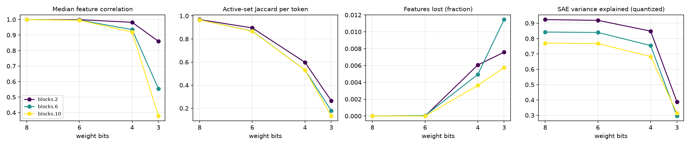

# quant-lens report

## Run config

| key | value |
|---|---|
| model | gpt2 |
| sae_release | gpt2-small-res-jb |
| hook_template | blocks.{layer}.hook_resid_pre |
| sae_id_template | blocks.{layer}.hook_resid_pre |
| layers | [2, 6, 10] |
| bits | [8, 6, 4, 3] |
| scheme | rtn |
| group_size | 128 |
| act_bits | 8 |
| calib_seqs | 32 |
| dataset | NeelNanda/pile-10k |
| n_docs | 2000 |
| n_seqs | 128 |
| ctx | 128 |
| batch_size | 8 |
| out | results/gpt2_rtn_g128 |
| save_per_feature | True |
| analysis_bits | None |
| ablate_layers | False |
| fragility | False |
| fragility_n | 50 |
| steering | False |
| steer_features | 32 |
| steer_alphas | [0.5] |
| steer_seqs | 16 |

## Summary

One row per (hook, bit width). `median_feature_corr`: median over live features of the Pearson correlation of activations, reference vs quantized. `jaccard`: per-token overlap of active feature sets. `topk_overlap`: per-token overlap of the 10 strongest features. `lost_frac` / `new_frac`: features that stop firing / only fire after quantization. `fve_ref` / `fve_q`: residual-stream variance explained by the SAE. `logit_kl`, `top1_agree`: output drift on the same tokens.

| hook | bits | scheme | group_size | median_feature_corr | jaccard | topk_overlap | lost_frac | new_frac | fve_ref | fve_q | logit_kl | top1_agree |
|---|---|---|---|---|---|---|---|---|---|---|---|---|
| blocks.2.hook_resid_pre | 8 | rtn | 128 | 0.9999 | 0.968 | 0.9854 | 0 | 0 | 0.9231 | 0.9237 | 0.0004575 | 0.9871 |
| blocks.6.hook_resid_pre | 8 | rtn | 128 | 0.9998 | 0.9649 | 0.9845 | 0 | 0 | 0.8432 | 0.8425 | 0.0004575 | 0.9871 |
| blocks.10.hook_resid_pre | 8 | rtn | 128 | 0.9997 | 0.965 | 0.9832 | 0 | 0 | 0.7703 | 0.7703 | 0.0004575 | 0.9871 |
| blocks.2.hook_resid_pre | 6 | rtn | 128 | 0.9991 | 0.8958 | 0.9471 | 0 | 0 | 0.9231 | 0.9186 | 0.007757 | 0.9458 |
| blocks.6.hook_resid_pre | 6 | rtn | 128 | 0.9963 | 0.869 | 0.9434 | 6.091e-05 | 0 | 0.8432 | 0.8397 | 0.007757 | 0.9458 |
| blocks.10.hook_resid_pre | 6 | rtn | 128 | 0.9951 | 0.8666 | 0.9391 | 0 | 0 | 0.7703 | 0.7672 | 0.007757 | 0.9458 |
| blocks.2.hook_resid_pre | 4 | rtn | 128 | 0.9824 | 0.598 | 0.7778 | 0.006061 | 0.05563 | 0.9231 | 0.8485 | 0.1338 | 0.7983 |
| blocks.6.hook_resid_pre | 4 | rtn | 128 | 0.9353 | 0.5315 | 0.7831 | 0.004934 | 0.0006091 | 0.8432 | 0.7549 | 0.1338 | 0.7983 |
| blocks.10.hook_resid_pre | 4 | rtn | 128 | 0.919 | 0.531 | 0.7663 | 0.003642 | 0 | 0.7703 | 0.6828 | 0.1338 | 0.7983 |
| blocks.2.hook_resid_pre | 3 | rtn | 128 | 0.8594 | 0.265 | 0.5184 | 0.007576 | 0.7545 | 0.9231 | 0.3875 | 1.467 | 0.3963 |
| blocks.6.hook_resid_pre | 3 | rtn | 128 | 0.5541 | 0.1794 | 0.404 | 0.01145 | 0.04434 | 0.8432 | 0.2952 | 1.467 | 0.3963 |
| blocks.10.hook_resid_pre | 3 | rtn | 128 | 0.3778 | 0.1327 | 0.339 | 0.005753 | 0.02533 | 0.7703 | 0.3145 | 1.467 | 0.3963 |

