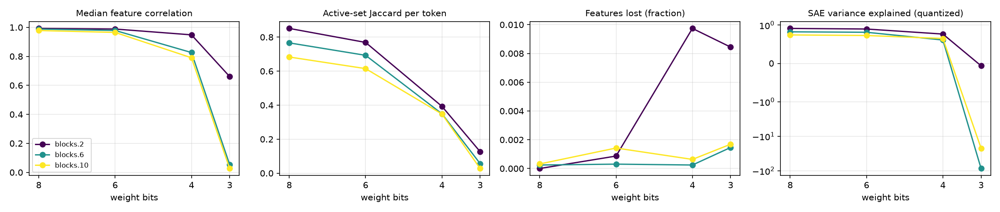

# quant-lens report

## Run config

| key | value |
|---|---|
| model | gpt2 |
| sae_release | gpt2-small-res-jb |
| hook_template | blocks.{layer}.hook_resid_pre |
| sae_id_template | blocks.{layer}.hook_resid_pre |
| layers | [2, 6, 10] |
| bits | [8, 6, 4, 3] |
| scheme | w8a8 |
| group_size | None |
| act_bits | 8 |
| calib_seqs | 32 |
| dataset | NeelNanda/pile-10k |
| n_docs | 2000 |
| n_seqs | 128 |
| ctx | 128 |
| batch_size | 8 |
| out | results/gpt2_w8a8 |
| save_per_feature | True |
| analysis_bits | None |
| ablate_layers | False |
| fragility | False |
| fragility_n | 50 |
| steering | False |
| steer_features | 32 |
| steer_alphas | [0.5] |
| steer_seqs | 16 |

## Summary

One row per (hook, bit width). `median_feature_corr`: median over live features of the Pearson correlation of activations, reference vs quantized. `jaccard`: per-token overlap of active feature sets. `topk_overlap`: per-token overlap of the 10 strongest features. `lost_frac` / `new_frac`: features that stop firing / only fire after quantization. `fve_ref` / `fve_q`: residual-stream variance explained by the SAE. `logit_kl`, `top1_agree`: output drift on the same tokens.

| hook | bits | scheme | group_size | median_feature_corr | jaccard | topk_overlap | lost_frac | new_frac | fve_ref | fve_q | logit_kl | top1_agree |
|---|---|---|---|---|---|---|---|---|---|---|---|---|
| blocks.2.hook_resid_pre | 8 | w8a8 | 0 | 0.9928 | 0.8513 | 0.9165 | 0 | 0.001082 | 0.9231 | 0.9148 | 0.05653 | 0.8663 |
| blocks.6.hook_resid_pre | 8 | w8a8 | 0 | 0.9883 | 0.7663 | 0.8981 | 0.0002436 | 6.091e-05 | 0.8432 | 0.826 | 0.05653 | 0.8663 |
| blocks.10.hook_resid_pre | 8 | w8a8 | 0 | 0.9782 | 0.6832 | 0.855 | 0.0003167 | 5.278e-05 | 0.7703 | 0.7453 | 0.05653 | 0.8663 |
| blocks.2.hook_resid_pre | 6 | w8a8 | 0 | 0.9885 | 0.769 | 0.8721 | 0.0008658 | 0.001299 | 0.9231 | 0.8989 | 0.08032 | 0.8415 |
| blocks.6.hook_resid_pre | 6 | w8a8 | 0 | 0.9787 | 0.6931 | 0.8691 | 0.0003045 | 0 | 0.8432 | 0.8144 | 0.08032 | 0.8415 |
| blocks.10.hook_resid_pre | 6 | w8a8 | 0 | 0.9652 | 0.6149 | 0.8289 | 0.001425 | 5.278e-05 | 0.7703 | 0.7299 | 0.08032 | 0.8415 |
| blocks.2.hook_resid_pre | 4 | w8a8 | 0 | 0.9484 | 0.393 | 0.6339 | 0.00974 | 0.1513 | 0.9231 | 0.7674 | 0.3833 | 0.6652 |
| blocks.6.hook_resid_pre | 4 | w8a8 | 0 | 0.8263 | 0.3493 | 0.6595 | 0.0002436 | 0.0413 | 0.8432 | 0.6122 | 0.3833 | 0.6652 |
| blocks.10.hook_resid_pre | 4 | w8a8 | 0 | 0.7902 | 0.3478 | 0.6196 | 0.0006333 | 0.01251 | 0.7703 | 0.6522 | 0.3833 | 0.6652 |
| blocks.2.hook_resid_pre | 3 | w8a8 | 0 | 0.6607 | 0.1265 | 0.3304 | 0.008442 | 0.9312 | 0.9231 | -0.06014 | 3.261 | 0.1833 |
| blocks.6.hook_resid_pre | 3 | w8a8 | 0 | 0.05358 | 0.05633 | 0.1592 | 0.001462 | 0.09392 | 0.8432 | -85.69 | 3.261 | 0.1833 |
| blocks.10.hook_resid_pre | 3 | w8a8 | 0 | 0.02652 | 0.02746 | 0.1125 | 0.001689 | 0.04634 | 0.7703 | -22.11 | 3.261 | 0.1833 |

