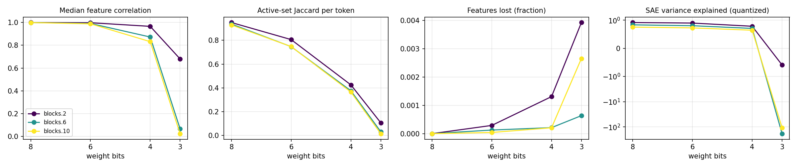

# quant-lens report

## Run config

| key | value |
|---|---|
| model | gpt2 |
| sae_release | gpt2-small-res-jb |
| hook_template | blocks.{layer}.hook_resid_pre |
| sae_id_template | blocks.{layer}.hook_resid_pre |
| layers | [2, 6, 10] |
| bits | [8, 6, 4, 3] |
| scheme | awq_lite |
| group_size | None |
| act_bits | 8 |
| calib_seqs | 32 |
| dataset | NeelNanda/pile-10k |
| n_docs | 3000 |
| doc_offset | 5000 |
| n_seqs | 512 |
| ctx | 128 |
| batch_size | 8 |
| out | results/robust/gpt2_awq_lite |
| save_per_feature | False |
| analysis_bits | None |
| ablate_layers | False |
| fragility | False |
| fragility_n | 50 |
| steering | False |
| steer_features | 32 |
| steer_alphas | [0.5] |
| steer_seqs | 16 |

## Summary

One row per (hook, bit width). `median_feature_corr`: median over live features of the Pearson correlation of activations, reference vs quantized. `jaccard`: per-token overlap of active feature sets. `topk_overlap`: per-token overlap of the 10 strongest features. `lost_frac` / `new_frac`: features that stop firing / only fire after quantization. `fve_ref` / `fve_q`: residual-stream variance explained by the SAE. `logit_kl`, `top1_agree`: output drift on the same tokens.

| hook | bits | scheme | group_size | median_feature_corr | jaccard | topk_overlap | lost_frac | new_frac | fve_ref | fve_q | logit_kl | top1_agree |
|---|---|---|---|---|---|---|---|---|---|---|---|---|
| blocks.2.hook_resid_pre | 8 | awq_lite | 0 | 0.9999 | 0.9497 | 0.9743 | 0 | 0 | 0.9174 | 0.9179 | 0.001783 | 0.9742 |
| blocks.6.hook_resid_pre | 8 | awq_lite | 0 | 0.9995 | 0.937 | 0.9732 | 0 | 0 | 0.836 | 0.8346 | 0.001783 | 0.9742 |
| blocks.10.hook_resid_pre | 8 | awq_lite | 0 | 0.9992 | 0.9294 | 0.9712 | 0 | 0 | 0.7602 | 0.7557 | 0.001783 | 0.9742 |
| blocks.2.hook_resid_pre | 6 | awq_lite | 0 | 0.9981 | 0.8062 | 0.9112 | 0.0002906 | 0.0002906 | 0.9174 | 0.8984 | 0.01939 | 0.9184 |
| blocks.6.hook_resid_pre | 6 | awq_lite | 0 | 0.9915 | 0.747 | 0.9114 | 0.0001272 | 0 | 0.836 | 0.8043 | 0.01939 | 0.9184 |
| blocks.10.hook_resid_pre | 6 | awq_lite | 0 | 0.9886 | 0.7479 | 0.9116 | 4.147e-05 | 0 | 0.7602 | 0.7264 | 0.01939 | 0.9184 |
| blocks.2.hook_resid_pre | 4 | awq_lite | 0 | 0.9662 | 0.4256 | 0.673 | 0.001308 | 0.03364 | 0.9174 | 0.7845 | 0.4012 | 0.6699 |
| blocks.6.hook_resid_pre | 4 | awq_lite | 0 | 0.8726 | 0.3758 | 0.6576 | 0.0002121 | 0.001612 | 0.836 | 0.7082 | 0.4012 | 0.6699 |
| blocks.10.hook_resid_pre | 4 | awq_lite | 0 | 0.832 | 0.3659 | 0.6453 | 0.0002073 | 0.0001659 | 0.7602 | 0.6442 | 0.4012 | 0.6699 |
| blocks.2.hook_resid_pre | 3 | awq_lite | 0 | 0.6801 | 0.1069 | 0.2845 | 0.003924 | 0.1979 | 0.9174 | -0.5927 | 4.317 | 0.1438 |
| blocks.6.hook_resid_pre | 3 | awq_lite | 0 | 0.06655 | 0.03182 | 0.1446 | 0.0006362 | 0.003011 | 0.836 | -185.1 | 4.317 | 0.1438 |
| blocks.10.hook_resid_pre | 3 | awq_lite | 0 | 0.02435 | 0.01538 | 0.09197 | 0.002654 | 0.0009952 | 0.7602 | -108.6 | 4.317 | 0.1438 |

