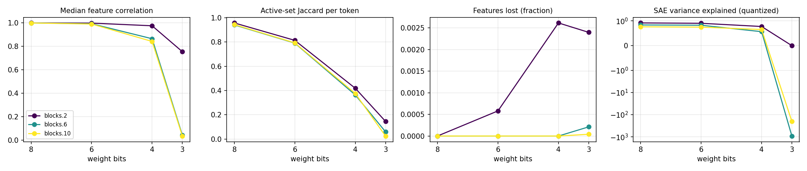

# quant-lens report

## Run config

| key | value |
|---|---|
| model | gpt2 |
| sae_release | gpt2-small-res-jb |
| hook_template | blocks.{layer}.hook_resid_pre |
| sae_id_template | blocks.{layer}.hook_resid_pre |
| layers | [2, 6, 10] |
| bits | [8, 6, 4, 3] |
| scheme | rtn |
| group_size | None |
| act_bits | 8 |
| calib_seqs | 32 |
| dataset | NeelNanda/pile-10k |
| n_docs | 3000 |
| doc_offset | 5000 |
| n_seqs | 512 |
| ctx | 128 |
| batch_size | 8 |
| out | results/robust/gpt2_rtn |
| save_per_feature | False |
| analysis_bits | None |
| ablate_layers | False |
| fragility | False |
| fragility_n | 50 |
| steering | False |
| steer_features | 32 |
| steer_alphas | [0.5] |
| steer_seqs | 16 |

## Summary

One row per (hook, bit width). `median_feature_corr`: median over live features of the Pearson correlation of activations, reference vs quantized. `jaccard`: per-token overlap of active feature sets. `topk_overlap`: per-token overlap of the 10 strongest features. `lost_frac` / `new_frac`: features that stop firing / only fire after quantization. `fve_ref` / `fve_q`: residual-stream variance explained by the SAE. `logit_kl`, `top1_agree`: output drift on the same tokens.

| hook | bits | scheme | group_size | median_feature_corr | jaccard | topk_overlap | lost_frac | new_frac | fve_ref | fve_q | logit_kl | top1_agree |
|---|---|---|---|---|---|---|---|---|---|---|---|---|
| blocks.2.hook_resid_pre | 8 | rtn | 0 | 0.9999 | 0.957 | 0.9782 | 0 | 0 | 0.9174 | 0.9171 | 0.00122 | 0.9787 |
| blocks.6.hook_resid_pre | 8 | rtn | 0 | 0.9995 | 0.9405 | 0.9743 | 0 | 0 | 0.836 | 0.8352 | 0.00122 | 0.9787 |
| blocks.10.hook_resid_pre | 8 | rtn | 0 | 0.9993 | 0.9435 | 0.9744 | 0 | 0 | 0.7602 | 0.7608 | 0.00122 | 0.9787 |
| blocks.2.hook_resid_pre | 6 | rtn | 0 | 0.9982 | 0.8134 | 0.9045 | 0.0005813 | 0.000218 | 0.9174 | 0.9024 | 0.01769 | 0.9196 |
| blocks.6.hook_resid_pre | 6 | rtn | 0 | 0.9928 | 0.7907 | 0.9151 | 0 | 0 | 0.836 | 0.8244 | 0.01769 | 0.9196 |
| blocks.10.hook_resid_pre | 6 | rtn | 0 | 0.9906 | 0.7926 | 0.9124 | 0 | 0 | 0.7602 | 0.747 | 0.01769 | 0.9196 |
| blocks.2.hook_resid_pre | 4 | rtn | 0 | 0.9756 | 0.4183 | 0.6622 | 0.002616 | 0.01758 | 0.9174 | 0.7725 | 0.3284 | 0.6854 |
| blocks.6.hook_resid_pre | 4 | rtn | 0 | 0.8651 | 0.3634 | 0.6888 | 0 | 0.002502 | 0.836 | 0.5625 | 0.3284 | 0.6854 |
| blocks.10.hook_resid_pre | 4 | rtn | 0 | 0.842 | 0.3753 | 0.6691 | 0 | 0.0004976 | 0.7602 | 0.65 | 0.3284 | 0.6854 |
| blocks.2.hook_resid_pre | 3 | rtn | 0 | 0.7547 | 0.1453 | 0.3587 | 0.002398 | 0.112 | 0.9174 | -0.003519 | 3.206 | 0.1988 |
| blocks.6.hook_resid_pre | 3 | rtn | 0 | 0.04255 | 0.0595 | 0.1753 | 0.0002121 | 0.003181 | 0.836 | -913.2 | 3.206 | 0.1988 |
| blocks.10.hook_resid_pre | 3 | rtn | 0 | 0.03541 | 0.02453 | 0.1274 | 4.147e-05 | 0.001037 | 0.7602 | -201.1 | 3.206 | 0.1988 |

