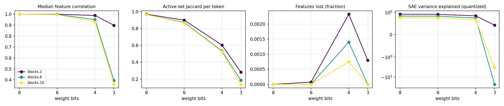

# quant-lens report

## Run config

| key | value |
|---|---|
| model | gpt2 |
| sae_release | gpt2-small-res-jb |
| hook_template | blocks.{layer}.hook_resid_pre |
| sae_id_template | blocks.{layer}.hook_resid_pre |
| layers | [2, 6, 10] |
| bits | [8, 6, 4, 3] |
| scheme | rtn |
| group_size | 128 |
| act_bits | 8 |
| calib_seqs | 32 |
| dataset | NeelNanda/pile-10k |
| n_docs | 3000 |
| doc_offset | 5000 |
| n_seqs | 512 |
| ctx | 128 |
| batch_size | 8 |
| out | results/robust/gpt2_rtn_g128 |
| save_per_feature | False |
| analysis_bits | None |
| ablate_layers | False |
| fragility | False |
| fragility_n | 50 |
| steering | False |
| steer_features | 32 |
| steer_alphas | [0.5] |
| steer_seqs | 16 |

## Summary

One row per (hook, bit width). `median_feature_corr`: median over live features of the Pearson correlation of activations, reference vs quantized. `jaccard`: per-token overlap of active feature sets. `topk_overlap`: per-token overlap of the 10 strongest features. `lost_frac` / `new_frac`: features that stop firing / only fire after quantization. `fve_ref` / `fve_q`: residual-stream variance explained by the SAE. `logit_kl`, `top1_agree`: output drift on the same tokens.

| hook | bits | scheme | group_size | median_feature_corr | jaccard | topk_overlap | lost_frac | new_frac | fve_ref | fve_q | logit_kl | top1_agree |
|---|---|---|---|---|---|---|---|---|---|---|---|---|
| blocks.2.hook_resid_pre | 8 | rtn | 128 | 1 | 0.9688 | 0.9859 | 0 | 0 | 0.9174 | 0.9181 | 0.0004755 | 0.9864 |
| blocks.6.hook_resid_pre | 8 | rtn | 128 | 0.9998 | 0.9656 | 0.9845 | 0 | 0 | 0.836 | 0.8355 | 0.0004755 | 0.9864 |
| blocks.10.hook_resid_pre | 8 | rtn | 128 | 0.9997 | 0.965 | 0.9836 | 0 | 0 | 0.7602 | 0.7601 | 0.0004755 | 0.9864 |
| blocks.2.hook_resid_pre | 6 | rtn | 128 | 0.9994 | 0.8992 | 0.9496 | 7.266e-05 | 0 | 0.9174 | 0.913 | 0.008464 | 0.9453 |
| blocks.6.hook_resid_pre | 6 | rtn | 128 | 0.9972 | 0.8715 | 0.9442 | 0 | 0 | 0.836 | 0.8327 | 0.008464 | 0.9453 |
| blocks.10.hook_resid_pre | 6 | rtn | 128 | 0.9959 | 0.8661 | 0.9394 | 0 | 4.147e-05 | 0.7602 | 0.7563 | 0.008464 | 0.9453 |
| blocks.2.hook_resid_pre | 4 | rtn | 128 | 0.9884 | 0.6035 | 0.7855 | 0.002325 | 0.00901 | 0.9174 | 0.8441 | 0.1431 | 0.7853 |
| blocks.6.hook_resid_pre | 4 | rtn | 128 | 0.9509 | 0.5339 | 0.7859 | 0.0014 | 0 | 0.836 | 0.7478 | 0.1431 | 0.7853 |
| blocks.10.hook_resid_pre | 4 | rtn | 128 | 0.9311 | 0.5257 | 0.769 | 0.0007464 | 0 | 0.7602 | 0.6756 | 0.1431 | 0.7853 |
| blocks.2.hook_resid_pre | 3 | rtn | 128 | 0.899 | 0.2833 | 0.5346 | 0.0007992 | 0.07985 | 0.9174 | 0.4287 | 1.552 | 0.3684 |
| blocks.6.hook_resid_pre | 3 | rtn | 128 | 0.3954 | 0.1856 | 0.4167 | 0 | 0.002587 | 0.836 | -23.05 | 1.552 | 0.3684 |
| blocks.10.hook_resid_pre | 3 | rtn | 128 | 0.359 | 0.1379 | 0.35 | 0 | 0.0008293 | 0.7602 | -3.309 | 1.552 | 0.3684 |

