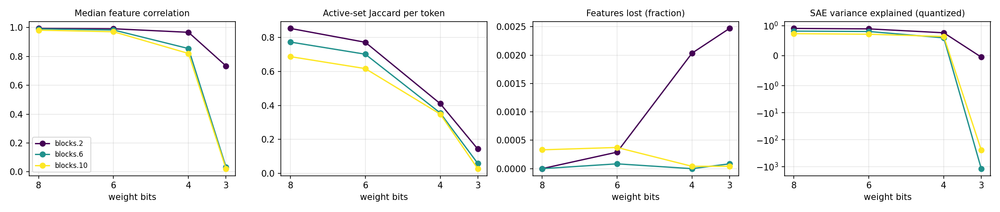

# quant-lens report

## Run config

| key | value |
|---|---|
| model | gpt2 |
| sae_release | gpt2-small-res-jb |
| hook_template | blocks.{layer}.hook_resid_pre |
| sae_id_template | blocks.{layer}.hook_resid_pre |
| layers | [2, 6, 10] |
| bits | [8, 6, 4, 3] |
| scheme | w8a8 |
| group_size | None |
| act_bits | 8 |
| calib_seqs | 32 |
| dataset | NeelNanda/pile-10k |
| n_docs | 3000 |
| doc_offset | 5000 |
| n_seqs | 512 |
| ctx | 128 |
| batch_size | 8 |
| out | results/robust/gpt2_w8a8 |
| save_per_feature | False |
| analysis_bits | None |
| ablate_layers | False |
| fragility | False |
| fragility_n | 50 |
| steering | False |
| steer_features | 32 |
| steer_alphas | [0.5] |
| steer_seqs | 16 |

## Summary

One row per (hook, bit width). `median_feature_corr`: median over live features of the Pearson correlation of activations, reference vs quantized. `jaccard`: per-token overlap of active feature sets. `topk_overlap`: per-token overlap of the 10 strongest features. `lost_frac` / `new_frac`: features that stop firing / only fire after quantization. `fve_ref` / `fve_q`: residual-stream variance explained by the SAE. `logit_kl`, `top1_agree`: output drift on the same tokens.

| hook | bits | scheme | group_size | median_feature_corr | jaccard | topk_overlap | lost_frac | new_frac | fve_ref | fve_q | logit_kl | top1_agree |
|---|---|---|---|---|---|---|---|---|---|---|---|---|
| blocks.2.hook_resid_pre | 8 | w8a8 | 0 | 0.9944 | 0.8537 | 0.9198 | 0 | 0.001017 | 0.9174 | 0.9097 | 0.05679 | 0.8689 |
| blocks.6.hook_resid_pre | 8 | w8a8 | 0 | 0.9911 | 0.7735 | 0.8991 | 0 | 0 | 0.836 | 0.8196 | 0.05679 | 0.8689 |
| blocks.10.hook_resid_pre | 8 | w8a8 | 0 | 0.9824 | 0.6876 | 0.8561 | 0.0003317 | 0 | 0.7602 | 0.7354 | 0.05679 | 0.8689 |
| blocks.2.hook_resid_pre | 6 | w8a8 | 0 | 0.9919 | 0.7721 | 0.8781 | 0.0002906 | 0.0008719 | 0.9174 | 0.8943 | 0.08302 | 0.8403 |
| blocks.6.hook_resid_pre | 6 | w8a8 | 0 | 0.9836 | 0.7019 | 0.8716 | 8.482e-05 | 0 | 0.836 | 0.8079 | 0.08302 | 0.8403 |
| blocks.10.hook_resid_pre | 6 | w8a8 | 0 | 0.9714 | 0.6171 | 0.828 | 0.0003732 | 0 | 0.7602 | 0.7161 | 0.08302 | 0.8403 |
| blocks.2.hook_resid_pre | 4 | w8a8 | 0 | 0.9674 | 0.4105 | 0.6544 | 0.002034 | 0.02136 | 0.9174 | 0.7643 | 0.4113 | 0.6527 |
| blocks.6.hook_resid_pre | 4 | w8a8 | 0 | 0.8547 | 0.3557 | 0.6661 | 0 | 0.002375 | 0.836 | 0.5949 | 0.4113 | 0.6527 |
| blocks.10.hook_resid_pre | 4 | w8a8 | 0 | 0.8207 | 0.3489 | 0.6287 | 4.147e-05 | 0.0003732 | 0.7602 | 0.6402 | 0.4113 | 0.6527 |
| blocks.2.hook_resid_pre | 3 | w8a8 | 0 | 0.7344 | 0.1436 | 0.3556 | 0.00247 | 0.1185 | 0.9174 | -0.04622 | 3.305 | 0.189 |
| blocks.6.hook_resid_pre | 3 | w8a8 | 0 | 0.03407 | 0.0588 | 0.1694 | 8.482e-05 | 0.003181 | 0.836 | -1178 | 3.305 | 0.189 |
| blocks.10.hook_resid_pre | 3 | w8a8 | 0 | 0.02233 | 0.02791 | 0.1183 | 4.147e-05 | 0.001037 | 0.7602 | -241.1 | 3.305 | 0.189 |

